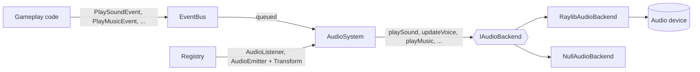

# Audio

## Purpose

The audio module plays sound effects and streamed music for a game without the game code ever touching an audio
library. Gameplay systems publish events on the `EventBus` or attach components to entities; `systems::AudioSystem`
turns them into calls to an audio backend.

It provides:

- one-shot sound effects with polyphony and a bounded number of simultaneous voices;
- streamed background music;
- three volume buses: master, music and SFX;
- 2D positional audio: stereo panning and distance attenuation around a listener entity;
- moving sound sources that follow their entity while they play;
- a silent fallback when no audio device is available (CI, Docker, servers);
- settings read from a TOML configuration file.

The module knows nothing about R-Type: sounds are opaque handles, and the game decides which file to load and when to
play it.

## Module Layout

The audio code is the `engine_audio` static library. It depends on `engine_core` (ECS), `engine_events` and
`engine_config`, and is only built with the `graphics` option because its default backend uses raylib.

```text
engine/src/audio/
├── types/              SoundId, MusicId, VoiceId, constants, SoundParams, AudioConfig
├── spatial/            SpatialConfig and the pan/attenuation computations
├── settings/           AudioSettings and readAudioSettings()
├── factory/            makeAudioBackend()
├── strategy/raylib/    RaylibAudioBackend (private: exposes raylib types)
├── AudioMiddleware.hpp clampFinite(): sanitizes values before they reach a library
├── IAudioBackend.hpp   backend interface
└── NullAudioBackend.hpp
engine/src/systems/audio/AudioSystem.*      the system
engine/src/events/AudioEvents.hpp           the events
engine/src/components/AudioListener.hpp     the listener component
engine/src/components/AudioEmitter.hpp      the emitter component
```

## Architecture



The backend is a strategy: `AudioSystem` only sees `IAudioBackend`, so it behaves the same with raylib, with the muted
backend, or with the recording backend used in tests. Only `strategy/raylib/` includes raylib.

## Quick Start

```cpp
#include "audio/factory/AudioBackendFactory.hpp"
#include "events/AudioEvents.hpp"
#include "systems/audio/AudioSystem.hpp"

ecs::EventBus eventBus;
ecs::Registry registry;

// Opens the audio device, or returns a muted backend if there is none.
const std::unique_ptr<audio::IAudioBackend> backend = audio::makeAudioBackend();
const audio::SoundId laser = backend->loadSound("assets/sfx/laser.ogg");
const audio::MusicId theme = backend->loadMusic("assets/music/theme.ogg");

systems::AudioSystem audioSystem(*backend, eventBus);
eventBus.publish(events::PlayMusicEvent{.music = theme});

while (running) {
    // ... gameplay publishes events and moves entities ...
    eventBus.publish(events::PlaySoundEvent{.sound = laser, .position = audio::SoundPosition{.x = x, .y = y}});

    audioSystem.update(registry);  // once per frame, after the entities have moved
}
```

The backend and the event bus must outlive the `AudioSystem`. Loading returns `NO_SOUND` / `NO_MUSIC` when a file
cannot be read or the backend is muted; playing these handles does nothing.

## Playing Sounds

### Events

All events live in `events/AudioEvents.hpp`, in the `events` namespace.

| Event | Fields | Effect |
|-------|--------|--------|
| `PlaySoundEvent` | `sound`, `volume = 1.0F`, `pitch = 1.0F`, `position` (optional) | Plays a sound effect once. With a `position`, it is panned and attenuated around the listener. |
| `PlayMusicEvent` | `music`, `loop = true` | Streams a music, replacing the current one. Requesting the music already playing keeps it going. |
| `StopMusicEvent` | | Stops the music. |
| `StopAllSoundsEvent` | | Stops every sound effect, including emitters (looping emitters restart on the next update). |
| `SetAudioVolumeEvent` | `bus`, `volume` | Changes the gain of the `Master`, `Music` or `Sfx` bus. |

Leave `position` empty for sounds that have no place in the world, such as menu clicks or the player's own feedback.

### Moving Sound Sources

A `PlaySoundEvent` computes its pan once, when the sound starts. For a long or looping sound attached to something
that moves (an engine hum, a buzzing enemy), add an `ecs::AudioEmitter` to an entity that has an `ecs::Transform`:

```cpp
registry.addComponent<ecs::AudioEmitter>(ship, ecs::AudioEmitter{.sound = engineHum, .volume = 0.6F});
```

| Field | Default | Description |
|-------|---------|-------------|
| `sound` | `NO_SOUND` | Sound to emit; `NO_SOUND` emits nothing. |
| `volume` | `1.0F` | Gain, multiplied by the SFX bus and the distance attenuation. |
| `pitch` | `1.0F` | Playback speed factor. |
| `loop` | `true` | Restart the sound when it ends. |
| `playing` | `true` | Set to `false` to stop the sound; back to `true` to start it again. |

Every update, the system starts the sound if needed, moves its pan and volume with the entity, restarts it when it
loops, and stops it when the entity is destroyed, the component is removed or `playing` becomes `false`.
An emitter whose voice was stolen by another sound resumes only when a voice is free, without stealing one back:
emitters competing for too few voices therefore never keep restarting each other.

| Use | For |
|-----|-----|
| `PlaySoundEvent` | Short sounds that do not follow anything once started: shots, explosions, pickups. |
| `AudioEmitter` | Long or looping sounds that must follow a moving entity. |

## Volume Buses

| Bus | Applies to | Applied by |
|-----|------------|------------|
| `Master` | Everything | The backend, on the whole output. |
| `Music` | The music stream | The backend. |
| `Sfx` | Sound effects and emitters | `AudioSystem`, when it starts or updates a sound. |

The gain of a sound effect is `sound volume × SFX volume × distance attenuation`, then the master gain is applied on
the output. Volumes are clamped to `[0, 1]`; NaN or infinite values are replaced by the default. Use
`AudioSystem::setVolume(bus, volume)` or publish a `SetAudioVolumeEvent`.

## Positional Audio

### Listener

`ecs::AudioListener` marks the entity whose `Transform` sounds are heard from, usually the camera or the player. The
first active listener is used. Without one, positioned sounds play centered at full volume.

### Pan and Attenuation

For a sound emitted at `(x, y)` and a listener at `(lx, ly)`, with `dx = x - lx` and `distance = hypot(dx, y - ly)`:

```text
pan         = clamp(dx / panRange, -1, 1) × maxPan
attenuation = 1                                              if distance ≤ minDistance
            = 0                                              if distance ≥ maxDistance
            = (maxDistance - distance) / (maxDistance - minDistance)   otherwise
```

These computations are pure functions in `audio/spatial/AudioSpatial.hpp` (`computePan`, `computeAttenuation`,
`computeSpatial`). They are configured with `audio::SpatialConfig`:

| Field | Default | Description |
|-------|---------|-------------|
| `enabled` | `true` | When `false`, positioned sounds play centered at full volume. |
| `panRange` | `640.0F` | Horizontal distance, in world units, at which a sound reaches `maxPan`. |
| `maxPan` | `0.6F` | Widest pan, in `[0, 1]`. Below 1 so no sound is heard in one ear only, which is tiring on headphones. |
| `minDistance` | `750.0F` | Sounds closer than this keep their full volume. |
| `maxDistance` | `1500.0F` | Sounds farther than this are silent and are not started at all. |

The defaults suit a 1280×720 view centered on the listener: every visible sound keeps its volume and only off-screen
sounds fade. Change them with `AudioSystem::setSpatialConfig()`.

## Frame Processing

Event listeners only queue the events, so publishing is cheap and never blocks gameplay code. `update(registry)` then:

1. finds the listener;
2. executes the queued events in arrival order: music and volume changes immediately, sound requests are resolved
   (bus volume, pan, attenuation) and kept aside;
3. starts the kept sounds;
4. updates the emitters;
5. calls `backend.update()`, which refills the music stream buffers.

This order gives the following guarantees:

- a `StopAllSoundsEvent` also cancels the sounds requested before it in the same frame;
- the same sound requested several times in one frame plays once, at its loudest request, so twenty simultaneous
  lasers do not saturate the output or take twenty voices;
- an inaudible sound (too far, or SFX bus at 0) is not started and takes no voice;
- at most `MAX_QUEUED_SOUNDS` (128) sound requests are kept per frame; music and volume events are never dropped.

## Backends

### Interface

`audio::IAudioBackend` loads sounds and musics and plays them. Every method must be safe to call when no device is
available.

| Method | Description |
|--------|-------------|
| `loadSound(path)` / `loadMusic(path)` | Return a handle, or `NO_SOUND` / `NO_MUSIC` on failure. |
| `unloadSound(id)` / `unloadMusic(id)` | Release a sound or music (e.g. when leaving a level); its playing instances stop. Handles are never reused. |
| `playSound(id, params)` | Starts an instance and returns its `VoiceId`, or `NO_VOICE`. |
| `playSoundWithoutStealing(id, params)` | Starts an instance only if a voice is free; never stops another one. |
| `updateVoice(voice, params)` | Changes the volume, pan and pitch of a playing instance and returns its `VoiceState`: `Playing`, `Ended` (finished or stopped) or `Stolen` (its voice was taken). |
| `stopVoice(voice)` / `stopAllSounds()` | Stop one or every instance. |
| `playMusic(id, loop)` / `stopMusic()` | Control the music stream. |
| `setMasterVolume(v)` / `setMusicVolume(v)` | Set the backend-side gains. |
| `update()` | Refills the music stream; called by `AudioSystem::update`. |
| `activeVoiceCount()` | Number of playing instances, for metrics and tests. |

A `VoiceId` identifies one playback and is never reused: once the instance ends or its voice is taken by another
sound, the old handle simply stops working. In the raylib backend it packs the voice index and a generation counter,
so controlling an instance is O(1), and starting one costs O(active voices + voices per sound), never a walk over every
loaded sound.

### Implementations

| Backend | Description |
|---------|-------------|
| `detail::RaylibAudioBackend` | Uses raylib (miniaudio). Each sound gets `voicesPerSound` aliases sharing its samples so it can overlap itself. When a limit is reached, the oldest instance is stopped. Only one instance may exist at a time, because raylib's audio device is global. |
| `NullAudioBackend` | Muted: loading fails, nothing plays, nothing is opened. Used as the fallback and in tests. |

### Factory

`audio::makeAudioBackend(kind, config)` never returns null:

| `AudioBackendKind` | Result |
|--------------------|--------|
| `Auto`, `Raylib` | A raylib backend if an audio device could be opened, a `NullAudioBackend` otherwise. |
| `Null` | A `NullAudioBackend`, without opening any device. |

`audio::AudioConfig` sets the voice limits: `voicesPerSound` (default 4) and `maxActiveVoices` (default 32).

## Configuration File

`engine_config` reads TOML files into dotted keys (`config::ConfigFile`). `audio::readAudioSettings()` turns the
`[audio]` table into an `audio::AudioSettings`, used to create the backend and passed to
`AudioSystem::applySettings()`:

```cpp
const config::ConfigFile file = config::ConfigFile::load("client/config/client.toml");
std::vector<std::string> warnings;
const audio::AudioSettings settings = audio::readAudioSettings(file, warnings);

auto backend = audio::makeAudioBackend(settings.backend, settings.voices);
systems::AudioSystem audioSystem(*backend, eventBus);
audioSystem.applySettings(settings);  // volumes and spatial settings
```

| Key | Default | Range | Applied |
|-----|---------|-------|---------|
| `audio.backend` | `"auto"` | `"auto"`, `"raylib"`, `"null"` | When the backend is created |
| `audio.voices_per_sound` | `4` | 1 to 16 | When the backend is created |
| `audio.max_active_voices` | `32` | 1 to 256 | When the backend is created |
| `audio.volume.master` | `1.0` | 0 to 1 | `applySettings` |
| `audio.volume.music` | `1.0` | 0 to 1 | `applySettings` |
| `audio.volume.sfx` | `1.0` | 0 to 1 | `applySettings` |
| `audio.spatial.enabled` | `true` | boolean | `applySettings` |
| `audio.spatial.pan_range` | `640.0` | ≥ 1 | `applySettings` |
| `audio.spatial.max_pan` | `0.6` | 0 to 1 | `applySettings` |
| `audio.spatial.min_distance` | `750.0` | ≥ 0 | `applySettings` |
| `audio.spatial.max_distance` | `1500.0` | ≥ `min_distance` | `applySettings` |

The file is treated as untrusted input and never stops the game:

- a missing, unreadable, oversized (over 1 MiB) or malformed file gives the defaults and an error message with its
  location;
- a missing key keeps its default silently;
- a value of the wrong type, out of range, NaN or infinite is replaced or clamped, and reported;
- an unknown key (a typo such as `mastr`) is reported and ignored.

The R-Type client reads `client/config/client.toml`, which documents every key.

## Robustness

- **No audio device**: the factory returns a `NullAudioBackend`; the game runs the same, silently.
- **Untrusted values**: volumes, pans, pitches and positions coming from events, scripts or files go through
  `clampFinite()` before reaching the library.
- **Bounded resources**: voice counts are capped by `AudioConfig` and by the configuration limits, and the sound queue
  is capped per frame.
- **Lifetime**: destroying the `AudioSystem` unsubscribes it and stops its emitters; destroying the backend unloads
  every sound and music before closing the device.

## Known Limitations

- **Looping emitters have a short gap**: raylib cannot loop a `Sound`, so `AudioSystem` restarts it when it ends. MP3
  files add their own silence at both ends; prefer OGG or WAV for looping sounds.
- **raylib 6.0 leaks at teardown**: `UnloadSoundAlias` keeps 64 bytes per alias (fixed upstream in
  raysan5/raylib#5857) and `UnloadMusicStream` keeps the decoder of WAV music. The leaks are bounded and happen only
  on shutdown. Prefer OGG for music.
- **Single thread**: `AudioSystem`, like `EventBus`, is not thread-safe. Publish audio events from the main thread; a
  network thread must hand its events over to it.
- **Headless builds**: `engine_audio` requires the `graphics` option, so it is not available in `--graphics=n` builds.

## Adding a Backend

1. Implement `audio::IAudioBackend` in `engine/src/audio/strategy/<library>/`, keeping the library types out of public
   headers.
2. Add the library with `add_requires` in `xmake.lua` and `add_packages` in `engine/src/audio/xmake.lua`.
3. Add a value to `audio::AudioBackendKind`, handle it in `makeAudioBackend()`, and accept its name in
   `readAudioSettings()`.
4. Add tests next to `tests/test_audio.cpp`.

`AudioSystem`, the events, the components and the games need no change.

## Tests

| Suite | Covers |
|-------|--------|
| `test_audio` | Raylib backend (voices, limits, music, voice handles), muted backend, factory. Device tests are skipped when no audio device is available. |
| `test_audio_system` | Event handling, buses, positional audio and emitters, with a recording backend. |
| `test_audio_settings` | Reading, validating and reporting the `[audio]` settings. |
| `test_config` | TOML loading, dotted keys, errors and size limit. |
