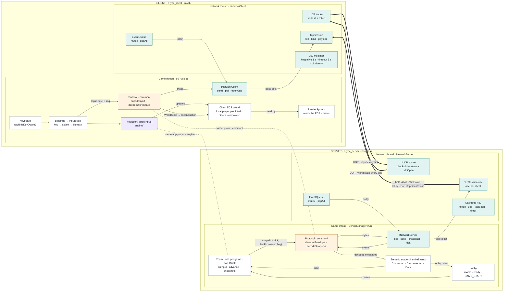
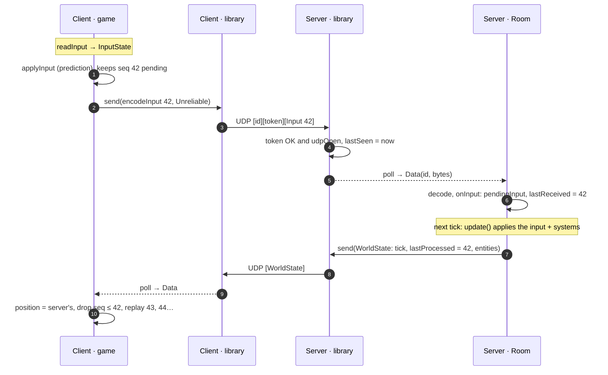
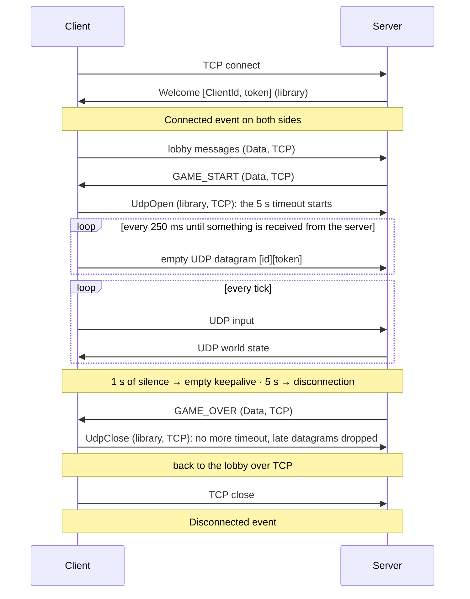
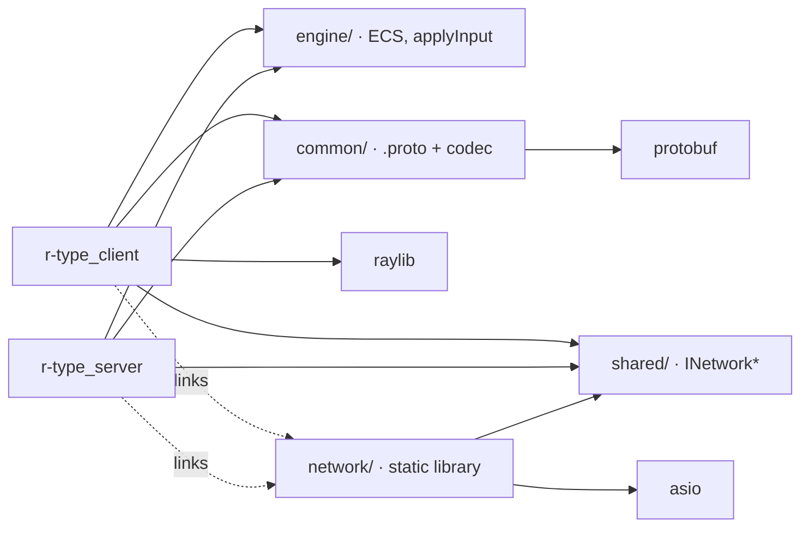

# Client ↔ Server Architecture

The client and the server, layer by layer, and what travels between them.

!!! note "Status"
The `network/` library, the `shared/` interfaces and the ECS core of `engine/` (registry, clock) exist.
`ServerManager` and `Room` exist as a skeleton: the game systems and the protocol are still `TODO`s. `common/`
(the `.proto`), the lobby and the gameplay systems describe the planned design.

**Layers**

| Layer           | Folder               | Role                                         |
|-----------------|----------------------|----------------------------------------------|
| Game            | `client/`, `server/` | game logic, rendering, lobby, game sessions  |
| Protocol        | `common/`            | Protobuf: messages ↔ bytes                   |
| Network library | `network/` (Asio)    | byte transport, TCP + UDP                    |
| Shared engine   | `engine/`            | ECS, `applyInput()`, identical on both sides |

---

## 1. Overview: two processes, two threads each



Each process has a **game thread** (the simulation, lock-free) and a **network thread** (Asio). They only talk
through two points:

- `asio::post` to send;
- the `EventQueue`, read by `poll()`, to receive.

Dotted links connect code that is identical on both sides.

Key points:

- **A key press never touches the screen directly.** It becomes an `InputState`, which is used twice: by the
  prediction (ECS) and by the protocol (network). Rendering only reads the ECS.
- **`Room` knows nothing about the network.** It receives already-decoded inputs and produces snapshots, so it can
  be tested without any socket.
- **Only `common/` knows about Protobuf.** Changing the format only touches that layer.

### One server loop iteration

Each room owns its own [`ecs::time::Clock`](clock.md): rooms are independent games, each with its own game time and
rate. The `ServerManager` runs them all on the game thread, one loop iteration about every millisecond:

1. `poll()` the network once and route the events: lobby messages, inputs stored in the player's room. This is the
   only place that reads the network: it has one event queue for every player.
2. `room.advance()` for each room: the room's clock runs the steps that are due (60 Hz by default, `DEFAULT_FIXED_DT`).
   Each step applies `applyInput` for each player, then the ECS systems with `time.deltaTime`.
3. For each room that ran at least one step: a snapshot → `send()` to each of its players, numbered with the room's
   `time().tickCount`.
4. Sleep 1 ms.

- `Room::start()` resets the room's clock: the game time (`tickCount`, `totalElapsedTime`) starts at 0 when the game
  starts, however long the room waited for its players. A waiting room does not step.
- If a room falls behind (debugger, overload), its clock runs at most 5 steps in a row, then drops the backlog. After
  several catch-up steps, a single snapshot is sent: it carries the latest state.
- Rooms are referred to by `RoomId`, never by pointer: an event for a room that no longer exists is simply ignored.

---

## 2. What is inside a packet

Each packet has two layers:

- the **library** bytes, which the game never sees;
- the **Protobuf payload**, which the library never reads.

All library integers are **little-endian**.

### TCP (both directions)

```
+--------------+---------+----------------------------------------+
| length       | kind    | Protobuf payload                       |
| u32          | u8      | 0 to 64 KiB (empty for UdpOpen/Close)  |
+--------------+---------+----------------------------------------+
 \__ library (5 bytes) __/ \__________________ game ______________/
```

| `kind`       | Direction | Meaning                                   |
|--------------|-----------|-------------------------------------------|
| `0` Data     | both      | payload handed to the game                |
| `1` Welcome  | S → C     | `[ClientId u32][token u32]`               |
| `2` UdpOpen  | C → S     | the client opened UDP, the timeout starts |
| `3` UdpClose | C → S     | the client closed UDP, no more timeout    |
| other        | —         | protocol violation: the session is closed |

### UDP client → server

```
+--------------+--------------+------------------------------------+
| ClientId     | token        | Protobuf payload                   |
| u32          | u32          | 1 to 1192 bytes (empty = keepalive)|
+--------------+--------------+------------------------------------+
 \______ library (8 bytes) __/ \______________ game _______________/
```

- Whole datagram: **1200 bytes maximum**.
- Dropped without allocation if: shorter than 8 bytes, unknown id, wrong token, or UDP closed (`udpOpen == false`).

### UDP server → client

```
+------------------------------------+
| Protobuf payload                   |
| 1 to 1192 bytes (empty = keepalive)|
+------------------------------------+
```

No header: the client filters on the server's address.

---

## 3. One input, from key press to correction



The server never answers "yes" or "no" to an input. The answer is the `lastProcessed` field in the world state: the
client snaps to the server's position and replays the inputs the server has not seen yet.

---

## 4. A connection, from start to end



Everything marked "library" is handled by `network/` alone. The game only sees `Connected`, `Data` and
`Disconnected`.

A `Disconnected` can arrive **without** a `Connected` if the connection fails before `Welcome` (server full, network
loss).

---

## 5. Module dependencies



The executables only include the `shared/` interfaces. `network/` is only linked, so no Asio type ever reaches game
code.

---

## Boundaries not to cross

| Rule                                        | Why                                                                                         |
|---------------------------------------------|---------------------------------------------------------------------------------------------|
| **`network/` never reads game data**        | It adds and strips its own bytes (length, kind, id, token) and never depends on `common/`.  |
| **`common/` knows nothing about Asio**      | The protocol turns messages into bytes and back. It does not know how they travel.          |
| **`engine/` knows neither raylib nor Asio** | The server runs without a screen, and `applyInput` must give the same result on both sides. |
| **Only one thread touches the sockets**     | The game goes through `asio::post` and `poll()`. No mutex in game code.                     |
