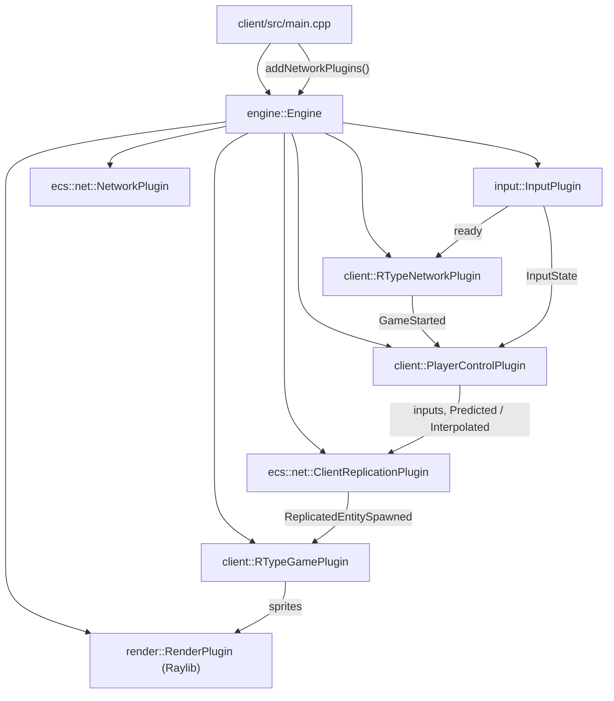

# Client Architecture

## 1. Overview

The R-Type client executable (`r-type_client`) is built on the generic game engine. It does not simulate the game: the
server does. The client sends the player's input, predicts the local ship, and displays what the server's snapshots say.



---

## 2. Entry Point (`main.cpp`)

`r-type_client [host] [port]`, by default `127.0.0.1` and port 4242 (`client/src/ClientOptions.cpp`). It exits with code
84 if the arguments are invalid, or if the connection fails or is lost. `main()` only assembles the engine:

```cpp
engine::Engine engine;
engine.addPlugin<render::RenderPlugin>()
    .addPlugin<input::InputPlugin>()
    .addPlugin<audio::AudioPlugin>()
    .addPlugin<systems::PhysicsPlugin>()
    .addPlugin<systems::AnimationPlugin>()
    .addPlugin<prefabs::PrefabPlugin>()
    .addPlugin<scripting::ScriptPlugin>()
    .addPlugin<client::RTypeGamePlugin>();
client::addNetworkPlugins(engine, *options);

engine.run();
return engine.getPlugin<client::RTypeNetworkPlugin>().failed() ? EXIT_ERROR : 0;
```

`client::addNetworkPlugins()` (`client/src/net/ClientNetwork.cpp`) creates the transport, adds the network plugins and
starts connecting. `connect()` never blocks: the window is open while the client connects, and a failure arrives as a
`Disconnected` event.

---

## 3. The Game Plugins

The client splits what needs a window from what does not, so that the network logic runs in tests.

### `RTypeNetworkPlugin`: the session with the server

No window and no rendering (`client/src/net/`, tested by `test_client_network` and `test_server_e2e`).

- **Session:** sends `Hello` when connected. On `LobbyList`, while it is in no room, it joins the first room waiting for
  players, or creates one. If the room started in the meantime, the join is refused, and the server pushes a new list
  because the room changed: the client tries again from it.
- **Ready:** the `ready` action (key R, gamepad Start) toggles the ready state while in a room.
- **Game start:** `GameStart` opens UDP on the port received in `Welcome`, then publishes `client::GameStarted` with the
  player's index. If UDP cannot be opened, the game does not start: the client stops.
- **Connection failed or lost:** logs why (`INetworkClient::disconnectReason()`: server unreachable or full, other version
  of the game, connection lost) and stops the engine; `failed()` then makes `main()` exit with code 84.

### `PlayerControlPlugin`: the local player in game

Also without window or rendering (`client/src/net/`, same tests).

- **Inputs:** after `GameStarted`, once per fixed step, publishes `ecs::net::LocalInput` with the actions held and the axes
  of the local `InputState`. The `ready` action is not a game input and is not sent.
- **Replicated entities:** the ship whose `subtype` is the player's index becomes `ecs::Predicted`, and every other entity
  `ecs::Interpolated`. On `InputApplied`, it moves the entity with `rtype::game::applyShipInput`, the same function as the
  server.

### `RTypeGamePlugin`: what is on screen

- **Initialization (`init`):** loads textures, applies the bindings (`client::input::setupDefaultBindings`), spawns the
  starfield, the camera and the entity holding the local `InputState`. It spawns no ship: ships come from the server.
- **Sprites:** on `ReplicatedEntitySpawned`, gives the entity the sprite of its `kind`, using `subtype` to choose the row of
  the ship spritesheet, so that players can tell their ships apart. A kind the client does not know stays invisible.
- **Shots:** the client spawns nothing. The `shoot` action travels in the player's input, and the bullets arrive in the
  snapshots like any other entity, interpolated: a shot appears one round trip after the key press.

There is no lobby screen yet, because the engine cannot draw text: the state of the lobby is printed in the terminal.

---

## 4. Input & Rendering Pipelines

1. **Input Pipeline**:
   - `input::InputPlugin` queries hardware input state (keyboard, gamepad) once per frame in `preUpdate`, before the fixed-timestep ticks.
   - Updates the `InputState` components of the local player, read by the game plugins.
   - Dispatches transition events (`InputActionEvent`) through the `EventBus`.
2. **Rendering Pipeline**:
   - `render::RenderPlugin` collects entities possessing both `ecs::Transform` and `ecs::Renderable`.
   - Sorts draw items by layer, depth, and texture ID to minimize state changes.
   - Renders them through the camera using Raylib within `Window::beginFrame()` and `Window::endFrame()`.
