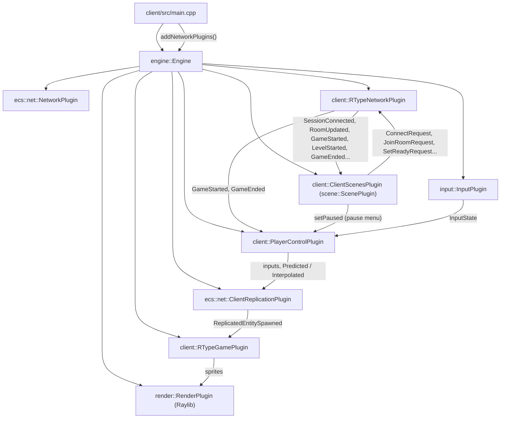
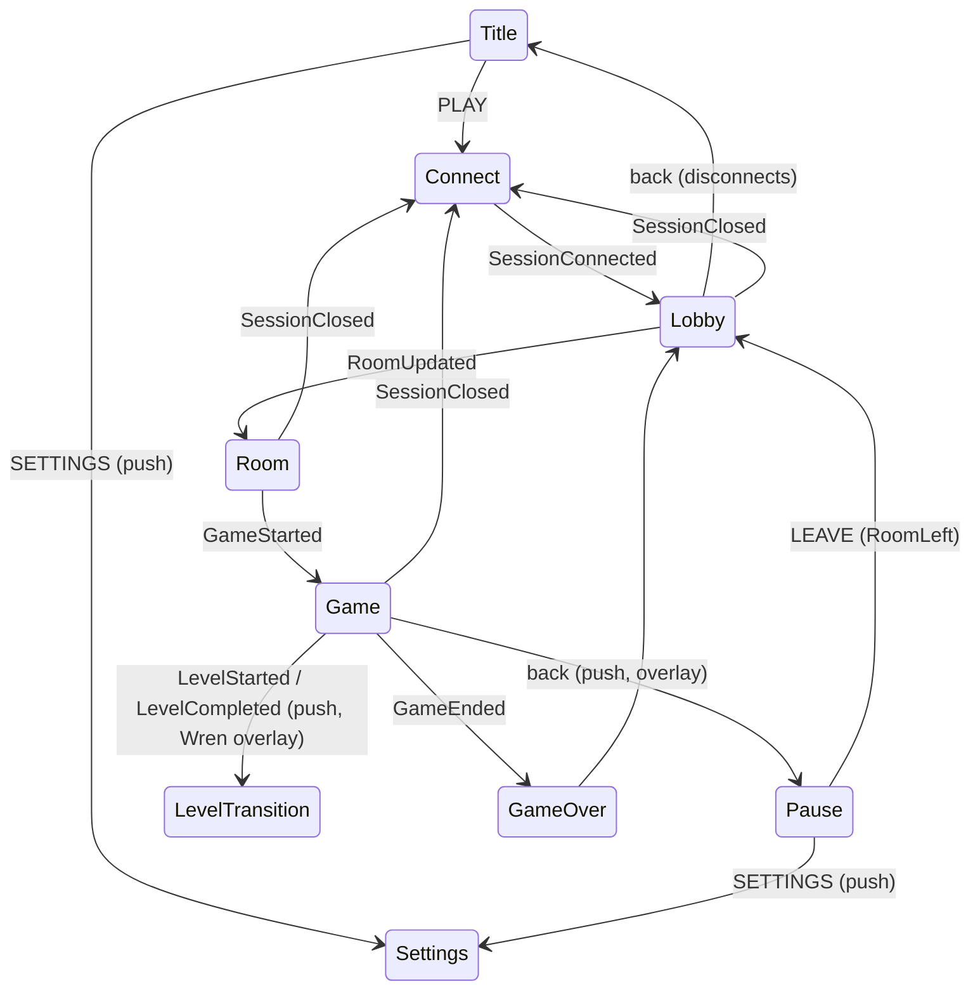

# Client Architecture

## 1. Overview

The R-Type client executable (`r-type_client`) is built on the generic game engine. It does not simulate the game: the
server does. The client sends the player's input, predicts the local ship, and displays what the server's snapshots say.



---

## 2. Entry Point (`main.cpp`)

`r-type_client [host] [port]`, by default `127.0.0.1` and port 4242 (`client/src/ClientOptions.cpp`). The address only
fills the connect screen in: nothing connects before the player asks. A host given on the command line wins over the
last server saved in the settings. The client exits with code 84 only if the arguments are invalid. `main()` only
assembles the engine:

```cpp
engine::Engine engine;
engine.addPlugin<render::RenderPlugin>(render::WindowConfig{.escapeClosesWindow = false})
    // ... input, audio, physics, animation, prefabs, scripting, hierarchy, ui ...
    .addPlugin<scene::ScenePlugin>()
    .addPlugin<scene::SceneScriptingPlugin>()
    .addPlugin<settings::SettingsPlugin>(config::userConfigDirectory("rtype") / "settings.toml")
    .addPlugin<client::RTypeGamePlugin>();
client::addNetworkPlugins(engine);
engine.addPlugin<client::ClientScenesPlugin>(options->host, options->port, args.size() > 1);
engine.run();
```

`client::addNetworkPlugins()` (`client/src/net/ClientNetwork.cpp`) adds the network plugins. `connect()` never blocks:
the window stays responsive while the client connects, and a failure arrives as a `Disconnected` event.

---

## 3. The Game Plugins

The client splits what needs a window from what does not, so that the network logic runs in tests.

### `RTypeNetworkPlugin`: the session with the server

No window and no rendering (`client/src/net/`, tested by `test_client_network` and `test_server_e2e`).

It is driven by request events and reports what happens with result events (`client/src/net/SessionEvents.hpp`), so
the screens and the session never call each other:

| Request              | Valid in        | Effect                                                   |
|----------------------|-----------------|----------------------------------------------------------|
| `ConnectRequest`     | offline         | New transport from the factory, `connect()`, then `Hello` |
| `DisconnectRequest`  | any             | `Leave`, stops the transport                             |
| `RefreshRoomsRequest`| lobby, room     | `LobbyListRequest`                                       |
| `CreateRoomRequest`  | lobby           | `LobbyCreate`                                            |
| `JoinRoomRequest`    | lobby           | `LobbyJoin`                                              |
| `SetReadyRequest`    | room            | `LobbyReady`                                             |
| `LeaveRoomRequest`   | room, game      | `Leave`; in game, closes UDP and resets the replication  |

| Result             | When                                                                         |
|--------------------|------------------------------------------------------------------------------|
| `SessionConnected` | `Welcome` received: the client is in the lobby                               |
| `SessionClosed`    | connection refused, failed or lost, with a reason for the player            |
| `RoomListUpdated`, `RoomUpdated`, `PlayerLeftRoom`, `RoomLeft` | lobby and room changes            |
| `GameStarted`      | `GameStart`: UDP opened                                                      |
| `LevelStarted`, `LevelCompleted` | `LevelStart`, `LevelComplete`                                  |
| `GameEnded`        | `GameOver`: UDP closed, replicated entities removed, back in the lobby       |

- A request that makes no sense in the current state (`SessionState`) is ignored.
- The last list of rooms, room, level and result are kept (`rooms()`, `room()`, `level()`, `lastResult()`), for a
  screen opened after the event.
- **One transport per connection.** A transport connects only once, so each `ConnectRequest` builds a new one and puts
  it in the shared `ecs::net::ClientConnection`. A failed connection can therefore be retried.
- **Clean games.** Leaving a game or receiving `GameOver` calls `ClientReplicationPlugin::reset()`. The next game,
  whose snapshot ticks start again from 1, is not dropped as stale.
- **No forced exit.** A failure never stops the engine: the scenes go back to the connect screen, which shows the
  reason.

### `PlayerControlPlugin`: the local player in game

Also without window or rendering (`client/src/net/`, same tests).

- **Inputs:** from `GameStarted` until the game ends or is left, once per fixed step, publishes `ecs::net::LocalInput`
  with the actions held and the axes of the local `InputState`, unless `setPaused(true)` (local pause). The `ready`
  action is not a game input and is not sent.
- **Replicated entities:** the ship whose `subtype` is the player's index becomes `ecs::Predicted`, and every other entity
  `ecs::Interpolated`. On `InputApplied`, it moves the entity with `rtype::game::applyShipInput`, the same function as the
  server.

### `ShipMetricsPlugin`: the game's line on the metrics board

`client/src/metrics/`, tested by `test_client_metrics`. Every `metrics::REFRESH_PERIOD`, writes the position of the
`ecs::Predicted` ship to the `Position` line of the `metrics::MetricsBoard`; there is no line before the game starts. It
requires `metrics::MetricsPlugin`, and stays out of `PlayerControlPlugin`, which only handles the player's inputs and
ship. See [In-Game Metrics](metrics.md).

### `RTypeGamePlugin`: what is on screen

- **Initialization (`init`):** loads textures, applies the bindings (`client::input::setupDefaultBindings`), spawns the
  starfield, the camera and the entity holding the local `InputState`. It spawns no ship: ships come from the server.
- **Sprites:** on `ReplicatedEntitySpawned`, gives the entity the sprite of its `kind`, using `subtype` to choose the row of
  the ship spritesheet, so that players can tell their ships apart. A kind the client does not know stays invisible.
- **Shots:** the client spawns nothing. The `shoot` action travels in the player's input, and the bullets arrive in the
  snapshots like any other entity, interpolated: a shot appears one round trip after the key press.
- **Boss looks:** a `boss_core` and a `boss_part` are drawn from `client/config/looks.toml` (see [the looks file](#looks-file-clientconfiglookstoml)), by their
  `subtype`: the variant of a boss, the look of a part. Without an entry, they are colored boxes.
- **Boss effects (`client/src/gameplay/BossEffects`):** a boss or a turret flashes red for `HIT_FLASH_DURATION` when its
  replicated `health` goes down. A boss that leaves the snapshots nearly dead (at most 1 hit point, or a tenth of its hit
  points at spawn) explodes: `EXPLOSION_BURSTS` bursts spread over its box for `EXPLOSION_SPREAD` seconds; a turret gets
  one burst. A boss removed with its game (game over, leaving) does not explode. The bursts are client-only entities.
- **Boss health bar (`GameScene`):** while a boss is on screen, a red bar under the HUD line shows its hit points left
  over its hit points at spawn (summed when there are several bosses), with a `BOSS` caption. It hides once no boss is
  left. The values come from `gameplay::bossHealth`, which reads the replicated `health` of the bosses.

#### Looks file (`client/config/looks.toml`)

Read at start-up by `looks::readLooks` (`client/src/looks/`). A missing file, a bad value or a texture that does
not load is logged and never stops the client: the look falls back to a box.

```toml
[[boss]]                       # one entry per boss variant (level `boss` event, key `variant`)
variant = 1
texture = "sprites/my_boss.png"
frame_x = 0                    # left of the first frame, in texture pixels
frame_y = 0                    # top of the strip
frame_width = 160
frame_height = 200
frames = 4                     # frames side by side, played in a loop
frame_duration = 0.12
loop = true
scale = 2.0

[[part]]                       # one entry per part look (level `[[events.parts]]`, key `look`)
look = 1
width = 40.0                   # without `texture`: a box of this size
height = 40.0

[[entity]]                     # one entry per prefab: alien_scout, alien_gunner, alien_elite, missile, power_up
prefab = "alien_gunner"
texture = "sprites/my_gunner.png"
frame_width = 40
frame_height = 40

[[entity]]                     # with `subtype`: only the entities of that subtype, such as the shots of one shooter
prefab = "missile"
subtype = 1                    # 1: alien gunner shots, 2: alien elite shots
texture = "sprites/red_shot.png"
frame_width = 16
frame_height = 16
```

| Key | Default | Range | Description |
|-----|---------|-------|-------------|
| `variant` / `look` / `prefab` | required | 0–255 / prefab name | Which boss variant, part look or entity the entry is for. A later entry with the same id wins. |
| `width`, `height` | default box | 0–2048 px | Box drawn without a sprite; 0 keeps the default size (128×160 for a boss, 48×48 for a part, the hitbox for an entity). |
| `texture` | none | relative path, no `..` | Spritesheet; without it, the entry is a box. |
| `subtype` | any | 0–255 | `[[entity]]` only: restyles only the entities of that `subtype`; an entry without it is the fallback. |
| `frame_x`, `frame_y` | `0` | 0–4096 | Origin of the first frame. |
| `frame_width`, `frame_height` | required with `texture` | 1–4096 | Size of a frame. |
| `frames` | `1` | 1–64 | Frames of the strip. |
| `frame_duration` | `0.1` | 0.01–10 s | Seconds per frame. |
| `loop` | `true` | | `false` stops on the last frame. |
| `scale` | `1` | 0.1–16 | Drawing scale. |
| `frame_stride` | `frame_width` | 0–4096 | Pixels from one frame to the next, for strips with empty space between their frames. |
| `frame_widths` | none | 1–4096 each, 64 frames | Widths of frames that differ, side by side from `frame_x`: they give the number of frames and replace `frame_width`. With `loop = false`, the animation holds its last frame. |
| `flip_x` | `false` | | Draws the sprite mirrored left to right, for a sheet facing the other way. |
| `face_motion` | `false` | | Turns the sprite towards where it moves (`gameplay::FaceMotion`), such as shots flying in any direction. The sheet is taken as facing right, or left with `flip_x`. The direction comes from the move between two frames: the server only sends positions. |
| `directional` | `false` | | The frames are directions around the full turn, not an animation: the client shows the one facing the nearest player ship (`gameplay::AimedSprite`). |
| `first_angle` | `0` | -360–360 | Direction of the first frame of a directional sprite, in degrees: 0 is right, 90 down, the next frames turning clockwise. |

An `[explosion]` table takes the same sprite keys (`texture`, `frame_*`, `frames`, `frame_duration`, `scale`): each
burst plays it once. Without it, the bursts are orange boxes that grow and fade.

The hitbox stays the server's (`width` and `height` of the level event): size the sprite to match it.

### Scenes: the menus (`client/src/scenes/`)

The screens are engine scenes (see [Scenes](scene.md)), built with the engine UI widgets (see
[User Interface](ui.md)) through `MenuKit`. `ClientScenesPlugin` registers them and opens the title screen.



| Scene             | Mode           | Content                                                                         |
|-------------------|----------------|---------------------------------------------------------------------------------|
| `Title`           | exclusive      | Play, Settings, Quit                                                            |
| `Connect`         | exclusive      | host and port fields (last server saved, else the command line), progress, error |
| `Settings`        | exclusive      | master, music and effects volumes, metrics panel; saved by `SettingsPlugin`     |
| `Lobby`           | exclusive      | scrollable list of rooms (only open ones are focusable), create, refresh, back  |
| `Room`            | exclusive      | players and their ready state, ready toggle, leave                              |
| `Game`            | exclusive      | HUD (player, level, score); back opens the pause menu                           |
| `LevelTransition` | overlay        | written in Wren (`scripts/scenes/LevelTransition.wren`): spawns the C++ `level_banner` prefab, waits 2.5 s, pops itself |
| `Pause`           | overlay        | local only: the game goes on below and for the others, the ship gets no input   |
| `GameOver`        | exclusive      | victory or defeat, scores, back to the lobby                                    |

- **Navigation.** Mouse, or keyboard and gamepad through the UI focus. Escape and gamepad B mean "back": the window
  does not close on Escape, and the game quits from the title screen.
- **No missed event.** A scene entered after an event (the first `LevelStart` follows `GameStart` at once, a room
  update may arrive before the room screen opens) reads the state the session keeps.
- **One owner per action.** Click and back handlers only act while their scene is the top of the stack, so the title
  under the settings, or the game under the pause menu, never react to them.
- **Settings.** `ClientScenesPlugin` declares them, applies the volumes and the metrics panel
  (`MetricsOverlayPlugin::setVisible`) on `SettingChanged`, and toggles the metrics setting on F3. The panel is hidden
  by default.

---

## 4. Input & Rendering Pipelines

1. **Input Pipeline**:
   - `input::InputPlugin` queries hardware input state (keyboard, gamepad) once per frame in `preUpdate`, before the fixed-timestep ticks.
   - Updates the `InputState` components of the local player, read by the game plugins.
   - Dispatches transition events (`InputActionEvent`) through the `EventBus`.
2. **Rendering Pipeline**:
   - `render::RenderPlugin` collects entities possessing both `ecs::Transform` and `ecs::Renderable`.
   - Sorts draw items by layer, depth, and texture ID to minimize state changes.
   - Renders them through the camera using Raylib within `Window::beginFrame()` and `Window::endFrame()`.
