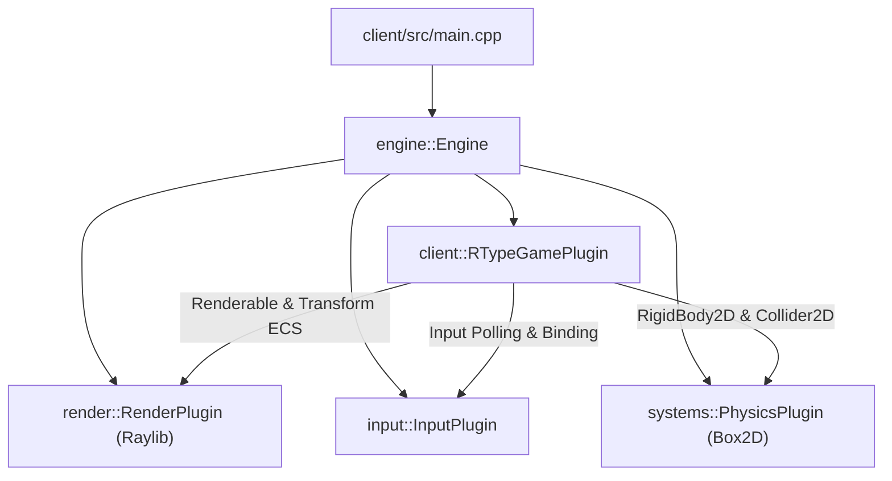

# Client Architecture

## 1. Overview

The R-Type client executable (`r-type_client`) is built as a lightweight, declarative application on top of the generic game engine. Rather than writing a procedural game loop with hardcoded subsystem dependencies, the client bootstraps the central `engine::Engine` and registers modular plugins.



---

## 2. Declarative Entry Point (`main.cpp`)

The client entry point initializes the engine, registers all required graphical and gameplay plugins, and launches the managed game loop:

```cpp
#include <exception>
#include <iostream>

#include "RTypeGamePlugin.hpp"
#include "core/Engine.hpp"
#include "input/InputPlugin.hpp"
#include "render/RenderPlugin.hpp"
#include "render/window/WindowConfig.hpp"
#include "systems/physics/PhysicsPlugin.hpp"

int main() {
    try {
        engine::Engine engine;
        engine.addPlugin<render::RenderPlugin>(render::WindowConfig{})
            .addPlugin<input::InputPlugin>()
            .addPlugin<systems::PhysicsPlugin>()
            .addPlugin<client::RTypeGamePlugin>();

        engine.run();
    } catch (const std::exception& error) {
        std::cerr << "client error: " << error.what() << '\n';
        return 1;
    }
    return 0;
}
```

---

## 3. The Game Logic Plugin (`RTypeGamePlugin`)

All gameplay rules, entity templates, and input bindings for the client demonstration are encapsulated within `client::RTypeGamePlugin`:

- **Dependency Declaration (`build`)**:

  ```cpp
  void RTypeGamePlugin::build(engine::PluginBuilder& builder) {
      builder.require<render::RenderPlugin>();
      builder.require<::input::InputPlugin>();
      builder.require<systems::PhysicsPlugin>();
      builder.optionally<scripting::ScriptPlugin>();
  }
  ```

- **Initialization (`init`)**:
  - Populates standard physical bindings (WASD, i.e. ZQSD on AZERTY keyboards, arrow keys + Space) via `client::input::setupDefaultBindings()` on the `IInputService`.
  - Spawns the initial demo scene (`spawnDemoScene`): player ship, static obstacle, dynamic background projectiles, and camera.
- **Fixed Timestep Tick (`fixedUpdate`)**:
  - Updates ship movement (`movePlayer`).
  - Advances player bullets and obstacle projectiles (`movePlayerBullets`, `moveProjectiles`).
  - Advances Box2D physics bodies.
- **Variable Frame Tick (`update`)**:
  - Checks discrete weapon trigger actions (`handlePlayerShoot`) and spawns projectile entities.

---

## 4. Input & Rendering Pipelines

1. **Input Pipeline**:
   - `input::InputPlugin` queries hardware input state (keyboard, gamepad) once per frame in `preUpdate`, before the fixed-timestep ticks.
   - Updates matching `InputState` ECS components on controllable entities.
   - Dispatches transition events (`InputActionEvent`) through the `EventBus`.
2. **Rendering Pipeline**:
   - `render::RenderPlugin` collects entities possessing both `ecs::Transform` and `ecs::Renderable`.
   - Sorts draw items by layer, depth, and texture ID to minimize state changes.
   - Renders them through the camera using Raylib within `Window::beginFrame()` and `Window::endFrame()`.
