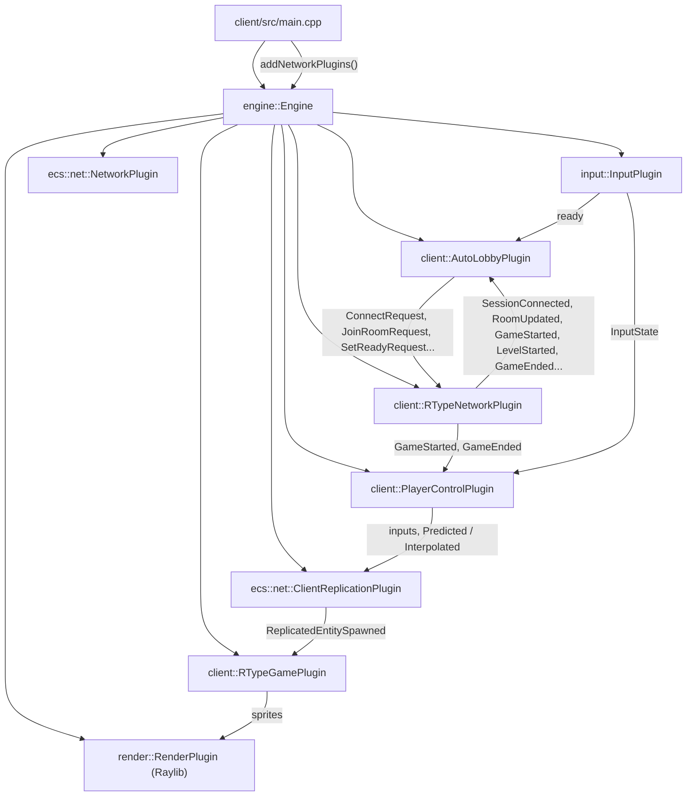

# Client Architecture

## 1. Overview

The R-Type client executable (`r-type_client`) is built on the generic game engine. It does not simulate the game: the
server does. The client sends the player's input, predicts the local ship, and displays what the server's snapshots say.



---

## 2. Entry Point (`main.cpp`)

`r-type_client [host] [port]`, by default `127.0.0.1` and port 4242 (`client/src/ClientOptions.cpp`). It exits with code
84 if the arguments are invalid, or if the connection fails or is lost. `main()` only assembles the engine:

```cpp
engine::Engine engine;
engine.addPlugin<render::RenderPlugin>()
    // ... input, audio, physics, animation, prefabs, scripting, hierarchy, ui ...
    .addPlugin<client::RTypeGamePlugin>();
client::addNetworkPlugins(engine);
engine.addPlugin<client::AutoLobbyPlugin>(*options);

engine.run();
return engine.getPlugin<client::AutoLobbyPlugin>().failed() ? EXIT_ERROR : 0;
```

`client::addNetworkPlugins()` (`client/src/net/ClientNetwork.cpp`) adds the network plugins. Nothing connects until a
`ConnectRequest` is published. `connect()` never blocks: the window is open while the client connects, and a failure
arrives as a `Disconnected` event.

---

## 3. The Game Plugins

The client splits what needs a window from what does not, so that the network logic runs in tests.

### `RTypeNetworkPlugin`: the session with the server

No window and no rendering (`client/src/net/`, tested by `test_client_network` and `test_server_e2e`).

It is driven by request events and reports what happens with result events (`client/src/net/SessionEvents.hpp`), so
the screens and the session never call each other:

| Request              | Valid in        | Effect                                                   |
|----------------------|-----------------|----------------------------------------------------------|
| `ConnectRequest`     | offline         | New transport from the factory, `connect()`, then `Hello` |
| `DisconnectRequest`  | any             | `Leave`, stops the transport                             |
| `RefreshRoomsRequest`| lobby, room     | `LobbyListRequest`                                       |
| `CreateRoomRequest`  | lobby           | `LobbyCreate`                                            |
| `JoinRoomRequest`    | lobby           | `LobbyJoin`                                              |
| `SetReadyRequest`    | room            | `LobbyReady`                                             |
| `LeaveRoomRequest`   | room, game      | `Leave`; in game, closes UDP and resets the replication  |

| Result             | When                                                                         |
|--------------------|------------------------------------------------------------------------------|
| `SessionConnected` | `Welcome` received: the client is in the lobby                               |
| `SessionClosed`    | connection refused, failed or lost, with a reason for the player            |
| `RoomListUpdated`, `RoomUpdated`, `PlayerLeftRoom`, `RoomLeft` | lobby and room changes            |
| `GameStarted`      | `GameStart`: UDP opened                                                      |
| `LevelStarted`, `LevelCompleted` | `LevelStart`, `LevelComplete`                                  |
| `GameEnded`        | `GameOver`: UDP closed, replicated entities removed, back in the lobby       |

- A request that makes no sense in the current state (`SessionState`) is ignored.
- The last list of rooms, room, level and result are kept (`rooms()`, `room()`, `level()`, `lastResult()`), for a
  screen opened after the event.
- **One transport per connection.** A transport connects only once, so each `ConnectRequest` builds a new one and puts
  it in the shared `ecs::net::ClientConnection`. A failed connection can therefore be retried.
- **Clean games.** Leaving a game or receiving `GameOver` calls `ClientReplicationPlugin::reset()`. The next game,
  whose snapshot ticks start again from 1, is not dropped as stale.
- **No forced exit.** A failure never stops the engine. `AutoLobbyPlugin`, which plays the lobby without a menu
  (connect from the command line, join the first open room or create one, the `ready` action toggles readiness),
  stops it on `SessionClosed`.

### `PlayerControlPlugin`: the local player in game

Also without window or rendering (`client/src/net/`, same tests).

- **Inputs:** from `GameStarted` until the game ends or is left, once per fixed step, publishes `ecs::net::LocalInput`
  with the actions held and the axes of the local `InputState`, unless `setPaused(true)` (local pause). The `ready`
  action is not a game input and is not sent.
- **Replicated entities:** the ship whose `subtype` is the player's index becomes `ecs::Predicted`, and every other entity
  `ecs::Interpolated`. On `InputApplied`, it moves the entity with `rtype::game::applyShipInput`, the same function as the
  server.

### `ShipMetricsPlugin`: the game's line on the metrics board

`client/src/metrics/`, tested by `test_client_metrics`. Every `metrics::REFRESH_PERIOD`, writes the position of the
`ecs::Predicted` ship to the `Position` line of the `metrics::MetricsBoard`; there is no line before the game starts. It
requires `metrics::MetricsPlugin`, and stays out of `PlayerControlPlugin`, which only handles the player's inputs and
ship. See [In-Game Metrics](metrics.md).

### `RTypeGamePlugin`: what is on screen

- **Initialization (`init`):** loads textures, applies the bindings (`client::input::setupDefaultBindings`), spawns the
  starfield, the camera and the entity holding the local `InputState`. It spawns no ship: ships come from the server.
- **Sprites:** on `ReplicatedEntitySpawned`, gives the entity the sprite of its `kind`, using `subtype` to choose the row of
  the ship spritesheet, so that players can tell their ships apart. A kind the client does not know stays invisible.
- **Shots:** the client spawns nothing. The `shoot` action travels in the player's input, and the bullets arrive in the
  snapshots like any other entity, interpolated: a shot appears one round trip after the key press.

There is no lobby screen yet, because the engine cannot draw text: the state of the lobby is printed in the terminal.

---

## 4. Input & Rendering Pipelines

1. **Input Pipeline**:
   - `input::InputPlugin` queries hardware input state (keyboard, gamepad) once per frame in `preUpdate`, before the fixed-timestep ticks.
   - Updates the `InputState` components of the local player, read by the game plugins.
   - Dispatches transition events (`InputActionEvent`) through the `EventBus`.
2. **Rendering Pipeline**:
   - `render::RenderPlugin` collects entities possessing both `ecs::Transform` and `ecs::Renderable`.
   - Sorts draw items by layer, depth, and texture ID to minimize state changes.
   - Renders them through the camera using Raylib within `Window::beginFrame()` and `Window::endFrame()`.
