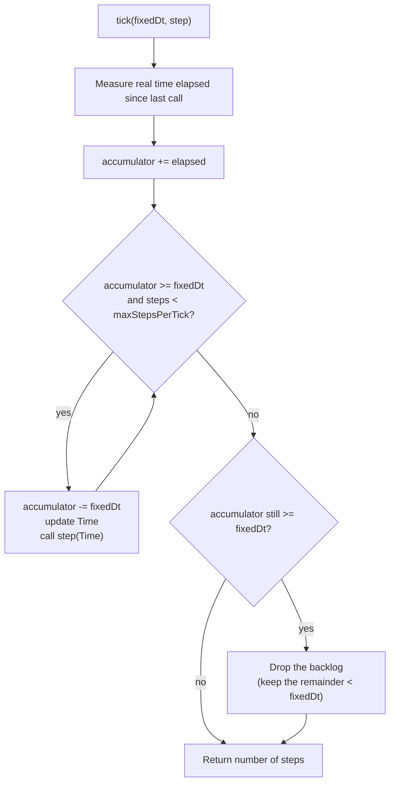

# Engine Clock (Fixed Timestep)

## 1. Purpose

The game simulation must not depend on CPU speed: an enemy moving at 100 units per second has to travel 100 units in one real second on a slow laptop as well as on a fast server. The **`Clock`** class turns the real time that elapses between two loop iterations into a whole number of **fixed-duration simulation steps** (the *fixed timestep* pattern).

It lives in `engine/src/ecs/time/` under the `ecs::time` namespace and has **no graphical dependency**, so the headless server and the client use the exact same code.

| File | Content |
|------|---------|
| `Time.hpp` | `Time` structure handed to every simulation step |
| `Clock.hpp` / `Clock.tpp` / `Clock.cpp` | The `Clock` class (`tick` is a template defined in the `.tpp`) |
| `SteadyNow.hpp` / `SteadyNow.cpp` | `steadyNowSeconds()`, the default time source |

## 2. How It Works

The clock keeps an **accumulator** of real time that has not been simulated yet.



On each call to `tick`:

1. The real time elapsed since the previous call is added to the accumulator (negative values are clamped to `0`).
2. While the accumulator holds at least one `fixedDt`, one step is consumed: the accumulator is decreased by `fixedDt`, the `Time` data is updated and your callback runs.
3. Whatever remains (less than one step) is kept for the next call, so no time is ever lost.

Consequences:

- **Fast machine / high loop frequency:** most calls run `0` or `1` step.
- **Slow machine / low loop frequency:** a call runs several steps in a row to catch up.
- In both cases the callback always sees the **same `deltaTime`**, and the simulated time grows at the same rate.

### Spiral-of-death protection

If the process freezes (debugger, OS suspend, heavy load), a huge amount of time accumulates. Running every missed step would take even longer and make the next frame worse, and so on. To avoid this, a single `tick` runs at most **`maxStepsPerTick`** steps (default: `5`). If a backlog still remains after that, it is dropped and only the remainder smaller than one step is kept.

## 3. The `Time` Structure

`Time` is passed (by `const&`) to every step.

| Field | Type | Meaning |
|-------|------|---------|
| `deltaTime` | `float` | Constant duration of one step, in seconds (equals the `fixedDt` given to `tick`) |
| `totalElapsedTime` | `float` | Simulated time since the clock started (or was reset), in seconds |
| `tickCount` | `std::uint64_t` | Number of steps executed since the clock started (or was reset) |

`Time.hpp` also provides `ecs::time::DEFAULT_FIXED_DT` (`0.0166F`, i.e. 60 Hz), the step size to pass to `tick` unless a different rate is needed.

The total is accumulated internally in `double` precision, so it does not drift even after many thousands of ticks.

## 4. API Reference

```cpp
namespace ecs::time {

class Clock {
  public:
    using TimeSource = std::function<double()>;           // current time in seconds
    static constexpr std::size_t DEFAULT_MAX_STEPS_PER_TICK = 5;

    explicit Clock(TimeSource source = nullptr,
                   std::size_t maxStepsPerTick = DEFAULT_MAX_STEPS_PER_TICK);

    template <typename Step>
    std::size_t tick(float fixedDt, Step&& step);          // returns number of steps run

    const Time& time() const noexcept;                     // data of the latest step
    void reset();                                          // restart accumulator and counters
};

}
```

| Member | Description |
|--------|-------------|
| `Clock(source, maxStepsPerTick)` | Records the starting instant. A `nullptr` source selects `steadyNowSeconds` (based on `std::chrono::steady_clock`). `maxStepsPerTick` is forced to at least `1`. |
| `tick(fixedDt, step)` | Runs `step(const Time&)` once per whole `fixedDt` of accumulated time. Does nothing and returns `0` if `fixedDt <= 0`. |
| `time()` | Returns the `Time` of the last executed step. |
| `reset()` | Re-reads the current instant and clears the accumulator, the total and the counters. |

`tick` is a template so that any callable (lambda, functor, function pointer, even move-only ones) can be passed without type erasure, heap allocation or indirect call on a path executed every frame.

## 5. Usage

### Server main loop

```cpp
ecs::time::Clock clock;
constexpr float FIXED_DT = ecs::time::DEFAULT_FIXED_DT;   // 0.0166F, ~60 Hz

while (running) {
    clock.tick(FIXED_DT, [&](const ecs::time::Time& time) {
        network.poll();                    // read client inputs
        scripts.update(time.deltaTime);    // game logic / AI
        physics.update(time.deltaTime);    // movement and collisions
        network.sendSnapshot();            // send state to clients
    });
    // short sleep to avoid burning the CPU
}
```

### Client main loop

The simulation advances in fixed steps, while drawing happens once per displayed frame, **outside** of `tick`:

```cpp
while (!window.shouldClose()) {
    clock.tick(FIXED_DT, [&](const ecs::time::Time& time) {
        input.update();
        animation.update(time.deltaTime);
    });
    renderSystem.draw(registry);
}
```

### Guidelines

- The callback receives a `const ecs::time::Time&` argument: a lambda must accept it, even if it ignores it (`[&](const ecs::time::Time&) { ... }`).
- Systems must take their `dt` from `Time::deltaTime` and **never measure time themselves**.
- Put in the callback only what must advance at a fixed rate (logic, AI, scripts, physics, network tick). Keep rendering and sleeping out of it.
- To run something less often than every step (for example sending snapshots every 3 ticks), use `time.tickCount`: `if (time.tickCount % 3 == 0) { ... }`.

## 6. Testing

The time source is injectable, so tests never wait for real time: they provide a function returning a variable that they advance by hand.

```cpp
double now = 0.0;
ecs::time::Clock clock([&now] { return now; });

now = 1.0;   // one second "passes" instantly
std::size_t steps = clock.tick(0.0166F, [](const ecs::time::Time&) {});
```

The unit tests in `tests/test_clock.cpp` cover:

- no step before one `fixedDt` has elapsed, and carry-over of the remaining time;
- constant `deltaTime`;
- no drift over 10,000 ticks;
- same number of steps at 144 Hz and at 20 Hz loop frequency (framerate independence);
- spiral-of-death cap;
- `reset()`, an invalid `fixedDt`, and the default real-time source.

Run them with:

```bash
xmake build test_clock
xmake test "test_clock/*"
```
