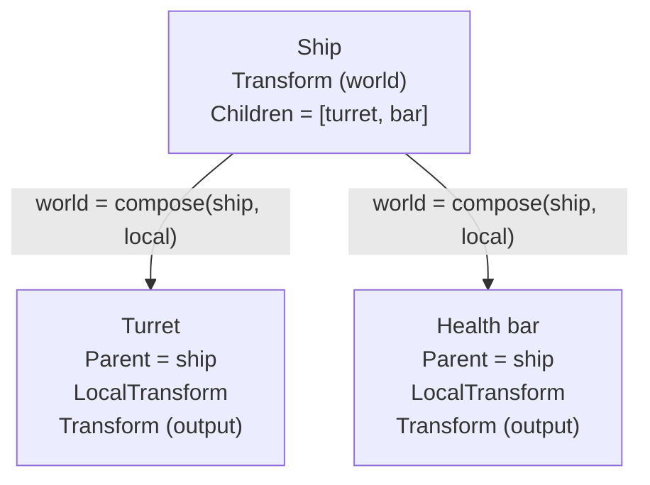
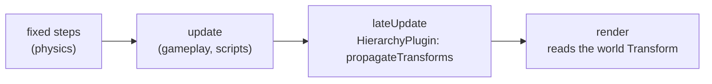

# Entity Hierarchy

The `engine_hierarchy` module links entities into parent/child trees: UI panels and their widgets, turrets or modules
attached to a ship, a health bar following an enemy. It is generic and headless, and depends only on `engine_core`.

## Components

All in `hierarchy/HierarchyComponents.hpp`, namespace `hierarchy`:

| Component        | On       | Meaning                                                                        |
|------------------|----------|--------------------------------------------------------------------------------|
| `Parent`         | child    | Handle of the parent entity.                                                   |
| `Children`       | parent   | Direct children, **in insertion order** (sibling order for UI draw/layout).    |
| `LocalTransform` | child    | Position, depth, rotation and scale **relative to the parent**.                |



`ecs::Transform` stays the **world** transform, so render, physics, audio and networking keep reading it unchanged.
For a child, it is an output: it is rewritten every frame from the parent's world transform and the child's
`LocalTransform`. Move a child by editing its `LocalTransform`.

!!! warning "Change links only through the API"
    Never add `Parent` or `Children` by hand: both sides of a link must agree. Removing them by hand is tolerated
    (the hooks repair the other side), but `removeParent` is cheaper.

## API

`hierarchy/Hierarchy.hpp`:

```cpp
#include "hierarchy/Hierarchy.hpp"
#include "hierarchy/HierarchyComponents.hpp"

const ecs::Entity panel = registry.spawnEntity();
const ecs::Entity button = registry.spawnEntity();
registry.addComponent<ecs::Transform>(panel, ecs::Transform{.x = 100.0F, .y = 50.0F});

hierarchy::setParent(registry, button, panel);  // keeps the button's current world position
registry.getComponents<hierarchy::LocalTransform>().get(button) = {.x = 10.0F, .y = 20.0F, .z = 1.0F};

hierarchy::parentOf(registry, button);    // std::optional<ecs::Entity>{panel}
hierarchy::childrenOf(registry, panel);   // std::span{button}
hierarchy::removeParent(registry, button);  // detach, world transform kept
```

| Function                              | Behaviour                                                                                    |
|---------------------------------------|----------------------------------------------------------------------------------------------|
| `setParent(reg, child, parent)`       | Detaches from the old parent, appends to the new one, computes `LocalTransform` so the child does not move. Returns `false` and changes nothing if an entity is dead (or a stale handle), if `child == parent`, or if it would create a cycle. |
| `removeParent(reg, child)`            | Removes `Parent` + `LocalTransform`; removes the parent's `Children` once empty.             |
| `parentOf`, `childrenOf`              | Read the links.                                                                              |
| `isAncestorOf(reg, ancestor, e)`, `rootOf(reg, e)` | Walk the parent chain.                                                          |

## Transform propagation

`propagateTransforms(registry)` (`hierarchy/TransformPropagation.hpp`) walks every tree from its root, parents
before children, so one pass handles any depth. For each child with a `LocalTransform`:

```
world.position = parent.position + rotate(parent.rotation, local.position * parent.scale)
world.rotation = parent.rotation + local.rotation
world.scale    = parent.scale * local.scale
world.z        = parent.z + local.z
```

- A parent without `ecs::Transform` counts as identity; a missing child `ecs::Transform` is created.
- A child without `LocalTransform` keeps its world transform, and its own children are placed from it.
- A 2D transform has no shear term: with a non-uniform parent scale and a rotated child, the child's own position
  stays exact, but its shape and its descendants' positions can differ from full affine composition.
- `toLocal(parentWorld, world)` is the inverse of `compose`; a collapsed (zero) parent scale never produces NaN.
  It cannot be inverted either: `setParent` under such a parent still succeeds, but the child is flattened onto the
  parent along that axis on the next propagation.

### When it runs

`HierarchyPlugin` runs the propagation in the engine's `lateUpdate` phase: after **every** plugin's `update` (gameplay,
scripts) and after the frame's fixed steps (physics), before `render`. Children are therefore up to date in the frame
their parent moved, without the hierarchy depending on any of the plugins that move entities.



```cpp
engine.addPlugin<systems::PhysicsPlugin>()
      .addPlugin<scripting::ScriptPlugin>()
      .addPlugin<hierarchy::HierarchyPlugin>();
```

!!! note "Physics bodies on children"
    The propagation owns a child's world transform. Give a child a **kinematic** body (or none): its propagated
    position is pushed to the physics world on the next fixed step. A dynamic body on a child would be overwritten
    every frame.

## Destruction

`HierarchyHooks` (installed by the plugin, or created directly on a registry in tests) listens to the registry:

- **Destroying an entity destroys all its descendants**, deepest first. The descendants are collected iteratively, so
  the call stack does not grow with the tree depth.
- A destroyed child is removed from its parent's `Children`.
- Removing `Parent` or `Children` by hand repairs the other side of the link (linear scan of the hierarchy components).

Entity handles are generational, so a handle to a destroyed child kept somewhere else reads as dead
(`registry.isAlive`) even after its slot is reused.

## HUD elements

The UI module (`engine_ui`) uses the same links to nest HUD elements. HUD elements are placed by `ui::UiAnchor`, not
by `ecs::Transform`, so `LocalTransform` plays no role there:

- An element whose `Parent` is also a HUD element (has a `UiAnchor`) is anchored **inside its parent's rectangle**:
  `anchorX/anchorY` are fractions of the parent's size and the offset is relative to its top-left corner.
- An element without a parent, or whose parent is not a HUD element (a ship, an enemy), is anchored against the screen.
- `ui::computeLayout` walks each tree depth-first: a parent is drawn before (below) its children, and siblings follow
  the order of `Children`. Buttons are hit-tested with the same rectangles.
- An entity without a `UiAnchor` is not laid out; HUD elements below it start new screen-anchored trees.

```cpp
const ecs::Entity panel = registry.spawnEntity();
registry.addComponent<ui::UiAnchor>(panel, ui::UiAnchor{.anchorX = 0.5F, .anchorY = 0.5F, .pivotX = 0.5F, .pivotY = 0.5F});
registry.addComponent<ui::UiRect>(panel, ui::UiRect{.width = 400.0F, .height = 200.0F});

const ecs::Entity quit = registry.spawnEntity();
registry.addComponent<ui::UiAnchor>(quit, ui::UiAnchor{.anchorX = 0.5F, .anchorY = 1.0F, .offsetY = -16.0F,
                                                       .pivotX = 0.5F, .pivotY = 1.0F});
registry.addComponent<ui::UiButton>(quit, ui::UiButton{.label = "Quit", .action = "quit"});
hierarchy::setParent(registry, quit, panel);  // bottom-centre of the panel; destroying the panel destroys it
```

## Not done yet

- **Wren bindings**: `Entity.setParent(p)`, `parent`, `children`, `detach()` in `scripts/core/Entity.wren`, to add with
  the Transform binding.
- **World-space HUD**: a HUD element parented to a world entity (a health bar over an enemy) is anchored against the
  screen; following the entity through the camera is still to do.
- **Sibling reordering**: children are always appended; an API to insert at or move to an index will be needed for UI.
- **Network**: replicated entities send their world transform, so children replicate as independent entities; the
  link itself is not replicated.
