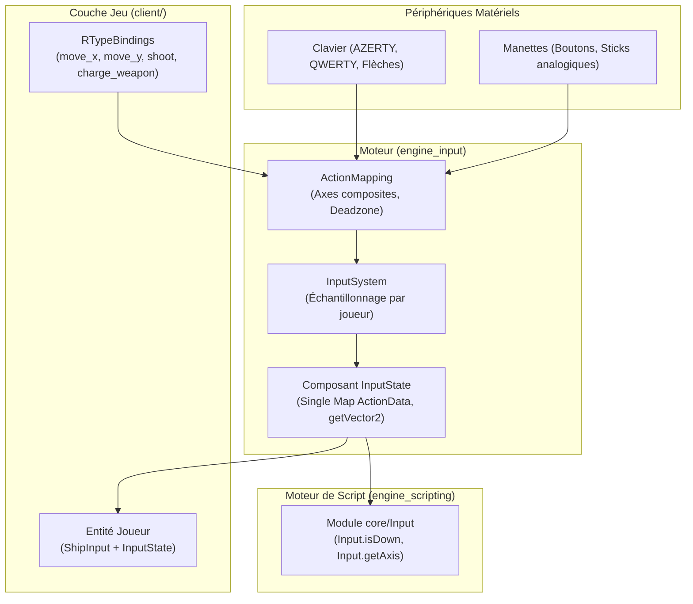

# Architecture du Système d'Input (Modular Input Architecture)

Ce document détaille la conception, l'implémentation et les choix d'architecture du sous-système d'entrées du moteur et de son intégration dans le client R-Type et le moteur de script Wren.

---

## 1. Vision et Principes Directeurs

Le système d'input a été conçu selon quatre piliers fondamentaux :

1. **Agnostique du Jeu (Engine Modular)** : Le moteur (`engine_input`) ne possède **aucune** action en dur (pas de `Shoot`, `MoveUp`, etc.) et **aucun** binding clavier/manette prédéfini. La définition des actions et des touches appartient exclusivement à la couche jeu (`client/`).
2. **Performance et Zéro Allocation au Runtime** : Hachage à la compilation (`constexpr`), stockage contigu et une unique table d'actions par composant.
3. **Paradigme ECS et Multi-joueurs Local Natif** : L'état d'entrée n'est plus un singleton global bloqué à un seul joueur, mais un **composant ECS** attaché à chaque entité contrôlable (`playerIndex`).
4. **Scripting Ergonomique (Wren)** : API dynamique et claire exposée aux concepteurs de scripts sans recompilation C++.



---

## 2. Découplage Moteur vs Jeu

### Problématique initiale

Initialement, le moteur définissait un `enum class Action { MoveUp, MoveDown, MoveLeft, MoveRight, Shoot, ChargeWeapon }` et un composant de gameplay `InputReceiver` contenant `shooting`, `charging` et `speed`.
Cette approche brisait la modularité du moteur :

- Impossible d'utiliser le moteur pour un autre type de jeu (ex: un RPG avec des actions `Interact`, `Inventory`, ou un jeu de plateforme avec `Jump`).
- Les touches par défaut (AZERTY / QWERTY) étaient codées en dur dans le constructeur de l'engine.

### Solution adoptée

- **Le moteur** fournit une boîte à outils dynamique : `ActionId`, `ActionMapping`, `InputState`, `InputSystem`.
- **Le client** configure ses propres actions sémantiques dans [`client/src/input/RTypeBindings.cpp`](file:///home/tom-gatin/EPITECH/ING/Rtype/client/src/input/RTypeBindings.cpp) :
  - `"move_x"` (Axe 1D composite : `KEY_A`/`KEY_D`, `KEY_LEFT`/`KEY_RIGHT`, stick gauche X).
  - `"move_y"` (Axe 1D composite : `KEY_W`/`KEY_S`, `KEY_UP`/`KEY_DOWN`, stick gauche Y).
  - `"shoot"` (Bouton digital : `KEY_SPACE`, `KEY_ENTER`, bouton manette A).
  - `"charge_weapon"` (Bouton digital : `KEY_LEFT_SHIFT`, gâchette droite manette).

---

## 3. Le Choix d'`ActionId` et du Hachage FNV-1a (32-bit)

### Pourquoi hacher et ne pas stocker les chaînes brutes (`std::string`) ?

L'utilisation d'un identifiant numérique 32-bit `ActionId` (`uint32_t`) généré par hachage FNV-1a apporte des gains massifs par rapport au stockage de chaînes brutes :

| Critère | `std::string` brute | `ActionId` (FNV-1a 32-bit) | Gain concret |
| :--- | :--- | :--- | :--- |
| **Coût à la compilation** | Aucun (exécuté au runtime). | `constexpr` : calculé dès la compilation. | **0 cycle CPU au runtime** pour les littéraux (`"shoot"` devient `0xBF98D248`). |
| **Comparaison de clé** | `memcmp` caractère par caractère en cas de match. | `cmp eax, ebx` en assembleur. | **1 cycle d'horloge** processeur. |
| **Empreinte mémoire par clé** | 32 octets (SSO libstdc++) + allocations tas au-delà de 15 caractères. | 4 octets (`uint32_t`). | **8× moins de mémoire**, élimination totale des allocations sur le tas dans les nœuds de la table. |
| **Sérialisation Réseau (UDP)** | 10 à 20 octets par paquet avec parsing de chaîne. | 4 octets dans le paquet binaire. | Réduction critique de la bande passante multijoueur. |

### Les Mathématiques de FNV-1a (*Fowler–Noll–Vo*)

Dans [`InputConstants.hpp`](file:///home/tom-gatin/EPITECH/ING/Rtype/engine/src/input/InputConstants.hpp) et [`ActionId.hpp`](file:///home/tom-gatin/EPITECH/ING/Rtype/engine/src/input/ActionId.hpp) :

```cpp
inline constexpr uint32_t FNV1A_OFFSET_BASIS_32 = 2166136261U; // 0x811C9DC5
inline constexpr uint32_t FNV1A_PRIME_32 = 16777619U;        // 0x01000193

constexpr ActionId makeActionId(std::string_view name) noexcept {
    uint32_t hash = FNV1A_OFFSET_BASIS_32;
    for (char c : name) {
        hash ^= static_cast<uint8_t>(c);
        hash *= FNV1A_PRIME_32;
    }
    return hash;
}
```

#### Pourquoi ces constantes ?

1. **`2166136261U` (`0x811C9DC5`) — *Offset Basis*** :
   Valeur d'initialisation calculée mathématiquement pour disperser les bits initiaux, garantissant qu'une chaîne vide ou courte ne commence pas avec une série de zéros.
2. **`16777619U` (`0x01000193`) — *FNV Prime*** :
   Nombre premier de Mersenne modifié choisi sur 32 bits pour maximiser la diffusion d'avalanche (chaque bit d'entrée modifie en moyenne 50% des bits de sortie). Les compilateurs optimisent cette multiplication en une suite très rapide d'additions et de décalages binaire (`(hash << 24) + (hash << 8) + ...`).

---

## 4. Structure de Données : Single Map `ActionData` & Performance Cache

### Problématique de l'ancienne implémentation

`InputState` utilisait 4 tables de hachage indépendantes :

- `_held` : `unordered_map<ActionId, bool>`
- `_justPressed` : `unordered_map<ActionId, bool>`
- `_justReleased` : `unordered_map<ActionId, bool>`
- `_axes` : `unordered_map<ActionId, float>`

À chaque frame et pour chaque action :

- 4 calculs de hash distincts.
- 4 recherches séparées (`find()`) avec pointage mémoire dispersé dans le tas (cache-miss L1 fréquents).
- 4 nœuds alloués dynamiquement par action.

### Solution : Table Unique `ActionData`

Dans [`InputState.hpp`](file:///home/tom-gatin/EPITECH/ING/Rtype/engine/src/input/InputState.hpp) :

```cpp
struct ActionData {
    bool held = false;
    bool justPressed = false;
    bool justReleased = false;
    float axis = 0.0F;
};

struct InputState {
    int playerIndex = 0;
    std::unordered_map<ActionId, ActionData> actions = {};
    // ...
};
```

**Bénéfices :**

- **1 seul lookup** par action au lieu de 4.
- **Localité spatiale optimale** : Tous les états d'une action (`held`, `pressed`, `released`, `axis`) résident sur **la même ligne de cache L1** (structure de 16 octets).
- **Zéro allocation répétée** : `resetFrameTransitions()` réinitialise les booléens sur place sans désallouer les nœuds.

---

## 5. Composant ECS `InputState` & Support Multi-joueurs

### Pureté ECS et Initialiseurs Désignés

Pour respecter les principes du Data-Oriented Design (DOD) et la règle des initialiseurs désignés :

- `InputState` est une **structure aggregate C++20** (aucun constructeur utilisateur, tous les champs publics par défaut).
- Elle peut être instanciée de manière explicite :

  ```cpp
  registry.addComponent<input::InputState>(playerEntity, input::InputState{.playerIndex = 0, .actions = {}});
  ```

- Elle fournit des accesseurs `const noexcept` inoffensifs (`isDown`, `getAxis`, `getVector2`) pour une lecture ergonomique depuis les systèmes de gameplay.

### Gestion Multi-joueurs (Couch Co-op / Manettes multiples)

- Chaque `InputSystem` est instancié avec un `playerIndex` et un `gamepadIndex` (`InputSystem(mapping, playerIndex, gamepadIndex)`).
- Dans `InputSystem::update()`, le système itère sur les entités possédant le composant `InputState` et filtre sur `state.playerIndex == _playerIndex`.
- **Compatibilité ascendante** : Si aucune entité n'a encore été spawnée ou si le code client interroge la ressource globale pour le joueur 0, une ressource globale `InputState` est automatiquement synchronisée en parallèle pour le joueur 0.

---

## 6. Axes Composites et Normalisation 2D (`getVector2`)

### Le Bug de la Vitesse Diagonale

Au clavier, les axes horizontaux et verticaux sont échantillonnés indépendamment. Si un joueur avance et va vers la droite en même temps :

- $X = 1.0\text{F}$
- $Y = 1.0\text{F}$
- Magnitude du vecteur déplacement : $\sqrt{1.0^2 + 1.0^2} = \sqrt{2} \approx 1.4142\text{F}$.
Sans normalisation, le vaisseau se déplace **41.4% plus vite en diagonale**, ce qui fausse l'équilibrage du jeu.

### Solution : `InputState::getVector2`

```cpp
AxisVector2 InputState::getVector2(ActionId axisX, ActionId axisY, bool normalize) const noexcept {
    float x = getAxis(axisX);
    float y = getAxis(axisY);
    if (normalize) {
        const float lenSq = (x * x) + (y * y);
        if (lenSq > 1.0F) {
            const float invLen = 1.0F / std::sqrt(lenSq);
            x *= invLen;
            y *= invLen;
        }
    }
    return AxisVector2{.x = x, .y = y};
}
```

Dans [`client/src/main.cpp`](file:///home/tom-gatin/EPITECH/ING/Rtype/client/src/main.cpp) :

```cpp
const auto move = inputState.getVector2("move_x", "move_y", true);
transform.x += move.x * ship.speed * deltaTime;
transform.y += move.y * ship.speed * deltaTime;
```

---

## 7. Intégration Scripting Wren (`core/Input`)

Le module intégré Wren `"core/Input"` supporte l'interrogation par `playerIndex` tout en fournissant des surcharges transparentes pour le joueur 0 :

```wren
import "core/Input" for Input

class PlayerController {
    construct new(entity) {
        _entity = entity
    }

    update(dt) {
        // Interrogation joueur 0 (par défaut)
        if (Input.isJustPressed("shoot")) {
            System.print("Player 0 fires weapon!")
        }

        // Interrogation multi-joueurs explicite
        var moveX = Input.getAxis(1, "move_x")
    }
}
```

Les callbacks C++ de liaison dans [`ScriptSystemBindings.cpp`](file:///home/tom-gatin/EPITECH/ING/Rtype/engine/src/systems/script/ScriptSystemBindings.cpp) résolvent l'entité ECS possédant le composant `input::InputState` avec `state.playerIndex == requestedPlayerIndex`.

---

## 8. Bilan des Choix et Alternatives Rejetées

| Alternative Envisagée | Décision | Justification Technique |
| :--- | :---: | :--- |
| **`enum class Action` rigide** | **Rejetée** | Empêche l'extensibilité, force la recompilation du moteur pour chaque nouveau jeu, incompatible avec Wren dynamique. |
| **`std::string` comme clés d'actions** | **Rejetée** | Coût d'allocation mémoire, lenteur des comparaisons caractère par caractère à 60 FPS, surcharge de bande passante réseau. |
| **Ressource ECS globale unique** | **Rejetée** | Rend le multi-joueur local impossible (le joueur 2 écrase les inputs du joueur 1). Remplacée par un composant ECS `InputState`. |
| **Input Buffering immédiat** | **Ajournée** | Non consommée par le gameplay actuel (pas de système d'animation verrouillée ou de cooldown d'attaque nécessitant un buffer). Évite la sur-ingénierie et le code mort. |
