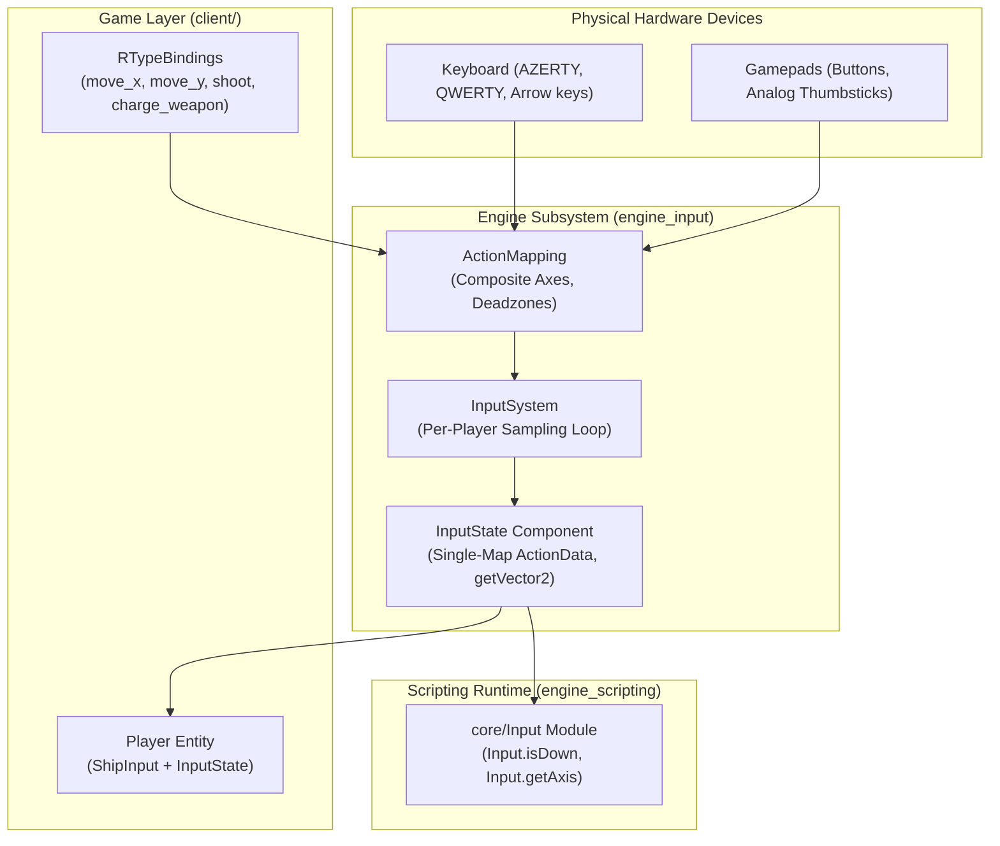

# Input System Architecture (Modular Input Architecture)

This document describes the design, implementation, and architectural decisions behind the engine's input subsystem and its integration with the R-Type client and the Wren scripting runtime.

---

## 1. Vision and Core Principles

The input subsystem is built around four fundamental architectural pillars:

1. **Game-Agnostic & Modular Engine**: The core engine (`engine_input`) possesses **no hardcoded actions** (such as `Shoot`, `MoveUp`, etc.) and **no predefined physical keybindings**. Semantic actions and hardware bindings belong exclusively to the game layer (`client/`).
2. **Performance and Zero Runtime Allocations**: Compile-time string hashing (`constexpr`), contiguous data layout, and a single contiguous action table per component.
3. **Pure ECS & Native Local Multiplayer**: Input state is not a restrictive global singleton, but an **ECS component** attached to controllable player entities (`playerIndex`).
4. **Ergonomic Scripting (Wren)** : Dynamic and expressive foreign API exposed to gameplay scripters without requiring C++ recompilation.



---

## 2. Decoupling Engine vs. Game Layer

### The Initial Problem

Initially, the engine declared a rigid `enum class Action { MoveUp, MoveDown, MoveLeft, MoveRight, Shoot, ChargeWeapon }` alongside a gameplay component `InputReceiver` carrying fields like `shooting`, `charging`, and `speed`.
This violated engine modularity:

- The engine could not be reused for other game genres (e.g., an RPG requiring `Interact` / `Inventory`, or a platformer requiring `Jump`).
- Hardcoded keyboard layouts (AZERTY / QWERTY) were baked into the engine constructor.

### The Decoupled Solution

- **The Engine** provides a generic dynamic toolkit: `ActionId`, `ActionMapping`, `InputState`, `InputSystem`.
- **The Client** defines its own semantic actions in [`client/src/input/RTypeBindings.cpp`](file:///home/tom-gatin/EPITECH/ING/Rtype/client/src/input/RTypeBindings.cpp):
  - `"move_x"` (1D composite axis: `KEY_A`/`KEY_D`, `KEY_LEFT`/`KEY_RIGHT`, left stick X).
  - `"move_y"` (1D composite axis: `KEY_W`/`KEY_S`, `KEY_UP`/`KEY_DOWN`, left stick Y).
  - `"shoot"` (Digital button: `KEY_SPACE`, `KEY_ENTER`, gamepad button A).
  - `"charge_weapon"` (Digital button: `KEY_LEFT_SHIFT`, right trigger).

---

## 3. Rationale for `ActionId` & 32-Bit FNV-1a Hashing

### Why Hash Strings Instead of Storing Raw `std::string`?

Using a 32-bit numeric identifier `ActionId` (`uint32_t`) derived from FNV-1a hashing provides major efficiency gains over storing raw strings:

| Criterion | Raw `std::string` | `ActionId` (32-Bit FNV-1a) | Concrete Benefit |
| :--- | :--- | :--- | :--- |
| **Compile-Time Cost** | None (computed at runtime). | `constexpr`: evaluated at compile time. | **0 CPU cycles at runtime** for string literals (`"shoot"` compiles directly to `0xBF98D248`). |
| **Key Comparison** | Multi-byte `memcmp` loop upon bucket collisions. | Single CPU instruction (`cmp eax, ebx`). | **1 clock cycle** lookup comparison. |
| **Memory Footprint** | 32 bytes (libstdc++ SSO) + heap allocation for strings > 15 chars. | 4 bytes (`uint32_t`). | **8× less memory**, completely eliminating heap allocations in hash map nodes. |
| **Network Serialization (UDP)** | 10–20 bytes per packet requiring string parsing. | 4 bytes in binary datagrams. | Drastically reduces multiplayer packet bandwidth and deserialization overhead. |

### The Mathematics of FNV-1a (*Fowler–Noll–Vo*)

Implemented in [`InputConstants.hpp`](file:///home/tom-gatin/EPITECH/ING/Rtype/engine/src/input/InputConstants.hpp) and [`ActionId.hpp`](file:///home/tom-gatin/EPITECH/ING/Rtype/engine/src/input/ActionId.hpp):

```cpp
inline constexpr uint32_t FNV1A_OFFSET_BASIS_32 = 2166136261U; // 0x811C9DC5
inline constexpr uint32_t FNV1A_PRIME_32 = 16777619U;        // 0x01000193

constexpr ActionId makeActionId(std::string_view name) noexcept {
    uint32_t hash = FNV1A_OFFSET_BASIS_32;
    for (const char c : name) {
        hash ^= static_cast<uint8_t>(c);
        hash *= FNV1A_PRIME_32;
    }
    return hash;
}
```

#### Why These Specific Constants?

1. **`2166136261U` (`0x811C9DC5`) — *Offset Basis***:
   Mathematically calculated initial seed chosen to disperse leading bits, guaranteeing that empty or short prefixes do not start with sequential zeros.
2. **`16777619U` (`0x01000193`) — *FNV Prime***:
   A 32-bit modified Mersenne prime engineered to produce optimal avalanche diffusion (every single input bit flips approximately 50% of the output bits). Modern compilers transform this multiplication into an ultra-fast sequence of bitwise shifts and additions (`(hash << 24) + (hash << 8) + ...`).

---

## 4. Data Layout: Single-Map `ActionData` & Cache Locality

### Problem with Previous Implementations

`InputState` previously maintained 4 isolated hash maps:

- `_held`: `unordered_map<ActionId, bool>`
- `_justPressed`: `unordered_map<ActionId, bool>`
- `_justReleased`: `unordered_map<ActionId, bool>`
- `_axes`: `unordered_map<ActionId, float>`

On every simulation frame and for each polled action:

- 4 separate hash computations were executed.
- 4 disjoint lookups (`find()`) triggered heap pointer-chasing and L1 cache misses.
- 4 heap-allocated node buckets per action.

### Solution: Consolidated `ActionData` Table

Implemented in [`InputState.hpp`](file:///home/tom-gatin/EPITECH/ING/Rtype/engine/src/input/InputState.hpp):

```cpp
struct ActionData {
    bool held = false;
    bool justPressed = false;
    bool justReleased = false;
    float axis = 0.0F;
};

struct InputState {
    int playerIndex = 0;
    std::unordered_map<ActionId, ActionData> actions;
    // ...
};
```

**Benefits:**

- **Single Lookup**: 1 lookup per action instead of 4.
- **Optimal Spatial Locality**: All state flags (`held`, `pressed`, `released`, `axis`) reside on **the exact same L1 cache line** (16-byte packed struct).
- **Zero Allocation Recycling**: `resetFrameTransitions()` clears flags in-place without deallocating or reallocating bucket memory.

---

## 5. ECS Component `InputState` & Local Multiplayer

### Pure ECS and Aggregate Initialization

To uphold Data-Oriented Design (DOD) principles and C++20 designated initializers:

- `InputState` is an **aggregate struct** (public member variables, no user-declared constructors).
- It can be initialized explicitly and safely:

  ```cpp
  registry.addComponent<input::InputState>(playerEntity, input::InputState{.playerIndex = 0, .actions = {}});
  ```

- It provides `const noexcept` inline query methods (`isDown`, `getAxis`, `getVector2`) for ergonomic consumption by gameplay systems.

### Local Multiplayer Support (Couch Co-op / Multiple Gamepads)

- Each `InputSystem` instance is configured with a logical `playerIndex` and hardware `gamepadIndex`:

  ```cpp
  InputSystem(mapping, playerIndex, gamepadIndex);
  ```

- During `InputSystem::update()`, the system iterates over entities owning an `InputState` component and updates only those where `state.playerIndex == _playerIndex`. If no entity has an `InputState` component for this player, no hardware polling or state mutation is performed.

---

## 6. Composite Axes and 2D Directional Normalization (`getVector2`)

### The Diagonal Speed Anomaly

When using a keyboard, orthogonal axes are polled independently. If a player moves diagonally (Up + Right):

- $X = 1.0\text{F}$
- $Y = 1.0\text{F}$
- Displacement vector magnitude: $\sqrt{1.0^2 + 1.0^2} = \sqrt{2} \approx 1.4142\text{F}$.
Without vector normalization, ships move **41.4% faster diagonally**, unbalancing gameplay.

### Solution: `InputState::getVector2`

```cpp
AxisVector2 InputState::getVector2(ActionId axisX, ActionId axisY, bool normalize) const noexcept {
    float x = getAxis(axisX);
    float y = getAxis(axisY);
    if (normalize) {
        const float lenSq = (x * x) + (y * y);
        if (lenSq > 1.0F) {
            const float invLen = 1.0F / std::sqrt(lenSq);
            x *= invLen;
            y *= invLen;
        }
    }
    return AxisVector2{.x = x, .y = y};
}
```

Consumed cleanly in [`client/src/main.cpp`](file:///home/tom-gatin/EPITECH/ING/Rtype/client/src/main.cpp):

```cpp
const auto move = inputState.getVector2("move_x", "move_y", true);
transform.x += move.x * ship.speed * deltaTime;
transform.y += move.y * ship.speed * deltaTime;
```

---

## 7. Wren Scripting Integration (`core/Input`)

The embedded `"core/Input"` Wren module natively supports explicit `playerIndex` queries while providing default wrappers for single-player ergonomics:

```wren
import "core/Input" for Input

class PlayerController {
    construct new(entity) {
        _entity = entity
    }

    update(dt) {
        // Player 0 query (default convenience wrapper)
        if (Input.isJustPressed("shoot")) {
            System.print("Player 0 fired weapon!")
        }

        // Explicit multiplayer query for Player 1
        var moveX = Input.getAxis(1, "move_x")
    }
}
```

The C++ glue in [`ScriptSystemBindings.cpp`](file:///home/tom-gatin/EPITECH/ING/Rtype/engine/src/systems/script/ScriptSystemBindings.cpp) locates the target entity's `input::InputState` component matching the requested `playerIndex`.

---

## 8. Keyboard Layout Detection & Unified Physical Mappings

### The Pitfall of Simultaneous Dual-Binding

Binding both QWERTY (`WASD`) and AZERTY (`ZQSD`) keys simultaneously to the same movement axes causes conflicting behavior:

- In GLFW (Raylib's desktop backend), key tokens represent **physical spatial scancodes on a standard keyboard**, not local character letters.
- On an AZERTY layout, the physical `W` key (bottom row) generates `KEY_Z`, while the physical `Z` key (top row) generates `KEY_W`.
- If both `KEY_W` and `KEY_Z` are bound to Move Up, pressing the physical key labeled `W` on AZERTY causes the ship to move forward!
- Similarly, the physical key labeled `A` on AZERTY generates `KEY_Q`. If `KEY_Q` is bound to Move Left, hitting `A` triggers unwanted horizontal displacement.

### Unified Spatial Key Bindings

Because `KEY_W`, `KEY_A`, `KEY_S`, `KEY_D` represent the physical inverted-T cluster in Raylib/GLFW:

- On an AZERTY keyboard, they correspond directly to the keys labeled **`Z`**, **`Q`**, **`S`**, **`D`**.
- On a QWERTY keyboard, they correspond directly to the keys labeled **`W`**, **`A`**, **`S`**, **`D`**.

By solely binding the spatial cluster keys in [`RTypeBindings.cpp`](file:///home/tom-gatin/EPITECH/ING/Rtype/client/src/input/RTypeBindings.cpp) and omitting `KEY_Z` and `KEY_Q`, both keyboard layouts are cleanly supported by a single, unified `setupDefaultBindings()` function without duplicate binding profiles or phantom inputs.

### Purpose of Engine `KeyboardLayout` Detection

The engine's layout detection utility ([`KeyboardLayout.hpp`](file:///home/tom-gatin/EPITECH/ING/Rtype/engine/src/input/KeyboardLayout.hpp)) is preserved as an informational service for **UI/HUD localization and tutorial prompts**:

- On AZERTY: On-screen tutorial hints display *"Press [Z] to move up"*.
- On QWERTY: On-screen tutorial hints display *"Press [W] to move up"*.

Detection order:

1. **Linux System Config**: Reads `/etc/default/keyboard` (`XKBLAYOUT`).
2. **Win32 Platform API**: Queries `GetKeyboardLayout(0)`.
3. **POSIX Locale Fallback**: Inspects environment variables (`LC_ALL`, `LANG`, etc.).
4. **Safe Default**: Defaults to `KeyboardLayout::Qwerty`.

---

## 9. Summary of Technical Trade-Offs

| Alternative Considered | Decision | Architectural Rationale |
| :--- | :---: | :--- |
| **Rigid `enum class Action`** | **Rejected** | Prevented runtime extensibility, required engine recompilation for new game actions, incompatible with dynamic Wren scripting. |
| **Raw `std::string` Map Keys** | **Rejected** | High memory footprint (32 bytes per key), slow string comparison loops on every frame, bloated UDP networking payloads. |
| **Simultaneous WASD + ZQSD Binding** | **Rejected** | Caused accidental vertical movement on AZERTY keyboards when hitting `W`, and blocked future key rebinding for special abilities. |
| **Global Singleton Resource** | **Rejected** | Made local multiplayer impossible (player 2 overwrote player 1 inputs). Replaced with entity-based `InputState` component. |
| **Immediate Input Buffering** | **Deferred** | Not consumed by current combat mechanics (no weapon cooldown lockouts or animation priority chains). Avoids dead code and premature optimization. |
