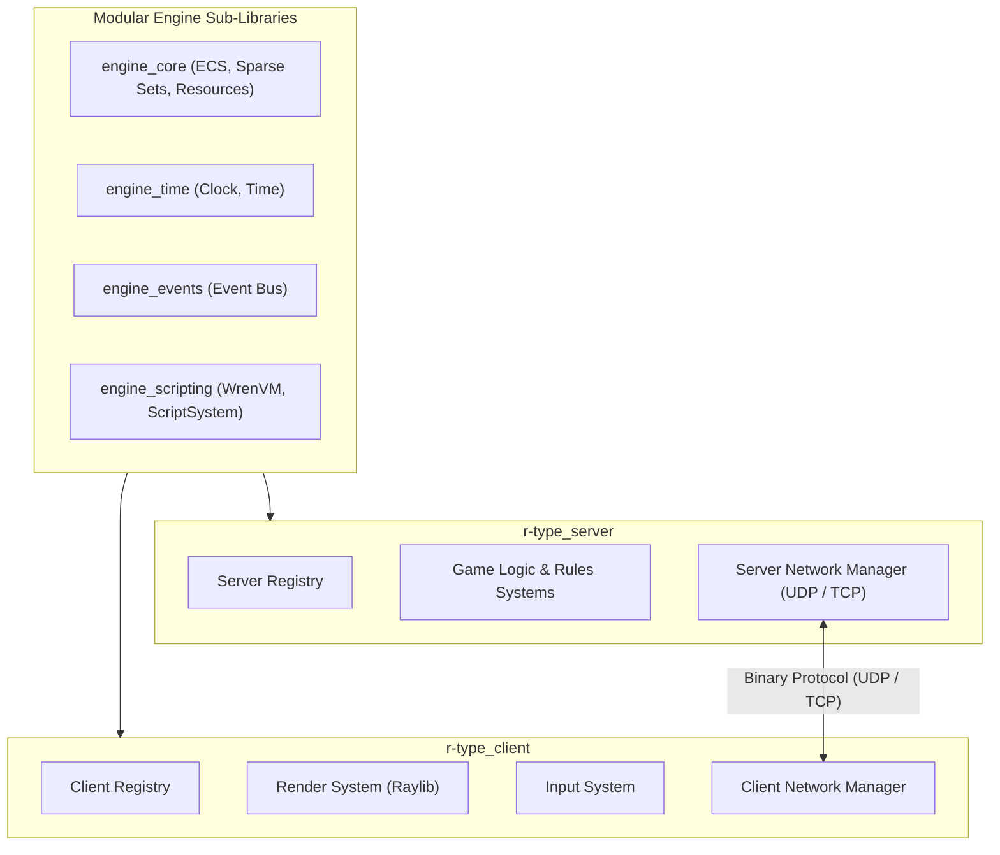
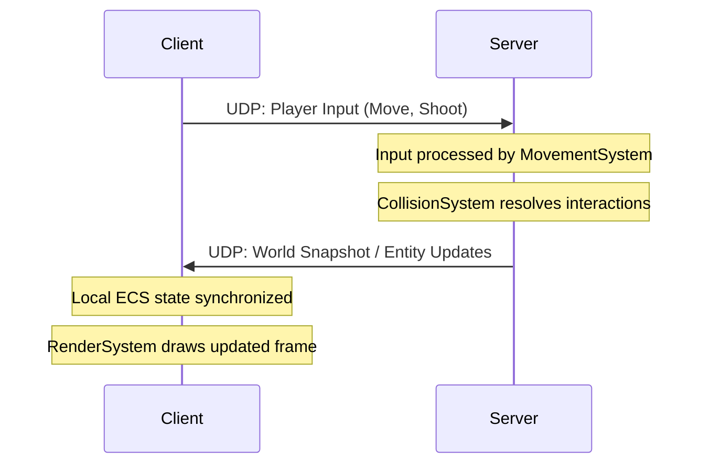

# Architecture Overview

## 1. High-Level Architecture

The project is structured into three primary tiers:

1. **Modular Engine:** An agnostic standalone set of link-time sub-libraries and plugins:
   - **`engine_core`**: Lightweight ECS Core (Registry, Sparse Arrays, Entity, CommandBuffer, Resources), central **`Engine`** coordinator, **`Mediator`** service registry, and **`PluginGraph`** dependency resolver.
   - **`engine_time`**: Fixed-timestep simulation clock (`Clock`), time data (`Time`), and monotonic time providers.
   - **`engine_events`**: Decoupled message passing interface (`EventBus`).
   - **`engine_scripting`**: Embedded Wren virtual machine, runtime scripting system (`ScriptSystem`), and `ScriptPlugin`.
   - **`engine_render` & `engine_input`**: Raylib-backed windowing, rendering, and spatial input sampling plugins (`RenderPlugin`, `InputPlugin`).
   - **`engine_physics`**: Box2D rigid body simulation plugin (`PhysicsPlugin`).
   - **`engine_prefabs`**: Named entity template registry plugin (`PrefabPlugin`).
   - **`engine_all`**: Meta/phony target building all engine sub-components together.
2. **Authoritative Server:** Hosts game simulation sessions, runs logical systems, enforces validation, and synchronizes states.
3. **Graphical Client:** Renders the world, handles local inputs, performs interpolation and client-side prediction, and queries user devices.

## 2. Client-Server Synchronization Model

The game follows an **Authoritative Server** architecture:

- **Client:** Captures player input and sends it across UDP datagrams. It renders local feedback and reconciles discrepancies when server updates arrive.
- **Server:** Runs at a fixed simulation tick rate, advances the game state, handles collision and damage calculations, and broadcasts compressed world updates.

