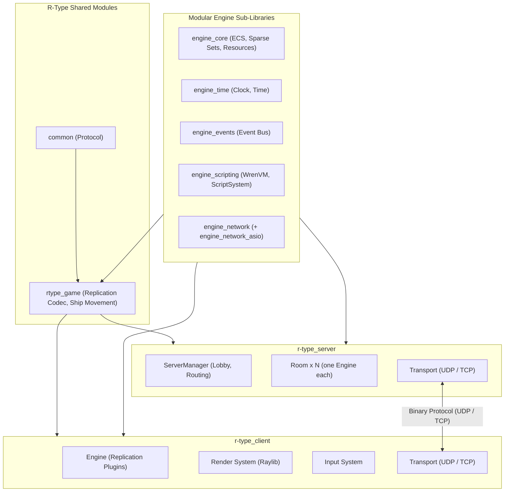
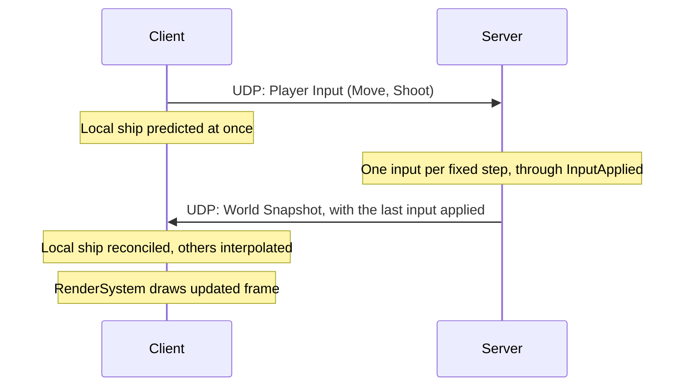

# Architecture Overview

## 1. High-Level Architecture

The project is structured into three primary tiers:

1. **Modular Engine:** An agnostic standalone set of link-time sub-libraries and plugins:
    - **`engine_core`**: Lightweight ECS Core (Registry, Sparse Arrays, Entity, CommandBuffer, Resources), central **
      `Engine`** coordinator, **`Mediator`** service registry, and **`PluginGraph`** dependency resolver.
    - **`engine_time`**: Fixed-timestep simulation clock (`Clock`), time data (`Time`), and monotonic time providers.
    - **`engine_events`**: Decoupled message passing interface (`EventBus`).
    - **`engine_scripting`**: Embedded Wren virtual machine, runtime scripting system (`ScriptSystem`), and
      `ScriptPlugin`.
    - **`engine_render` **: Raylib-backed windowing and rendering (`RenderPlugin`), which also translates engine input codes for its backend.
   - **`engine_input`**: Backend-agnostic input mapping (`InputPlugin`) sampling hardware through `IWindowService`.
    - **`engine_physics`**: Box2D rigid body simulation plugin (`PhysicsPlugin`).
    - **`engine_network`**: Transport interfaces (`INetworkServer`, `INetworkClient`), `NetworkConfig`, `NetworkPlugin` and
      the replication plugins (snapshots, input queue, prediction, interpolation), around a codec provided by the game.
      No Asio.
    - **`engine_network_asio`**: Asio implementation of the transport, created through `ecs::net::createServer()` /
      `createClient()`.
    - **`engine_prefabs`**: Named entity template registry plugin (`PrefabPlugin`).
    - **`engine_all`**: Meta/phony target building all engine sub-components together.
2. **Authoritative Server:** Hosts game simulation sessions, one `engine::Engine` per room, runs logical systems, enforces
   validation, and synchronizes states.
3. **Graphical Client:** Renders the world, handles local inputs, and queries user devices. Interpolation and client-side
   prediction come from the engine's replication plugins.

Between the engine and the executables, two R-Type modules are shared by the server and the client:

- **`common`**: the protocol alone (Protobuf schema and codec). It does not depend on the engine.
- **`rtype_game`**: what needs both the engine and the protocol: the replication codec, and the ship movement both sides must
  compute the same way.

## 2. Client-Server Synchronization Model

The game follows an **Authoritative Server** architecture:

- **Client:** Captures player input and sends it across UDP datagrams. It renders local feedback and reconciles
  discrepancies when server updates arrive.
- **Server:** Runs at a fixed simulation tick rate, advances the game state, handles collision and damage calculations,
  and sends each player a snapshot of its room.

