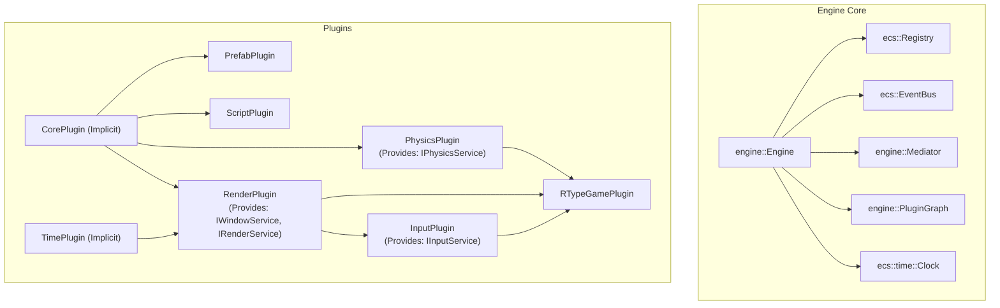

# Plugins, Dependencies & Mediator Architecture

## 1. Overview & Motivation

The R-Type engine is designed according to **Track #1 (Advanced Architecture)**: it must remain a generic, standalone, and decoupled game engine library that can power multiple distinct games.

To achieve true modularity, the engine introduces three interconnected architectural patterns:

1. **The Plugin System (`engine::IPlugin`)**: Replaces manual procedural wiring with an inversion-of-control lifecycle (`build`, `init`, `fixedUpdate`, `update`, `render`, `shutdown`).
2. **The Dependency Graph (`engine::PluginGraph`)**: Resolves compile-time and runtime inter-plugin requirements as a Directed Acyclic Graph (DAG) using **Kahn's topological sort algorithm**, providing early cycle and missing-dependency detection.
3. **The Mediator (`engine::Mediator`)**: A typed service registry where plugins register and query **abstract interfaces** (`IWindowService`, `IRenderService`, `IInputService`, `IPhysicsService`) rather than concrete subsystems, decoupling modules entirely.



---

## 2. Plugin Lifecycle (`IPlugin`)

Every engine subsystem and game module implements the `engine::IPlugin` interface:

```cpp
class IPlugin {
  public:
    virtual ~IPlugin() = default;
    [[nodiscard]] virtual std::string_view name() const noexcept = 0;

    virtual void build(PluginBuilder& builder) {}
    virtual void init(Engine& engine) {}
    virtual void fixedUpdate(Engine& engine, const ecs::time::Time& time) {}
    virtual void update(Engine& engine, const ecs::time::Time& time) {}
    virtual void render(Engine& engine) {}
    virtual void shutdown(Engine& engine) {}
};
```

### Lifecycle Stages & Order

1. **`build(PluginBuilder& builder)`**:
   - Declares mandatory dependencies (`builder.require<T>()`) and optional dependencies (`builder.optionally<T>()`).
   - Invoked during `engine.init()` before topological resolution.
2. **`init(Engine& engine)`**:
   - Executed in **topological order** (dependencies initialize before dependents).
   - Instantiates subsystem resources and registers abstract services into `engine.mediator()`.
3. **`fixedUpdate(Engine& engine, const Time& time)`**:
   - Executed in **topological order** inside constant `fixedDt` simulation steps.
   - Used for deterministic physics, movement, and network synchronization.
4. **`update(Engine& engine, const Time& time)`**:
   - Executed in **topological order** on every frame with variable delta time.
   - Used for input polling, state updates, animations, and gameplay triggers.
5. **`render(Engine& engine)`**:
   - Executed in **topological order** during the frame presentation phase.
   - Collects and draws entities through active cameras.
6. **`shutdown(Engine& engine)`**:
   - Executed in **reverse topological order** (dependents shut down before their dependencies).
   - Unregisters services and safely releases GPU / hardware resources.

---

## 3. Dependency Graph & Resolution (`PluginGraph`)

The `engine::PluginGraph` constructs a directed graph of all registered plugins and applies **Kahn's algorithm** for topological ordering:

1. **Required Dependencies (`builder.require<T>()`)**:
   - Must be present in the graph. If absent, `PluginDependencyException` is thrown immediately with the missing plugin name.
2. **Optional Dependencies (`builder.optionally<T>()`)**:
   - If present, topological ordering ensures the dependency executes before the consumer.
   - If absent, resolution proceeds normally without error.
3. **Cycle Detection**:
   - If a circular dependency exists ($A \rightarrow B \rightarrow A$ or $A \rightarrow B \rightarrow C \rightarrow A$), Kahn's algorithm fails to visit all nodes.
   - A `PluginDependencyException` is thrown detailing the exact list of plugins participating in the cycle.

---

## 4. The Mediator & Decoupled Services

The `engine::Mediator` acts as an in-process service locator allowing plugins to communicate through abstract interfaces rather than concrete types:

```cpp
// Consuming a service through the Mediator
auto& inputService = engine.service<engine::IInputService>();
auto& mapping = inputService.mapping();

// Safe optional query
auto windowService = engine.tryService<engine::IWindowService>();
if (windowService && !windowService->get().shouldClose()) {
    // Window is active
}
```

### Standard Abstract Interfaces

| Interface | Header | Purpose | Provided By |
| ----------- | -------- | --------- | ------------- |
| `IWindowService` | `core/services/IWindowService.hpp` | Window state, frame bracketing, close queries | `RenderPlugin` |
| `IRenderService` | `core/services/IRenderService.hpp` | 2D entity draw collection and presentation | `RenderPlugin` |
| `IInputService` | `core/services/IInputService.hpp` | Action mapping configuration and controller indices | `InputPlugin` |
| `IPhysicsService` | `core/services/IPhysicsService.hpp` | Physics simulation stepping and body stats | `PhysicsPlugin` |
| `PrefabManager` | `prefabs/PrefabManager.hpp` | Entity template registry and spawning factory | `PrefabPlugin` |

---

## 5. Implicit Foundation Plugins

To guarantee that the ECS Registry and simulation Clock are always available, `engine::Engine` automatically injects two foundational plugins during `engine.init()` if they are not explicitly registered:

1. **`engine::CorePlugin`**:
   - Root node in the dependency graph.
   - Coordinates registry lifecycle and base cleanup.
2. **`engine::TimePlugin`**:
   - Depends on `CorePlugin`.
   - Manages the `ecs::time::Time` resource in the ECS Registry across both `fixedUpdate` and `update` phases.

---

## 6. Tutorial: Creating a Custom Plugin

Creating a new engine or game plugin is straightforward:

```cpp
#include "core/IPlugin.hpp"
#include "core/Engine.hpp"
#include "core/services/IInputService.hpp"

class MyCustomPlugin final : public engine::IPlugin {
  public:
    [[nodiscard]] std::string_view name() const noexcept override {
        return "MyCustomPlugin";
    }

    void build(engine::PluginBuilder& builder) override {
        // Declare required dependencies
        builder.require<engine::CorePlugin>();
        builder.require<input::InputPlugin>();
    }

    void init(engine::Engine& engine) override {
        // Retrieve services exposed by dependencies
        auto& input = engine.service<engine::IInputService>();
        // Initialize custom entities or resources
    }

    void fixedUpdate(engine::Engine& engine, const ecs::time::Time& time) override {
        // Physics or simulation logic
    }

    void update(engine::Engine& engine, const ecs::time::Time& time) override {
        // Frame logic
    }

    void shutdown(engine::Engine& engine) override {
        // Cleanup resources
    }
};
```

### Registering and Running

```cpp
#include "core/Engine.hpp"
#include "render/RenderPlugin.hpp"
#include "input/InputPlugin.hpp"
#include "MyCustomPlugin.hpp"

int main() {
    engine::Engine engine;
    engine.addPlugin<render::RenderPlugin>()
          .addPlugin<input::InputPlugin>()
          .addPlugin<MyCustomPlugin>();

    engine.run();
    return 0;
}
```
