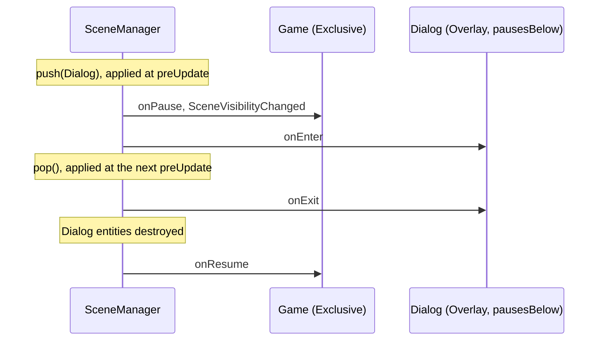

# Scenes

The `engine_scene` module splits a game into **scenes**: a title screen, a lobby, a level, a pause overlay. A scene
owns everything it creates (entities, event subscriptions, systems) and releases all of it when it leaves the stack,
so switching from the menu to a level and back never leaks an entity or a listener.

It is generic and headless: it depends only on `engine_core` and `engine_events`, never on rendering, networking or
scripting, so a server can use it too.

## Concepts

| Type                | Header                    | Role                                                                     |
|---------------------|---------------------------|--------------------------------------------------------------------------|
| `IScene`            | `scene/IScene.hpp`        | A scene: optional hooks `onEnter`, `onExit`, `onPause`, `onResume`.      |
| `SceneContext`      | `scene/SceneContext.hpp`  | What the scene uses to create what it owns.                              |
| `SceneManager`      | `scene/SceneManager.hpp`  | Registered scenes, the stack and the queued transitions.                 |
| `ScenePlugin`       | `scene/ScenePlugin.hpp`   | Applies transitions and runs scene systems from the engine loop.         |
| `SceneMember`       | `scene/SceneTypes.hpp`    | Component marking an entity as owned by a scene.                         |
| Events              | `scene/SceneEvents.hpp`   | `SceneEntered`, `SceneExited`, `ScenePaused`, `SceneResumed`, `SceneVisibilityChanged`. |

The engine keeps **one registry**. A scene does not own a world of its own: its entities carry a 2-byte
`SceneMember{id}` component. Entities without it (a camera, an input state, replicated entities managed by the network
module) outlive scene changes.

## Writing a scene

```cpp
#include "scene/IScene.hpp"
#include "scene/SceneContext.hpp"

class TitleScene final : public scene::IScene {
  public:
    [[nodiscard]] std::string_view name() const noexcept override { return "Title"; }

    void onEnter(scene::SceneContext& context) override {
        const ecs::Entity logo = context.spawn();  // destroyed when the scene exits
        context.registry().addComponent(logo, ui::UiText{.text = "MY GAME"});

        context.subscribe<ui::UiButtonClickedEvent>([&context](const ui::UiButtonClickedEvent& click) {
            if (click.action == "play") {
                context.manager().switchTo<GameScene>();
            }
        });

        context.addSystem(scene::SceneStage::Update, [](engine::Engine& engine, const ecs::time::Time& time) {
            // runs every frame while the title runs
        });
    }
};
```

| `SceneContext` call               | Released on exit by                                                        |
|-----------------------------------|-----------------------------------------------------------------------------|
| `spawn()`                         | destroying every entity whose `SceneMember` names the scene               |
| `adopt(entity)`                   | same: the entity gets the scene's `SceneMember`                            |
| `subscribe<E>(callback)`          | cancelling the subscription (stored as a token and a typed function pointer) |
| `addSystem(stage, system)`        | dropping the system                                                        |

Children of an owned entity (`hierarchy::setParent`) are destroyed with it when `HierarchyPlugin` is loaded, so a
UI panel spawned with `spawn()` takes its widgets with it. `ScenePlugin` shuts down before `HierarchyPlugin`, in
whatever order they were added, so this also holds when the program closes.

What a destroy listener adds to the exiting scene while its entities go (an entity, a subscription, a system) is
released as well.

Errors in the hooks never leave a half-entered or half-exited scene:

- If `onEnter` throws, the scene is rolled back: its entities, subscriptions and systems go, it leaves the stack, and
  the scenes below run and show again. It gets no `onExit` and no `SceneExited`.
- If `onExit` or a destroy listener throws, the scene still leaves the stack completely.

In both cases the first error is then rethrown.

Subscriptions also deliver events while the scene is paused; check `context.isRunning()` in the callback when that
matters. Systems only run while the scene runs.

## Registering and switching

```cpp
engine.addPlugin<scene::ScenePlugin>();
scene::SceneManager& scenes = engine.getPlugin<scene::ScenePlugin>().manager();
scenes.registerScene<TitleScene>();
scenes.registerScene<GameScene>(levelConfig);  // constructor arguments
scenes.switchTo<TitleScene>();                 // applied on the first frame
engine.run();
```

Anywhere else, the manager is a Mediator service: `engine.service<scene::SceneManager>()`.

A scene is registered once under a unique name and keeps its state between visits. `get<T>()` and `idOf<T>()`
find a scene by type when it is the only one of its type (they throw otherwise; use `find(name)`).
`registerScene` returns a dense `SceneId`; `find(name)` and `idOf<T>()` look it up.

| Call            | Effect                                                    |
|-----------------|-----------------------------------------------------------|
| `switchTo(id)`  | Exits every scene of the stack, top first, then enters `id`. |
| `push(id)`      | Enters `id` on top of the stack.                          |
| `pop()`         | Exits the top scene (nothing on an empty stack).          |
| `replace(id)`   | Exits the top scene, then enters `id` in its place.       |

!!! note "Transitions are deferred"
    These calls only queue the change. `ScenePlugin::preUpdate` applies the queue at the start of the next frame,
    so no entity disappears in the middle of a system and every stage of a frame sees the same stack.
    A transition queued by a hook (`onEnter` pushing an overlay, for instance) is applied in the same frame.
    More than `SceneManager::MAX_TRANSITIONS_PER_FRAME` (64) transitions in one frame throws `std::logic_error`:
    scenes are switching each other forever. Pushing a scene already on the stack also throws.
    From a scene system, `applyTransitions()` does nothing (the queue waits for the next frame) and `clear()` throws,
    since both would destroy the system while it runs. `clear()` also drops what the exit hooks queue.

## Stack, modes and pausing

The top scene always runs and is visible. Below it, each scene's `mode()` decides:

| Scene above                      | Scenes below are       |
|----------------------------------|------------------------|
| `SceneMode::Exclusive` (default) | hidden and paused      |
| `SceneMode::Overlay`             | visible and running    |
| `Overlay` with `pausesBelow()`   | visible but paused     |

A local pause menu in a networked game is an `Overlay` that does not pause below: the game keeps simulating and
replicating behind it. A blocking dialog is an `Overlay` that pauses below.

Hook order on a push: the scenes below get `onPause` (and `SceneVisibilityChanged`) **before** the new scene's
`onEnter`. On a pop, the exiting scene gets `onExit`, its entities are destroyed, then the scenes below get `onResume`.
`switchTo` exits the whole stack without resuming anyone.



Entities of a hidden scene carry `ecs::Hidden` with the `Scene` reason, so the UI and the world renderer skip them
without knowing about scenes. An entity spawned while its scene is hidden starts hidden. Hiding done by the game
itself (`HiddenReason::Manual`) is kept when the scene shows again. See [User Interface](ui.md#hiding).

Plugins that are not scenes can gate themselves on the stack: `isActive(id)` (on the stack), `isRunning(id)`,
`isVisible(id)` and `top()` are flag lookups, cheap enough for every frame. They can also listen to the scene events.

## Scenes in Wren

The `engine_scene_scripting` module bridges scenes and Wren. It is the only module that depends on both
`engine_scene` and `engine_scripting`, so a game without scripting does not link it.

```cpp
engine.addPlugin<scene::ScenePlugin>();
engine.addPlugin<scripting::ScriptPlugin>();
engine.addPlugin<scene::SceneScriptingPlugin>();

auto& bridge = engine.getPlugin<scene::SceneScriptingPlugin>();
bridge.registerScriptScene(engine, "LevelIntro", "scripts/scenes/LevelIntro", "LevelIntro",
                           scene::ScriptSceneOptions{.mode = scene::SceneMode::Overlay, .hasUpdate = true});
```

### The `core/Scene` module

```wren
import "core/Scene" for Scene

Scene.switchTo("Game")       // push(name), replace(name), pop(): deferred to the next frame, like in C++
Scene.current                // name of the top scene, or null
Scene.isActive("Pause")      // on the stack
Scene.isRunning("Game")      // on the stack and not paused
```

An unknown name aborts the calling fiber with an error. Names are only resolved on these calls, never per frame.

### Scripted scenes

A scripted scene is a Wren class with `construct new()` and optional hooks:

```wren
import "core/Engine" for Engine
import "core/Scene" for Scene

class LevelIntro {
    construct new() {}

    onEnter() {
        Engine.spawnPrefab("level_banner", 640, 360)   // owned by this scene
        Engine.wait(2)                                 // hooks run in a fiber
        Scene.pop()
    }
    onExit() {}
    onPause() {}
    onResume() {}
    update(dt) {}          // only called if ScriptSceneOptions::hasUpdate
    fixedUpdate(dt) {}     // only called if ScriptSceneOptions::hasFixedUpdate
}
```

- The enter, exit, pause and resume hooks run in a fiber, so they may call `Engine.wait`. A missing hook is not an
  error.
- `update(dt)` and `fixedUpdate(dt)` are called through cached handles, with no fiber and no lookup per frame. They
  only run while the scene runs.
- When the scene exits, the fibers it put to sleep are cancelled, so a pending `Engine.wait` never resumes into a
  scene that is gone.
- A hot reload rebuilds the instance in the new VM without calling `onEnter` again. `core/Scene` and its bindings
  are kept.

### Who owns what scripts spawn

Entities spawned from Wren with `Engine.spawnPrefab` get a `SceneMember`, decided in this order:

1. If the code that spawned it belongs to a **scripted scene** (its hooks, its update, a fiber it put to sleep), the
   entity goes to that scene.
2. If it belongs to a **scripted entity** that has a `SceneMember` (its `onSpawn`, `update`, `onCollision`,
   `onDestroy`, a fiber it put to sleep), the entity goes to the same scene.
3. Otherwise it goes to the **top exclusive scene**, `SceneManager::spawnTarget()`. With an empty stack, it gets no
   owner.

An entity whose owner scene exited before the spawn was flushed is destroyed right away.

This relies on two generic hooks of `systems::ScriptSystem`, usable by other extensions:
- the **script owner** (`currentOwner`, `setCurrentOwner`, `cancelFibers`), recorded by sleeping fibers and spawns;
- the **spawn decorator** (`setSpawnDecorator`).

Two more hooks support the bridge:
- `addModuleSource` provides built-in modules such as `core/Scene`;
- `addVmResetListener` notifies hot reloads, so handles can be released and rebuilt.

## Frame timeline

```text
preUpdate     ScenePlugin applies queued transitions (hooks, entity cleanup, events)
fixedUpdate   systems added with SceneStage::FixedUpdate, of running scenes, bottom first
update        SceneStage::Update systems
lateUpdate    SceneStage::LateUpdate systems
shutdown      every scene exits, top first
```

A system added while systems run (from a system, or from an event published by one) starts at the next run of its
stage, so a system list never changes under its own loop.

## Performance

- **No allocation per frame.** Systems are stored once per scene; the subscription list, the system lists, the
  transition queue and the scratch buffer used to collect a scene's entities keep their capacity between visits.
- **Unloading a scene** is one pass over the dense `SceneMember` array, then one `Registry::killEntities` call. The
  batch runs the same destroy listeners as `killEntity` (scripts, hierarchy, network map) but does the listener
  bookkeeping once for the whole batch.
- **Queries** are flag lookups by dense id; names are only resolved by `find`, never per frame.
