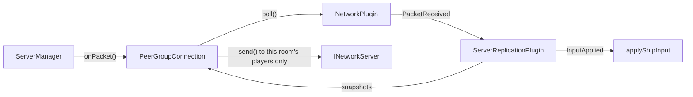

# Server Architecture

`r-type_server` is the authoritative side of the game: it runs the simulation and clients only send it inputs. It is
headless and does not link raylib.

## Threads

| Thread       | Runs                                       | Touches                                    |
|--------------|--------------------------------------------|--------------------------------------------|
| Network      | The Asio transport (`engine_network_asio`) | Sockets; receiving never waits on the game |
| Server       | `ServerManager::run()` and the `Lobby`     | The clients, the rooms and their players   |
| One per room | `Room::advance()`, once the game started   | The engine of this room, under its mutex   |

They only talk through the transport's event queue (`poll()`) and `asio::post` (`send()`), and a room receives its
packets
through the thread-safe `PeerGroupConnection`. A slow or crashed client therefore never blocks a game, and a room with
many
entities does not slow down the others. The mutex of a room is only contended when a player leaves it: the server thread
then waits for the step in progress. An exception in a simulation stops that room only.
See [Network Architecture](network.md#6-threading-model).

The server thread and the room threads sleep 1 ms between two passes. `main()` holds an `ecs::time::PreciseSleepScope`
for the whole run so that this stays true on Windows, where a sleep lasts about 15.6 ms by default. See
[Engine Clock — Sleeping between two passes](clock.md#sleeping-between-two-passes).

## `ServerManager`

Owns the transport and the `Lobby`, and holds no game logic. Each loop iteration, about every millisecond:

1. **`poll()` the network once** and route the events. This is the only place that reads it: a room polling the shared
   queue would steal the events of the others.
2. Kick the clients that sent no `Hello` within 5 seconds.

Reliable payloads are decoded here: the handshake is handled here too, and the rest goes to the `Lobby`. Unreliable
payloads are forwarded to the client's room without being decoded: only the replication codec reads them.

A client of another protocol version is refused with `INetworkServer::refuse()`, so that it can tell its player why.

### Lobby

`Lobby` (`server/src/Lobby.cpp`) owns the rooms and the clients past their `Hello`, and only runs on the server thread.
A room holds at most `MAX_PLAYERS_PER_ROOM` players: 2 for now, while the protocol allows up to 4.

| Message            | Effect                                                                                   |
|--------------------|------------------------------------------------------------------------------------------|
| `LobbyListRequest` | Answers with `LobbyList`                                                                 |
| `LobbyCreate`      | Creates a room with the client in it, sends `LobbyUpdate`                                |
| `LobbyJoin`        | Adds the client if the room is open, sends `LobbyUpdate` to the room                     |
| `LobbyReady`       | Updates the room; when everyone is ready, starts it and sends `GameStart` to each player |
| `Leave`            | Removes the client from its room, waiting or in game; it stays connected, back in the lobby (a disconnection does the same) |

- A departure sends `PlayerLeft` to the others. In a lobby it can also start the room, if the player who left was the
  last one not ready.
- An empty room is destroyed.
- Each change of the list is pushed as `LobbyList` to the clients not in a game.
- A message in the wrong phase is dropped, as the [RFC](../protocol/packets.md#8-validation) requires.
- Rooms are referred to by `RoomId`, never by pointer: an event for a room that no longer exists is ignored.
- `GameStart` is sent before the room starts, because starting it sends the `LevelStart` of the first level.
- `Lobby::update()`, called at every iteration of the server loop, destroys the rooms whose game is over
  (`Room::hasEnded()`). Their players are back in the lobby and get the list of rooms.
- When the server stops, the players in game receive `GameOver{SERVER_SHUTDOWN}` before the rooms are destroyed.

## `Room`

One game: one `engine::Engine`, so one registry, event bus, clock and set of plugins. Games are isolated from each
other.

- **Payloads are dropped until the game starts:** nothing would consume them, and a client must not be able to fill the
  queue.
- **`start()` gives each player its index**, its position in join order, so the indices have no holes whoever left the
  lobby. `GameStart` requires `player_index < player_count`. It also resets the clock: game time starts at 0, however
  long the room waited.
- **`runInBackground()` gives a started room its thread**, which stops when the room is destroyed.
- **`advance()` does nothing while the room waits.** After several catch-up steps, a single snapshot is sent, since it
  carries the latest state.

## Collisions

The server classifies physics contacts with `rtype::server::collision::CollisionRouter` (`server/src/collision/`, target `rtype_collision`). It subscribes to the engine `events::CollisionBeginEvent` and uses the categories from `prefabs/CollisionCategories.hpp` to republish each contact as an R-Type event:

| Event | Pair |
| ------- | ------ |
| `ShotHitEvent` | Player shot ↔ enemy / obstacle (`byPlayer = true`), enemy shot ↔ player / obstacle (`byPlayer = false`) |
| `ShipContactEvent` | Player ship ↔ enemy / obstacle |
| `PowerUpTouchedEvent` | Player ship ↔ power-up |

The router does not change any state: game rules (damage, kills, pickups) subscribe to these events. `gameplay::CombatPlugin` owns the router of each room.

## Gameplay

Each room's engine runs `systems::PhysicsPlugin`, `hierarchy::HierarchyPlugin`, `timeline::TimelinePlugin`, the gameplay plugins
(`server/src/gameplay/`, target `rtype_gameplay`), `prefabs::PrefabPlugin` and `scripting::ScriptPlugin`. Every entity
they spawn is replicated: the client only draws what the server simulates.

`gameplay::addGameplayPlugins()` adds the gameplay plugins. Each has one job, and they never call each other: they
talk through the events of `gameplay/GameplayEvents.hpp`.

| Plugin | Job | Publishes | Listens to |
|--------|-----|-----------|------------|
| `LevelDirectorPlugin` | Plays the level, spawns the enemies, holds the scroll | `LevelEventPlayed`, `LevelStarted`, `LevelFinished`, `protocol::LevelStart` | `TimelineEventFired`, `BossFightStarted`/`Ended`, `ShipRespawnStarted`, `AllRespawnsOver` |
| `CombatPlugin` | Shots, hits, kills, scores, power-ups | `ShipDestroyed`, `protocol::LevelComplete`, `protocol::GameOver` | inputs, collision events, `LevelFinished` |
| `BossFightPlugin` | Spawns the bosses, follows the fight | `BossFightStarted`, `BossFightEnded` | `LevelEventPlayed` (`boss`) |
| `RespawnPlugin` | Brings destroyed ships back | `ShipRespawnStarted`, `AllRespawnsOver` | `ShipDestroyed` |
| `TerrainPlugin` | Builds and scrolls the terrain | | `LevelEventPlayed` (`terrain`), `LevelStarted` |
| `CleanupPlugin` | Destroys what left the screen | | |
| `EnemyFirePlugin` | Fires the guns of the enemies (`prefabs::EnemyGun`) at the nearest ships | | |
| `EnemyMotionPlugin` | Moves the enemies that weave (`prefabs::SineWave`) | | |

- **Levels:** the server loads the campaign (`server/levels/level_*.toml`, by name) at start-up and every room plays it.
  `TimelinePlugin` moves
  a cursor at the scroll speed; `LevelDirectorPlugin` handles the events it reaches: `spawn` creates the enemies, `scroll`
  changes the speed, `end` wins the game (see [Game flow](#game-flow)). A `boss` event stops the scroll until its
  `boss_core` is destroyed, and `[[terrain]]` sections scroll as 256 px blocks that destroy the ships touching them. See
  [Level Files](../gameplay/levels.md).
- **Respawn:** a destroyed ship comes back at its start position (`gameplay::shipSpawnPoint()`) and blinks for
  `RESPAWN_DURATION` (3 s) with the `invulnerable` flag: it cannot be hit, and the scroll, the terrain and the next
  waves wait. Boss fights and respawns share one scroll hold: the scroll resumes once all of them are over. There are
  no lives or game over yet.
- **Scripts:** each room has its own Wren VM. What a script spawns with `Engine.spawnPrefab(name, x, y)` goes through
  `gameplay::registerScriptPrefabs()`, so it is replicated too (kind `makeEntityKind(name)`). Player ships and bullets
  cannot be spawned by a script, nor a `boss_core`: a boss fight only starts from a level `boss` event.
- **Shots:** while a player's input holds `shoot`, its ship fires a `player_bullet` every 0.2 s at most (0.08 s for
  5 s after picking up a `power_up`). The bullet's `subtype` is the index of the player who fired it.
- **Ship hits:** room ships carry the `player_ship` collider. An enemy shot (`missile`), an enemy or an obstacle touching
  a ship destroys it, and it respawns; a ship that is respawning cannot be hit, and enemy shots fly through it.
- **Kills and scores:** a `ShotHitEvent` of a player shot on an enemy destroys both and gives 1 point to the shooter.
  Each player has their own score. An enemy with hit points (a boss, a turret) loses one per shot and dies at 0.
- **Boss parts:** a boss may have parts, children of it in the entity hierarchy (the room runs
  `hierarchy::HierarchyPlugin`). A shot on a weak point hurts the boss; armor, and the body of a boss that has a weak
  point, stop the shot. See [Boss Part](../prefabs/boss-part.md).
- **Cleanup:** player bullets more than 64 px past the right edge, and enemies, enemy shots and power-ups more than
  64 px past the left one, are destroyed.
- **Score log:** every 5 s of game time, the server logs `[server] scores: P1=<n> P2=<n>`. The clients get the scores
  at the end of the game.

### Game flow

`Room::start()` calls `LevelDirectorPlugin::startGame()`; the game is the campaign the server loaded, its levels chained
by `level::Level::next`:

1. **Start.** A `protocol::LevelStart` (index and count of the level, its name) is published on the room's bus, and the
   room sends it to its players.
2. **End of a level.** When the level reaches its `end` event, the scroll stops and `LevelDirectorPlugin` publishes
   `LevelFinished`. `CombatPlugin`, which keeps the scores, publishes a `protocol::LevelComplete` with them.
3. **Next level.** After `INTERMISSION_DURATION` (3 s), every replicated entity but the ships is destroyed and the next
   level starts, back to step 1.
4. **Victory.** After the last level, `CombatPlugin` also publishes `protocol::GameOver{VICTORY}`. The room forwards it,
   marks itself ended, and the lobby destroys it.

Before `startGame()` (in the tests), the `end` event restarts the level instead. There are no lives yet, so the game
never ends in `ALL_DEAD`.

The gameplay never touches the network: it only publishes protocol structs, and the room broadcasts them.

## What is not simulated yet

Enemy shots, ship damage and power-ups are still to do (so `ALL_DEAD` cannot happen yet), as well as `Chat`, which the server drops. A snapshot is the complete state of the room, split into as many datagrams as needed: 36 entities per
datagram, and at most 64 of them, about 2300 entities. Past that it is not sent (an error is logged).
