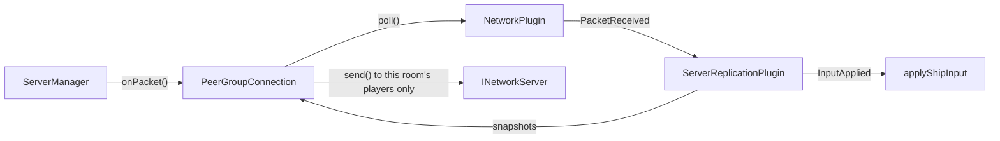

# Server Architecture

`r-type_server` is the authoritative side of the game: it runs the simulation and clients only send it inputs. It is
headless and does not link raylib.

## Threads

| Thread  | Runs                                        | Touches                               |
|---------|---------------------------------------------|---------------------------------------|
| Network | The Asio transport (`engine_network_asio`)  | Sockets; receiving never waits on the game |
| Game    | `ServerManager::run()`: lobby and all rooms | Game state; no lock in game code      |

They only talk through the transport's event queue (`poll()`) and `asio::post` (`send()`). A slow or crashed client
therefore never blocks the game thread. See [Network Architecture](network.md#6-threading-model).

## `ServerManager`

Owns the transport and the rooms, and holds no game logic. Each loop iteration, about every millisecond:

1. **`poll()` the network once** and route the events. This is the only place that reads it: a room polling the shared
   queue would steal the events of the others.
2. Kick the clients that sent no `Hello` within 5 seconds.
3. **`advance()` every room.**

Reliable payloads are decoded here (handshake, lobby). Unreliable payloads are forwarded to the client's room without
being decoded: only the replication codec reads them.

### Lobby

| Message            | Effect                                                                                 |
|--------------------|----------------------------------------------------------------------------------------|
| `LobbyListRequest` | Answers with `LobbyList`                                                               |
| `LobbyCreate`      | Creates a room with the client in it, sends `LobbyUpdate`                              |
| `LobbyJoin`        | Adds the client if the room is open, sends `LobbyUpdate` to the room                   |
| `LobbyReady`       | Updates the room; when everyone is ready, starts it and sends `GameStart` to each player |
| `Leave`            | Removes the client from its room (a disconnection does the same)                       |

- A departure sends `PlayerLeft` to the others. In a lobby it can also start the room, if the player who left was the
  last one not ready.
- An empty room is destroyed.
- Each change of the list is pushed as `LobbyList` to the clients not in a game.
- A message in the wrong phase is dropped, as the [RFC](../protocol/packets.md#8-validation) requires.
- Rooms are referred to by `RoomId`, never by pointer: an event for a room that no longer exists is ignored.

## `Room`

One game: one `engine::Engine`, so one registry, event bus, clock and set of plugins. Games are isolated from each other.

- **Payloads are dropped until the game starts:** nothing would consume them, and a client must not be able to fill the
  queue.
- **`start()` gives each player its index**, its position in join order, so the indices have no holes whoever left the
  lobby. `GameStart` requires `player_index < player_count`. It also resets the clock: game time starts at 0, however
  long the room waited.
- **`advance()` does nothing while the room waits.** After several catch-up steps, a single snapshot is sent, since it
  carries the latest state.

## What is not simulated yet

Only ship movement runs on the server. Shots, enemies, collisions and `GameOver` are still to do, as well as `Chat`, which
the server drops. A snapshot is the complete state of the room: past about 45 entities it no longer fits in a datagram and
is not sent (an error is logged), so more entities will need delta or partial snapshots.
