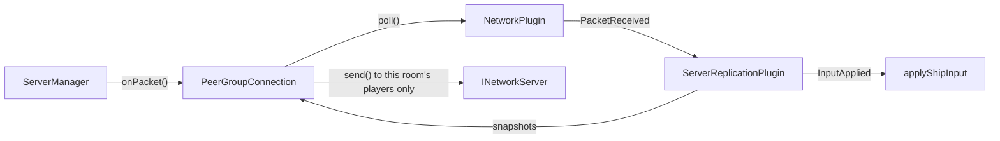

# Server Architecture

`r-type_server` is the authoritative side of the game: it runs the simulation and clients only send it inputs. It is
headless and does not link raylib.

## Threads

| Thread       | Runs                                       | Touches                                    |
|--------------|--------------------------------------------|--------------------------------------------|
| Network      | The Asio transport (`engine_network_asio`) | Sockets; receiving never waits on the game |
| Server       | `ServerManager::run()` and the `Lobby`     | The clients, the rooms and their players   |
| One per room | `Room::advance()`, once the game started   | The engine of this room, under its mutex   |

They only talk through the transport's event queue (`poll()`) and `asio::post` (`send()`), and a room receives its
packets
through the thread-safe `PeerGroupConnection`. A slow or crashed client therefore never blocks a game, and a room with
many
entities does not slow down the others. The mutex of a room is only contended when a player leaves it: the server thread
then waits for the step in progress. An exception in a simulation stops that room only.
See [Network Architecture](network.md#6-threading-model).

## `ServerManager`

Owns the transport and the `Lobby`, and holds no game logic. Each loop iteration, about every millisecond:

1. **`poll()` the network once** and route the events. This is the only place that reads it: a room polling the shared
   queue would steal the events of the others.
2. Kick the clients that sent no `Hello` within 5 seconds.

Reliable payloads are decoded here: the handshake is handled here too, and the rest goes to the `Lobby`. Unreliable
payloads are forwarded to the client's room without being decoded: only the replication codec reads them.

A client of another protocol version is refused with `INetworkServer::refuse()`, so that it can tell its player why.

### Lobby

`Lobby` (`server/src/Lobby.cpp`) owns the rooms and the clients past their `Hello`, and only runs on the server thread.

| Message            | Effect                                                                                   |
|--------------------|------------------------------------------------------------------------------------------|
| `LobbyListRequest` | Answers with `LobbyList`                                                                 |
| `LobbyCreate`      | Creates a room with the client in it, sends `LobbyUpdate`                                |
| `LobbyJoin`        | Adds the client if the room is open, sends `LobbyUpdate` to the room                     |
| `LobbyReady`       | Updates the room; when everyone is ready, starts it and sends `GameStart` to each player |
| `Leave`            | Removes the client from its room (a disconnection does the same)                         |

- A departure sends `PlayerLeft` to the others. In a lobby it can also start the room, if the player who left was the
  last one not ready.
- An empty room is destroyed.
- Each change of the list is pushed as `LobbyList` to the clients not in a game.
- A message in the wrong phase is dropped, as the [RFC](../protocol/packets.md#8-validation) requires.
- Rooms are referred to by `RoomId`, never by pointer: an event for a room that no longer exists is ignored.

## `Room`

One game: one `engine::Engine`, so one registry, event bus, clock and set of plugins. Games are isolated from each
other.

- **Payloads are dropped until the game starts:** nothing would consume them, and a client must not be able to fill the
  queue.
- **`start()` gives each player its index**, its position in join order, so the indices have no holes whoever left the
  lobby. `GameStart` requires `player_index < player_count`. It also resets the clock: game time starts at 0, however
  long the room waited.
- **`runInBackground()` gives a started room its thread**, which stops when the room is destroyed.
- **`advance()` does nothing while the room waits.** After several catch-up steps, a single snapshot is sent, since it
  carries the latest state.
- **`ShootingPlugin` decides the shots.** While `shoot` is held in an applied input, a ship shoots at most once per
  `SHOT_INTERVAL`, whatever the client sends. Bullets are moved by `PhysicsPlugin`, replicated with the kind
  `player_bullet` and the shooter's index as `subtype`, and removed once off screen.

## What is not simulated yet

Ship movement and shots run on the server. Bullets do not hit anything yet: enemies, collisions and `GameOver` are still
to
do, as well as `Chat`, which the server drops. A snapshot is the complete state of the room, split into as many
datagrams as needed: 36 entities per
datagram, and at most 64 of them, about 2300 entities. Past that it is not sent (an error is logged).
