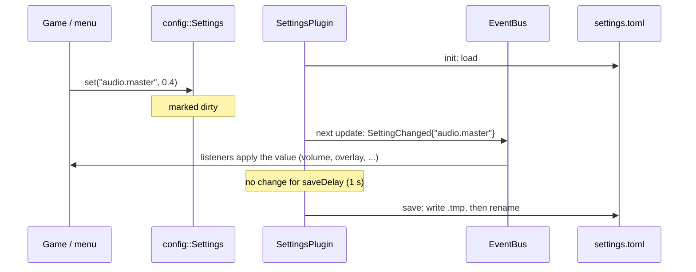

# User Settings

User settings (volumes, last server address, player name, debug overlays) are typed values with defaults, saved to a
TOML file in the user's configuration directory. They are split across two modules:

| Module            | Contents                                                                  | Depends on                 |
|-------------------|---------------------------------------------------------------------------|----------------------------|
| `engine_config`   | `ConfigFile` (read **and write**), `Settings`, `userConfigDirectory`      | toml++ only                |
| `engine_settings` | `SettingsPlugin`, `SettingChanged` event                                  | core, events, config       |

## Declaring and using settings

```cpp
#include "config/Settings.hpp"
#include "settings/SettingsPlugin.hpp"

engine.addPlugin<settings::SettingsPlugin>(config::userConfigDirectory("rtype") / "settings.toml");
config::Settings& prefs = engine.getPlugin<settings::SettingsPlugin>().settings();
prefs.define("audio.master", 1.0);           // the default fixes the type
prefs.define("debug.metrics", false);
prefs.define("net.last_host", std::string("127.0.0.1"));

// later, anywhere: engine.service<config::Settings>()
prefs.set("audio.master", 0.4);               // false if unchanged, undeclared or of the wrong type
const double volume = prefs.getNumber("audio.master");
```

- **Types.** A key keeps the type of its default. A number setting accepts integers. Reading an undeclared key, or
  with the wrong getter, throws `std::out_of_range`: it is a programming error.
- **File.** Dotted keys are nested TOML tables (`[audio] master = 0.4`).
  - A value of the wrong type in the file is ignored with a warning.
  - A **key the game does not declare is kept** when saving, so another version of the game does not lose it.
  - A missing file is a first launch. A corrupt file keeps the defaults, and the game still starts.
- **Order.** `define` can come before or after the file is loaded; a declared key takes the loaded value either way.

## SettingsPlugin

- `init` loads the file and registers `config::Settings` in the Mediator.
- Every changed key is published once as `settings::SettingChanged{key}` at the next `update`. That includes values
  loaded from the file that differ from their defaults, so a plugin listening to the event (audio volume, metrics
  overlay) applies the saved values on the first frame without special start-up code.
- **Debounced saves.** The file is written once no setting changed for `saveDelay` seconds (1 s by default). A volume
  slider dragged for two seconds writes the file once, not sixty times. Pending changes are saved at shutdown.
- **Atomic writes.** `ConfigFile::save` writes `<file>.tmp` then renames it over the file, creating missing
  directories. A crash during a save never leaves a truncated settings file.



## Where the file lives

`config::userConfigDirectory(app)` returns:

| Platform | Directory                                                        |
|----------|------------------------------------------------------------------|
| Linux    | `$XDG_CONFIG_HOME/<app>`, else `~/.config/<app>`                 |
| Windows  | `%APPDATA%\<app>`                                                |
| macOS    | `~/Library/Application Support/<app>`                            |

If no home is known, it falls back to `<current directory>/<app>`.

This is the storage layer a future developer console and CVars can build on: a CVar is a declared setting plus a
console binding.
