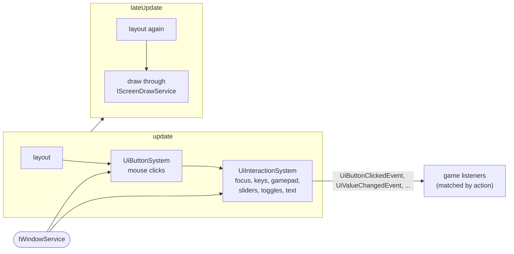

# User Interface

The `engine_ui` module draws a HUD and menus in screen space, on top of the world. It talks only to engine services
(`IWindowService` for input, `IScreenDrawService` for drawing), so it contains no graphics-library code and is tested
without a window. It depends on `engine_core` and `engine_hierarchy`.

Add `ui::UiPlugin` (it requires `hierarchy::HierarchyPlugin`). Every frame:

1. `update` lays the HUD out, runs `UiButtonSystem` (mouse clicks on buttons), then `UiInteractionSystem` (focus,
   keyboard and gamepad navigation, text inputs, sliders, toggles, list scrolling).
2. `lateUpdate` lays the HUD out again, after every plugin's `update`, and draws it.

## Elements

An element is an entity with a `UiAnchor` (where it sits) and one or more drawables, all in `ui/components/`:

| Component        | Draws                                     | Interaction                                       |
|------------------|-------------------------------------------|---------------------------------------------------|
| `UiRect`         | filled rectangle with an optional border  |                                                   |
| `UiText`         | text (font from `IScreenDrawService::loadFont`) |                                             |
| `UiImage`        | texture stretched to its size, tinted     |                                                   |
| `UiProgressBar`  | background and filled part                |                                                   |
| `UiButton`       | background by state, centred label        | `UiButtonClickedEvent{entity, action}`            |
| `UiToggle`       | box, mark while on                        | click or confirm: `UiToggleChangedEvent`          |
| `UiSlider`       | track, filled part, knob                  | drag, or left/right by `step`: `UiValueChangedEvent` |
| `UiTextInput`    | box, text or placeholder, blinking caret  | typing (optionally made capitals, filtered by `allowed`), Backspace (repeats), Enter: `UiTextSubmittedEvent` |
| `UiScrollList`   | nothing itself                            | its children are rows, see below                  |

Events are declared in `events/UiEvents.hpp`. Widgets are matched by their `action` string, so a listener does not
need entity ids.

`UiAnchor` places an element inside its container: the screen for a root element, else the rectangle of its
`hierarchy` parent. Destroying a panel destroys its widgets (hierarchy cascade).

## Focus and navigation

Add `UiFocusable{order}` to a widget to make it reachable without a mouse. The focused widget is the `UiFocus`
resource. Game code may set it, for instance to focus the first button when a menu opens. It is drawn with an
outline.

| Command | Default bindings                     | Effect                                                       |
|---------|--------------------------------------|--------------------------------------------------------------|
| Up      | Up arrow, D-pad up                   | previous widget                                              |
| Down    | Down arrow, Tab, D-pad down          | next widget                                                  |
| Left / Right | arrows, D-pad                   | move a focused slider; otherwise previous / next widget      |
| Confirm | Enter, Space, gamepad A (bottom face) | click the button, flip the toggle, submit the text input    |
| Back    | Escape, gamepad B (right face)       | publish `UiBackEvent`                                        |

- Focus moves through the visible focusable widgets in increasing `order`, then in layout order, and wraps around.
- A click on a focusable widget focuses it; a click elsewhere clears the focus.
- A widget that disappears (destroyed or hidden) loses the focus.
- Space types a space while a text input has the focus, so only the other confirm bindings submit it.
- The bindings are the `UiNavigation` resource, which `UiPlugin` emplaces with the defaults above. A game rebinds
  them freely. Holding a key moves the focus once.

!!! note "Escape"
    By default the window closes on Escape. A game that uses Escape for back or pause opens its window with
    `render::WindowConfig{.escapeClosesWindow = false}` and quits through its own menu.

## Scroll lists

The children of a `UiScrollList` are rows. Only `visibleCount` rows, starting at `first`, are laid out. Each one is
anchored in its own slot of `itemHeight` pixels, stacked from the top of the list.

Rows out of view are neither laid out, drawn nor clickable, so a list of hundreds of entries costs only its visible
rows. The mouse wheel over the list scrolls it, and up/down on a focused row move to the next focusable row,
scrolling as needed: rows without `UiFocusable` (a disabled entry) are skipped. `first` is clamped to the number of
rows.

## Hiding

`ecs::Hidden` (`components/Hidden.hpp`, in `engine_core`) asks every renderer to skip an entity:

- The UI layout skips a hidden element **with its whole subtree**.
- The world `RenderSystem` skips hidden sprites.

Use `ecs::hide(registry, e)` and `ecs::show(registry, e)`. Each owner has its own reason bit
(`HiddenReason::Manual`, `HiddenReason::Scene`), so the scene manager hiding a covered scene never shows an element
the game hid itself.

## Performance

- The layout walk and the render pass keep their buffers between frames.
- The renderer draws straight from the components, without copying them.
- The interaction system only allocates when it publishes an event.

A steady HUD therefore lays out, draws and handles input without allocating.
