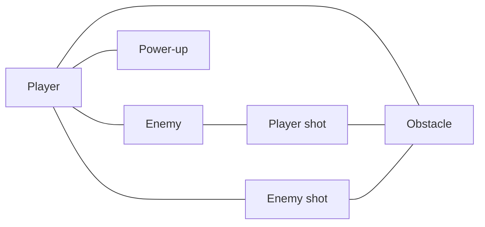

# Collision Categories

**Source:** `server/src/prefabs/CollisionCategories.hpp` (namespace `prefabs::collision`)

## Principle

Each `ecs::Collider2D` carries two 16-bit fields, forwarded to the Box2D fixture filter:

- `categoryBits` — **what I am** (exactly one bit);
- `maskBits` — **what I can touch** (a set of categories).

Two colliders `A` and `B` interact only if **both** accept each other:

```cpp
(A.categoryBits & B.maskBits) != 0 && (B.categoryBits & A.maskBits) != 0
```

This is the rule implemented by `prefabs::collision::canCollide(a, b)`. A single side accepting the other is not enough: an obstacle accepts every category (`ALL`), yet an enemy passes through it because `ENEMY_MASK` does not include `OBSTACLE`.

## Categories

| Constant | Bit | Used by |
|----------|-----|---------|
| `PLAYER` | `0x0001` | Player ship (no prefab yet) |
| `ENEMY` | `0x0002` | [`alien_scout`](alien-scout.md) |
| `PLAYER_SHOT` | `0x0004` | [`player_bullet`](player-bullet.md) |
| `ENEMY_SHOT` | `0x0008` | [`missile`](missile.md) |
| `OBSTACLE` | `0x0010` | [`obstacle`](obstacle.md) |
| `POWER_UP` | `0x0020` | [`power_up`](power-up.md) |

`ALL` (`0xFFFF`) is a mask accepting every category.

## Masks

| Mask | Value | Accepts |
|------|-------|---------|
| `PLAYER_MASK` | `0x003A` | `ENEMY`, `ENEMY_SHOT`, `OBSTACLE`, `POWER_UP` |
| `ENEMY_MASK` | `0x0005` | `PLAYER`, `PLAYER_SHOT` |
| `PLAYER_SHOT_MASK` | `0x0012` | `ENEMY`, `OBSTACLE` |
| `ENEMY_SHOT_MASK` | `0x0011` | `PLAYER`, `OBSTACLE` |
| `OBSTACLE_MASK` | `0xFFFF` | everything |
| `POWER_UP_MASK` | `0x0001` | `PLAYER` |

## Who touches whom

Result of `canCollide` for every pair (✅ interact, — ignore each other). The table is symmetric.

|  | Player | Enemy | Player shot | Enemy shot | Obstacle | Power-up |
|---|:---:|:---:|:---:|:---:|:---:|:---:|
| **Player** | — | ✅ | — | ✅ | ✅ | ✅ |
| **Enemy** | ✅ | — | ✅ | — | — | — |
| **Player shot** | — | ✅ | — | — | ✅ | — |
| **Enemy shot** | ✅ | — | — | — | ✅ | — |
| **Obstacle** | ✅ | — | ✅ | ✅ | ✅ | — |
| **Power-up** | ✅ | — | — | — | — | — |



## Gameplay meaning

| Pair | Meaning |
|------|---------|
| Player ↔ Enemy | Ramming an enemy damages the player. |
| Player ↔ Enemy shot | The player is hit by a missile. |
| Player ↔ Obstacle | The player is blocked by / crashes into level geometry. |
| Player ↔ Power-up | The player collects the bonus. |
| Enemy ↔ Player shot | The enemy is hit by a player bullet. |
| Shot ↔ Obstacle | Projectiles are stopped by level geometry. |

Pairs that deliberately ignore each other:

- **Player ↔ Player** and **Player ↔ Player shot**: no player-vs-player collision, no friendly fire.
- **Enemy ↔ Enemy** and **Enemy ↔ Enemy shot**: enemies overlap freely and never shoot each other.
- **Shot ↔ Shot**: projectiles cross each other.
- **Enemy ↔ Obstacle**: enemies fly through level geometry.
- **Power-up ↔ anything but Player**: shots and enemies cannot destroy or collect a bonus.
- **Obstacle ↔ Obstacle**: accepted by the masks, but both bodies are static, so Box2D never tests the pair.

## Adding a category

1. Add a new bit constant (next free bit: `0x0040`); 16 categories are available in total.
2. Write its mask.
3. Update the masks of the existing categories that must touch it. Both sides must agree, otherwise the pair is ignored.
4. Update the table above and the `CollisionCategoriesFilterPairs` test in `tests/prefabs/PrefabManagerTests.cpp`.

!!! warning "Filtering is not detection"
    Categories and masks only decide which pairs are **allowed** to interact. With Box2D v2.4.2, a contact is only created when at least one of the two bodies is `Dynamic`.

    | Category | Body type | Why |
    |----------|-----------|-----|
    | `PLAYER` | must be `Dynamic` | Covers every pair involving the player. |
    | `PLAYER_SHOT` | `Dynamic` | Covers Player shot ↔ Enemy and Player shot ↔ Obstacle. |
    | `ENEMY_SHOT` | `Dynamic` | Covers Enemy shot ↔ Obstacle. |
    | `ENEMY` | `Kinematic` | Every pair already contains a `Dynamic` body. |
    | `POWER_UP` | `Kinematic` | Its only pair (Player) contains a `Dynamic` body. |
    | `OBSTACLE` | `Static` | Never moves. |

    Sensors are not handled by continuous collision detection, so the `bullet` flag does not prevent a fast projectile from tunnelling through a thin collider. Reacting to a contact (damage, pickup, destruction) is not handled by the prefabs themselves.
