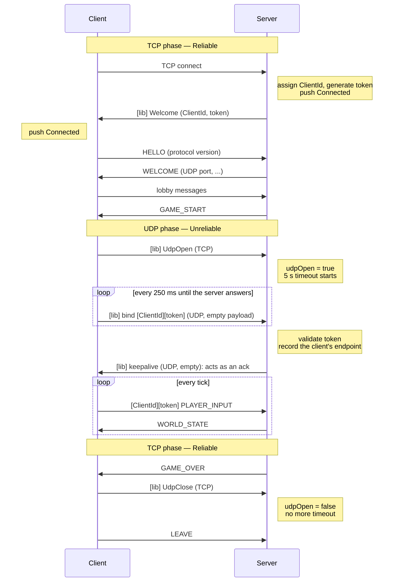

# Network Transport & Connection

This document specifies how messages are mapped to TCP and UDP, how a client connects and disconnects, and how messages
are framed and validated on the wire.

The design of the library implementing it is described in [Network Architecture](../architecture/network.md). The byte
layout of each packet is specified in the [Protocol RFC](rfc.md) and [Packets](packets.md).

---

## Table of contents

1. [Transport: TCP or UDP](#1-transport-tcp-or-udp)
2. [Connection lifecycle](#2-connection-lifecycle)
3. [Framing and validation](#3-framing-and-validation)

---

## 1. Transport: TCP or UDP

### Rule

- Latency matters and old data is useless → **`Unreliable` (UDP)**
- The message must arrive and latency does not matter → **`Reliable` (TCP)**

### Message classification

| Message                    | Phase             | Channel            | Transport | Reason                                            |
|----------------------------|-------------------|--------------------|-----------|---------------------------------------------------|
| Handshake, version check   | Before game       | Reliable           | TCP       | Must arrive                                       |
| Session token, `ClientId`  | Connection        | Internal (library) | TCP       | Required to bind the UDP address                  |
| Lobby (rooms, ready state) | Before game       | Reliable           | TCP       | Must arrive in order                              |
| Game start                 | Before game       | Reliable           | TCP       | Must arrive                                       |
| UDP open / close           | Game start / over | Internal (library) | TCP       | Starts / stops the server's UDP timeout           |
| Keepalive                  | In game           | Internal (library) | UDP       | Keeps the timeout alive when the game is silent   |
| Player inputs              | In game           | Unreliable         | UDP       | Sent every tick; the next one replaces a lost one |
| World state                | In game           | Unreliable         | UDP       | Sent every tick; stale states are dropped         |
| Critical in-game events    | In game           | Unreliable + ack   | UDP       | Must stay ordered with the world state            |
| Chat                       | Any               | Reliable           | TCP       | Must arrive in order, low volume                  |
| Game over, scores          | After game        | Reliable           | TCP       | Must arrive                                       |
| Leave                      | Any               | Reliable           | TCP       | Clean disconnection                               |

### Constraints on mixing both

- **No ordering between TCP and UDP.** Anything that must stay consistent with the world state goes over UDP.
- **No bulk TCP transfer during a game.** Large TCP transfers fill network queues and increase UDP loss and latency.
  Small TCP messages (chat) have no measurable impact.

---

## 2. Connection lifecycle

Messages tagged `[lib]` are internal to the network library: the game never sends nor receives them.

### Binding TCP and UDP to one player

This is done entirely by the network library. The game only sees `Connected`, `Data` and `Disconnected` events, all
carrying the same `ClientId` for one player.

1. A TCP connection is accepted. The server assigns a `ClientId`, generates a random session token
   (`std::random_device`, 32 bits), pushes `Connected`, and sends an internal `Welcome (ClientId, token)` frame.
   When the client library receives `Welcome`, it pushes `Connected`: from then on `openUdp()` can be called.
2. When the game calls `openUdp(port)`, the client library sends an internal `UdpOpen` frame over TCP, then an empty
   **bind** datagram, resent every 250 ms until it receives anything from the server.
3. Every datagram from the client starts with `[ClientId][token]`. The server accepts it only if the client exists, the
   token matches, and UDP is open for this client. It then records the datagram's source endpoint. The first time, it
   answers with an empty datagram, which stops the client's resends.
4. When the game calls `closeUdp()`, the client library sends an internal `UdpClose` frame over TCP and closes UDP.

Afterwards:

- the first bind datagram is often dropped: it travels over UDP at the same time as `UdpOpen` over TCP, with no
  ordering between them, and arrives while UDP is still closed for this client. The resend every 250 ms binds the
  endpoint within one tick after `UdpOpen` arrives. Until then, the server cannot send UDP to this client;
- any valid datagram updates the client's endpoint, so a NAT rebinding is harmless;
- a datagram received while UDP is closed is dropped. `UdpOpen` / `UdpClose` travel over TCP, which is ordered, while
  datagrams are not: a late input sent just before `closeUdp()` cannot bind the endpoint again;
- server → client datagrams carry no library header: the client only accepts datagrams from the server's endpoint.

### Disconnection

| Situation                   | Detection                                                              | Result                                         |
|-----------------------------|------------------------------------------------------------------------|------------------------------------------------|
| Player leaves               | `LEAVE`, TCP closed                                                    | `Disconnected` event                           |
| Client crash / network loss | TCP closed, or no valid UDP packet for 5 s while UDP is open           | `Disconnected` event                           |
| Server shutdown             | `asio::signal_set` (SIGINT / SIGTERM)                                  | Clients notified over TCP, sockets closed      |
| Server unreachable          | No UDP packet from the server for 5 s while UDP is open, or TCP closed | Client-side `Disconnected` event               |
| Server full                 | More than 64 clients: the server closes the new connection             | Client-side `Disconnected` without `Connected` |
| Peer not reading TCP        | More than 1 MiB waiting in its write queue                             | Session closed, `Disconnected` event           |

While UDP is open, each side's library sends an empty **keepalive** datagram when it has sent nothing for 1 s. Silence
on UDP therefore always means a connection problem, never an idle player or a paused game, and the timeout does not
depend on how often the game sends. In the lobby (UDP closed), only TCP closing detects a disconnection.

---

## 3. Framing and validation

| Transport            | Message boundaries                     | Framing added by the library                                    |
|----------------------|----------------------------------------|-----------------------------------------------------------------|
| TCP                  | Not preserved (byte stream)            | `[length u32][kind u8][payload]`, the length counts the payload |
| UDP, client → server | Preserved (one datagram = one message) | `[ClientId u32][token u32][payload]`                            |
| UDP, server → client | Preserved (one datagram = one message) | None: `[payload]`                                               |

All integers added by the library are **little-endian**. The payload is the game's message, starting with the protocol
header; the library never reads it.

TCP `kind` values:

| `kind`         | Direction       | Payload                          |
|----------------|-----------------|----------------------------------|
| `0` `Data`     | both            | Game message, handed to the game |
| `1` `Welcome`  | server → client | `[ClientId u32][token u32]`      |
| `2` `UdpOpen`  | client → server | Empty                            |
| `3` `UdpClose` | client → server | Empty                            |

Rules enforced by the library:

- A UDP datagram **must not** exceed **1200 bytes**, to avoid IP fragmentation. Client datagrams use 8 bytes of
  library header, so the game payload is limited to **1192 bytes** in both directions. `send()` refuses larger payloads.
- An **empty** UDP payload is a keepalive: it is never handed to the game, and `send()` refuses empty unreliable
  payloads.
- A client datagram shorter than 8 bytes, longer than 1200 bytes, with an unknown `ClientId`, a wrong token, or received
  while UDP is closed for this client is dropped.
- `send()` refuses a TCP payload larger than 64 KiB. A received frame announcing more than 64 KiB, or a `kind` not
  allowed in its direction, closes the session.
- More than 1 MiB waiting to be written to one peer closes its session: the peer is not reading anymore.
- The server accepts at most 64 simultaneous connections; any other one is closed right away.
- Only **valid** datagrams update a client's `lastSeen`.

Rules enforced by the game protocol layer:

- Any message that is too short, or has a wrong magic or version, is dropped **before** its payload is read.
