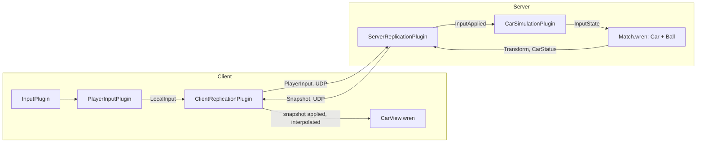

# RLSS

RLSS is the second sample game built on the engine (Track #1): a 2D, side-view car football game whose car and ball
physics are modelled on Rocket League. It proves that the engine is reusable: it lives outside `engine/`, links only the
engine modules it needs, and the engine knows nothing about it (the game does not modify `engine/` at all).

## Layout

```
rlss/
├── xmake.lua           -- includes the targets below (the client only with --graphics=y)
├── shared/             -- rlss_shared: protocol + codec, arena dimensions, player palette (no engine)
├── game/               -- rlss_game: game components, replication codec, Wren bindings (server + client)
├── server/             -- rlss_server: headless, authoritative
├── client/             -- rlss_client: window, arena and car drawing, controls
└── scripts/            -- Wren: Match, Car, Ball, Arena, tunings (server physics); CarView, BallView (client look)
```

| Target        | Engine modules used                                                                               |
|---------------|---------------------------------------------------------------------------------------------------|
| `rlss_shared` | none                                                                                              |
| `rlss_game`   | `engine_core`, `engine_network`, `engine_input`, `engine_scripting`                               |
| `rlss_server` | `rlss_game` + `engine_time`, `engine_events`, `engine_network_asio`                               |
| `rlss_client` | `rlss_game` + `engine_time`, `engine_events`, `engine_render`, `engine_network_asio`             |

## Running

```sh
xmake
./rlss_server [port]            # default port 4250
./rlss_client [host] [port]     # default 127.0.0.1 4250, start as many as you want
```

Run both from the repository root: the Wren scripts are loaded from `rlss/scripts/`. Scripts are hot-reloaded: save
`rlss/scripts/CarTuning.wren` or `BallTuning.wren` while the server runs to tune the physics live.

| Action                             | Keyboard                    | Gamepad           |
|------------------------------------|-----------------------------|-------------------|
| Drive (ground) / rotate (air)      | A / D, Q / D, ← / →         | left stick        |
| Jump, then double jump or dodge    | Space, W, Z, ↑              | bottom face button |
| Boost                              | Shift, S, ↓                 | right face button, right trigger |

## How it plugs into the engine

Both executables are an `engine::Engine` plus plugins; game plugins never call each other, they communicate through
the `EventBus` and the ECS.



- **Server** (`rlss/server/main.cpp`): `NetworkPlugin` fed by `ServerConnection` (game-side adapter, one engine owns
  every peer), `ServerReplicationPlugin` with the RLSS `ReplicationCodec`, `ScriptPlugin`, then:
    - `CarSimulationPlugin` exposes the components to Wren, spawns the arena entity (tag `arena` + `ArenaShape`,
      running the `Match` script) and the replicated ball (`Ball` script, kind `KIND_BALL`), and copies each applied
      input into the car's `InputState`;
    - `LobbyPlugin` gives each peer a slot (color + spawn point) and a car: `Transform`, `InputState`, `InputBuffer`,
      `NetworkOwner`, `CarLook`, `CarStatus`, `ScriptComponent{Car}`, replicated with kind `KIND_CAR`. It also broadcasts the
      `LobbyState` when a player joins or leaves.
- **Client** (`rlss/client/main.cpp`): connects first (no window if the server is unreachable), opens UDP, then
  `RenderPlugin`, `InputPlugin`, `NetworkPlugin` fed by `ServerLink`, `ClientReplicationPlugin`, `ScriptPlugin`, and:
    - `ArenaViewPlugin` draws the arena with flat colored rectangles and frames it with the camera;
    - `CarViewPlugin` gives each replicated car its parts (body and cabin in the player color, wheels, headlight,
      boost flame and gauge) and the `CarView` script that places them every frame;
    - `BallViewPlugin` builds the ball (a disc of strips and two seams, tagged `ball_part`) and the `BallView` script
      that places the pieces and turns the seams with the ball;
    - `PlayerInputPlugin` publishes the local controls as a `LocalInput` every fixed step;
    - `SessionPlugin` logs the player count and closes the game when the connection is lost.

### What is scripted

| Wren module              | Runs on | Role                                                                     |
|--------------------------|---------|--------------------------------------------------------------------------|
| `rlss/scripts/Match`      | server  | Fixed 120 Hz loop: steps the cars and the ball, car-ball contacts         |
| `rlss/scripts/Simulation` | server  | Registry the `Car` / `Ball` instances join and leave                      |
| `rlss/scripts/Car`        | server  | Whole car physics and boost, one instance per car                         |
| `rlss/scripts/Ball`       | server  | Ball physics: drag, bounces, spin                                         |
| `rlss/scripts/Arena`      | server  | Arena shape as a signed distance field: distance, wall normal, curvature  |
| `rlss/scripts/CarTuning`, `BallTuning` | server | Rocket League constants                                     |
| `rlss/scripts/CarView`    | client  | Size and placement of the car parts, wheel spin, boost flame and gauge    |
| `rlss/scripts/BallView`   | client  | Placement of the ball pieces, seams turning with the ball                 |

The scripts see the ECS through component classes bound by `rlss::game::installScriptBindings` in the
`rlss/components` module: `Transform`, `Controls` (`InputState.playerIndex`), `ArenaShape`, `CarParts`. They read the
player input with the engine's `Input.getAxis(player, "steer")` / `Input.isDown(player, "jump" | "boost")`. Bound
classes also include `CarStatus` (boost, written by `Car`, replicated) and `BallPart` (client ball pieces).

The cars and the ball are not stepped by their own `update`: each instance registers in `Simulation`, and the `Match`
script (on the arena entity) steps them all in a fixed order, so that their contacts are resolved deterministically.

What stays in C++: creating entities (Wren can only spawn prefabs at a position), the network and replication, and
the arena drawing (hundreds of shapes created once).

## Car physics

Side view, y down, Rocket League units (uu). The arena is 1920 × 1024 uu with 280 uu curved corners; the car hitbox is
118 × 36 uu. `Car.wren` steps at a fixed 120 Hz whatever the frame rate.

| Quantity                          | Value                                    |
|-----------------------------------|------------------------------------------|
| Gravity                           | 650 uu/s²                                |
| Throttle acceleration             | 1600 uu/s² at rest → 160 at 1400 → 0 at 1410 uu/s |
| Braking / coasting                | 3500 / 525 uu/s²                         |
| Sticky force on any surface       | 325 uu/s²                                |
| Jump                              | 292 uu/s + 1458 uu/s² while held, 0.2 s max |
| Second jump window                | 1.25 s after the first jump              |
| Dodge                             | 500 uu/s forward (533 back), scaled by speed; spins at 5.5 rad/s for 0.65 s |
| Air control                       | 12.46 rad/s², damping 2.798, max 5.5 rad/s |
| Max speed                         | 2300 uu/s                                |

- **On the wheels**, the car follows the surface: floor, curved corners, walls, ceiling. Gravity along the surface
  slows a climb. The surface holds the car while `−g·n + v²·curvature + sticky ≥ 0`: always on the floor and walls,
  on the curved corners only if fast enough, never on the flat ceiling. There the suspension (20 uu) extends for a
  moment before the wheels lose contact, so the car drives on the ceiling only briefly.
- The stick is screen-relative but locked while held: holding "right" drives up the right wall and along the ceiling.
  Steering against the motion brakes; below 200 uu/s it turns the car around (Sideswipe-style mirror).
- **In the air**: jump hold, double jump (no direction) or dodge (toward the stick), air rotation. The four hitbox
  corners collide with the arena; touching wheels first (roof within 60° of the wall normal) lands, otherwise the body
  bounces and tips over. On the roof, jump rolls the car back on its wheels.

### Boost

Boost pushes toward the nose: 991.7 uu/s² on the ground (where it also means full throttle), 1058.3 uu/s² in the air,
up to the 2300 uu/s cap. It burns 33.3 per second (a full tank lasts 3 s) and lasts at least 0.1 s once started. Like in
Sideswipe there are no boost pads: the tank (100, full at spawn) refills while the car touches a surface, wheels or
body. The refill rate (25 per second, empty to full in 4 s) is an estimate, not a published value.

## Ball physics

| Quantity                   | Value                                                          |
|----------------------------|----------------------------------------------------------------|
| Radius                     | 91.25 uu                                                       |
| Gravity                    | 650 uu/s²                                                      |
| Air drag                   | 3% of the speed per second                                     |
| Bounce (restitution)       | 0.6 of the speed into the wall                                 |
| Wall friction              | 0.35: sliding turns into spin and spin into sliding            |
| Max speed / spin           | 6000 uu/s / 6 rad/s                                            |
| Mass                       | a car weighs six balls                                         |

Car against ball: the rotated car hitbox is tested against the ball circle. The contact itself does not bounce
(restitution 0, friction 2, shared by mass, using the speed of the car at the contact point so a flipping nose hits
harder). Then Rocket League's extra impulse is added to the ball, at most every other step: along the line from the car
center to the ball center, its vertical part scaled by 0.35 and its part along the car nose by 0.65, with a strength of
0.65 × the relative speed up to 500 uu/s, 0.55 at 2300, 0.3 at 4600. A car hitting a ball at rest sends it about 1.3
times faster than itself; the bumper hits the ball under its center, so it also pops up.

## Tests

`tests/rlss/CarPhysicsTests.cpp` runs the Wren physics headless: landing, acceleration curve, turning around, wall and
ceiling, jump height (~230 uu), dodge, boost (past the throttle cap, 33.3 per second, refill only against a surface),
ball bounce height (0.36 × the drop), car pushing the ball, hit speed, and 400 random input sequences (with and without
the ball) where neither the car nor the ball may leave the arena.

## Protocol

The transport handshake uses `protocolId = 0x524C0003` ("RL", version 3), so R-Type and RLSS peers (or two RLSS
versions) refuse each other. Every message starts with a one-byte type; multi-byte integers are big-endian, floats
IEEE 754 binary32. Received messages are untrusted: an unknown type, a wrong size, an out-of-range field or a
non-finite float drops the message.

| Type | Name          | Direction       | Channel    | Payload                                                         |
|------|---------------|-----------------|------------|-----------------------------------------------------------------|
| 1    | `LobbyState`  | server → client | Reliable   | `players u16`                                                   |
| 2    | `Snapshot`    | server → client | Unreliable | `tick u32, lastInput u32, partIndex u8, partCount u8, count u8`, then `count` × entity |
| 3    | `PlayerInput` | client → server | Unreliable | `sequence u32, steer i8 (−127..127), buttons u8 (bit 0 jump, bit 1 boost)` |

A snapshot entity is 20 bytes: `id u32 (≠ 0), kind u8 (1 car, 2 ball), x f32, y f32, rotation f32, flags u8 (bit 0
facing left, bit 1 boosting), color u8, boost u8 (0..100)`. A part carries at most 48 entities, a snapshot at most 64
parts.

## Not done yet

- No goals, no score, no kickoff reset.
- Cars do not collide with each other.
- No client-side prediction: the local car is interpolated like the others (fine on a LAN).
