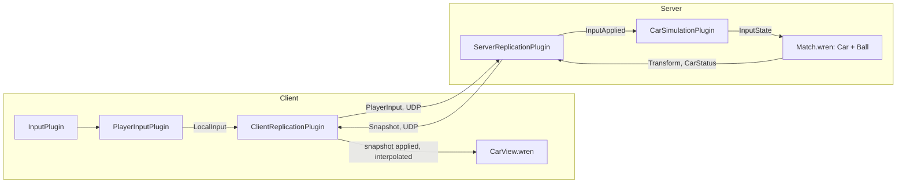
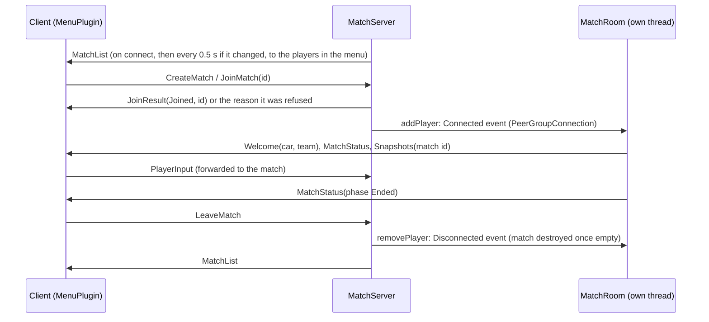

# RLSS

RLSS is the second sample game built on the engine (Track #1): a 2D, side-view car football game whose car and ball
physics are modelled on Rocket League. It proves that the engine is reusable: it lives outside `engine/`, links only the
engine modules it needs, and the engine knows nothing about it (the game does not modify `engine/` at all).

## Layout

```
rlss/
├── xmake.lua           -- includes the targets below (the client only with --graphics=y)
├── shared/             -- rlss_shared: protocol + codec, arena dimensions, player palette (no engine)
├── game/               -- rlss_game: game components, replication codec, Wren bindings (server + client)
├── server/             -- rlss_server: headless, authoritative, one engine (and thread) per match
├── client/             -- rlss_client: window, menus, arena and car drawing, controls, sounds
├── assets/             -- sounds/*.wav; textures/*.png drawn by generate_textures.py (original artwork);
│                          fonts/: Russo One (SIL Open Font License, see fonts/OFL.txt)
└── scripts/            -- Wren: Match, Kickoff, Car, Ball, Arena, tunings (server); CameraDirector, CarView, BallView
                           (client)
```

| Target        | Engine modules used                                                                               |
|---------------|---------------------------------------------------------------------------------------------------|
| `rlss_shared` | none                                                                                              |
| `rlss_game`   | `engine_core`, `engine_network`, `engine_input`, `engine_scripting`                               |
| `rlss_server` | `rlss_game` + `engine_time`, `engine_events`, `engine_network_asio`, `engine_scripting`          |
| `rlss_client` | `rlss_game` + `engine_time`, `engine_events`, `engine_render`, `engine_audio`, `engine_network_asio` |

## Running

```sh
xmake
./rlss_server [port]            # default port 4250
./rlss_client [host] [port]     # default 127.0.0.1 4250, start as many as you want
```

Run both from the repository root: the Wren scripts are loaded from `rlss/scripts/`, the sounds from
`rlss/assets/sounds/`, the textures and the font from `rlss/assets/textures/` and `rlss/assets/fonts/`. Scripts are
hot-reloaded: save
`rlss/scripts/CarTuning.wren` or `BallTuning.wren` while the server runs to tune the physics live.

The client first asks for a name (keyboard: up to 12 letters, digits, spaces, `-` or `.`; Enter or **VALIDER**). It is
shown above your car in the matches; click it in the corner of the menu to change it. Then the menu, drawn over the
arena (with the mouse):

- **NOUVELLE PARTIE** creates a 3-minute match on the server and puts you in it (blue team).
- **REJOINDRE** lists the matches being played (teams, score, clock); click one that is not full to join it. The list
  updates by itself; the mouse wheel scrolls a long one.
- At the end of a match, the end screen shows the final score and whether your team won; **RETOUR AU MENU** takes you
  back to the menu. Closing the window (or Escape) quits.

| Action                             | Keyboard                    | Gamepad           |
|------------------------------------|-----------------------------|-------------------|
| Drive (ground) / aim the nose (air) | A / D, Q / D, ← / →        | left stick        |
| Aim the nose up / down (air)       | W / S, Z / S, ↑ / ↓         | left stick        |
| Jump, then double jump or dodge    | Space                       | bottom face button |
| Boost                              | Shift                       | right face button, right trigger |

In the air the stick aims: the nose turns toward where it points (up, down, left, right or in between). Point it up and
boost to fly up.

## How it plugs into the engine

Both executables are an `engine::Engine` plus plugins; game plugins never call each other, they communicate through
the `EventBus` and the ECS.



- **Server** (`rlss/server/main.cpp`): a `MatchServer` owns the transport and runs the menu side (see
  [Matches and menus](#matches-and-menus)). Each match is a `MatchRoom`: its own `engine::Engine` on its own thread,
  with `NetworkPlugin` fed by an engine `PeerGroupConnection` (it only reaches the players of this match),
  `ServerReplicationPlugin` with the RLSS `ReplicationCodec` (which writes the match id in every snapshot),
  `ScriptPlugin` (one Wren VM per match), then:
    - `CarSimulationPlugin` exposes the components to Wren, spawns the arena entity (tag `arena` + `ArenaShape`,
      with the goals, running the `Match` script, holding the `MatchState`) and the replicated ball (`Ball` script, kind
      `KIND_BALL`), copies each applied input into the car's `InputState`, and sends the `MatchState` to the players
      (`MatchStatus` message: to everybody when it changes, to a player who joins);
    - `RosterPlugin` gives each player of the match a team (the one with fewer players, blue on a tie, at most 2 per
      team), a slot (color, kickoff spot) and a car: `Transform`, `InputState`, `InputBuffer`, `NetworkOwner`,
      `CarLook`, `CarStatus{placeAtKickoff}`, `ScriptComponent{Car}`, replicated with kind `KIND_CAR`; the player gets
      a `Welcome` with its car and team.
- **Client** (`rlss/client/main.cpp`): connects first (no window if the server is unreachable), opens UDP, then
  `RenderPlugin`, `InputPlugin`, `NetworkPlugin` fed by `ServerLink`, `ClientReplicationPlugin`, `ScriptPlugin`, and:
    - `AssetsPlugin` loads the textures and the font once (`GameAssets`, an ECS resource read by the views, see
      [Graphics](#graphics));
    - `ArenaViewPlugin` draws the arena picture (in tiles) and the stadium behind it, which moves slower than the
      arena when the camera moves (parallax);
    - `CameraPlugin` owns the camera: it keeps a `CameraRig` up to date (local car from the server's `Welcome`, ball,
      match phase, window size, arena bounds) for the `CameraDirector` script, which frames the action (see below);
    - `CarViewPlugin` gives each replicated car its textured parts (body tinted with the player color, glass and
      trims, wheels, headlight glow, boost flame and gauge, flip reset flash) and the `CarView` script that places
      them every frame;
    - `BallViewPlugin` builds the ball (panels that turn with it, lighting that does not, one colored halo per shot,
      tagged `ball_part`) and the `BallView` script that places the pieces;
    - `HudPlugin` writes each `MatchStatus` of the joined match into a `MatchState` (read by the sounds) and draws the
      HUD on screen with the engine's `IScreenDrawService`: score and clock at the top, kickoff countdown and "GO!",
      the "GOAL!" banner in the color of the team that scored, the boost meter of the local car in the bottom-right
      corner. Nothing is shown in the menus;
    - `GoalEffectPlugin` blows the ball up when a goal is scored (see [Graphics](#graphics)) and hides the ball until
      the kickoff;
    - `SoundPlugin` plays the sounds through the engine `AudioPlugin` (see [Sounds](#sounds));
    - `PlayerInputPlugin` publishes the local controls as a `LocalInput` every fixed step, while in a match;
    - `NameTagPlugin` draws each player's name above their car, from the server's `PlayerNames` (see
      [Player names](#player-names));
    - `MenuPlugin` runs the name entry, the menus and the end screen (see [Matches and menus](#matches-and-menus)) and publishes the
      client events `MatchJoined` / `MatchLeft`, which the scoreboard, the camera and the inputs follow;
    - `SessionPlugin` closes the game when the connection is lost.

### What is scripted

| Wren module              | Runs on | Role                                                                     |
|--------------------------|---------|--------------------------------------------------------------------------|
| `rlss/scripts/Match`      | server  | Fixed 120 Hz loop: steps the cars and the ball, car-ball contacts, goals, score, kickoff, clock, overtime, end |
| `rlss/scripts/Kickoff`    | server  | Teams, kickoff spots, goal celebration and countdown durations            |
| `rlss/scripts/Shots`      | server  | Colored shots (red, purple, gold), flip and boost resets on the ball      |
| `rlss/scripts/Simulation` | server  | Registry the `Car` / `Ball` instances join and leave                      |
| `rlss/scripts/Car`        | server  | Whole car physics and boost, one instance per car                         |
| `rlss/scripts/Ball`       | server  | Ball physics: drag, bounces, spin                                         |
| `rlss/scripts/Arena`      | server  | Arena shape as a signed distance field: distance, wall normal, curvature  |
| `rlss/scripts/CarTuning`, `BallTuning` | server | Rocket League constants                                     |
| `rlss/scripts/CarView`    | client  | Placement of the car sprites (mirrored when facing left), wheel spin, boost flame and gauge |
| `rlss/scripts/BallView`   | client  | Placement of the ball pieces, panels turning with the ball, halo pulse     |
| `rlss/scripts/CameraDirector` | client | Camera: aim, zoom, easing, arena bounds, kickoff wide shot         |

The scripts see the ECS through component classes bound by `rlss::game::installScriptBindings` in the
`rlss/components` module: `Transform`, `Controls` (`InputState.playerIndex`), `ArenaShape`, `CarParts`. They read the
player input with the engine's `Input.getAxis(player, "steer")` / `Input.isDown(player, "jump" | "boost")`. Bound
classes also include `CarStatus` (boost, written by `Car`, replicated) and `BallPart` (client ball pieces).

The cars and the ball are not stepped by their own `update`: each instance registers in `Simulation`, and the `Match`
script (on the arena entity) steps them all in a fixed order, so that their contacts are resolved deterministically.

What stays in C++: creating entities (Wren can only spawn prefabs at a position), the network and replication, the
arena drawing (a few tiles placed once), the HUD and the menus (drawn on screen every frame, the menus driven by
network messages).

## Goals and match

Like in Sideswipe, the goals open in the side walls a little above the floor: the bottom curved corner is a ramp that
ends at the goal mouth (360 uu above the floor, 540 uu high, 240 uu deep). The goal bottom is 60 uu below the top of
the curve (`arena::GOAL_DROP`): it cuts the end of the ramp, and the bottom post stands where they meet, on the curve,
4 uu inside the arena. There is no wall above the ramp to drive on: a car driving fast up the ramp flies up the mouth or
into the goal, and the walls above the goals are reached in the air. The crossbar and the bottom of each goal meet the
wall at a post, a convex edge that the ball bounces off and the car collides with. The two back corners of each goal are rounded (`arena::GOAL_CORNER_RADIUS`, 120 uu, a bit more than
the ball): a ball or a car rising along the back of the goal follows the curve instead of stopping in a sharp corner.
The radius travels to the scripts in `ArenaShape.goalCornerRadius`, and the client draws the same curve.

`Arena.wren` is an exact signed distance to the union of the rounded rectangle and the two goal boxes with their
rounded back corners (nearest point over all segments and arcs, sign from an inside test); away from the side walls it uses the faster rounded rectangle
formula alone.

- **Teams**: even player slots are blue (left side, defending the left goal, cool colors), odd slots orange (right
  side, warm colors). Teammates line up one behind the other at kickoff.
- **Goal**: as in Rocket League, once the whole ball is behind the goal line. The team attacking that goal scores.
- **After a goal**: the ball explodes in the goal. The blast blows away the cars closer than 900 uu to it (up to
  1600 uu/s next to it, fading with the distance, always a little upward; `Kickoff.BLAST_RADIUS` / `BLAST_SPEED`), and
  the ball is out of play: it stays where it exploded, without colliding (clients hide it). 2 s of celebration
  ("GOAL!" on screen), then every car goes back to its
  kickoff spot (at rest, full boost) and the ball to the center of the arena. A 3-2-1 countdown follows, everybody
  frozen, then play resumes and the ball drops. A player who joins starts at their kickoff spot.
- **Clock**: a match starts with a kickoff and lasts 3 minutes of play (`Match.DURATION`): the clock stops during the
  goal celebrations and the countdowns. When it runs out, the match ends, unless the score is tied: then comes an
  overtime, after a kickoff, with no time limit (the clock counts up, "+0:42" in gold), and the next goal wins once its
  celebration is over. An ended match stays frozen.

## Matches and menus

The server hosts up to 16 matches at once, of up to 4 players (2 against 2). The `MatchServer` keeps every connected
player either in the menu or in one match, and routes what they send accordingly:



- The `MatchServer` thread never touches a match's engine: it pushes `Connected` / `Disconnected` / data events into
  the match's `PeerGroupConnection` (thread-safe), and reads a summary (teams, score, clock, phase) that the match
  refreshes under a mutex after each frame. A match that throws is reported as ended, so its players get the end screen.
- A match is listed until it ends; a full one is shown but cannot be joined. A match without players is destroyed, a
  player who disconnects leaves their match.
- Client side, `MenuPlugin` draws the screens on screen with `UiCanvas` (rectangles, pictures and text in the game
  font, rebuilt when the screen changes and drawn every frame through `IScreenDrawService`) and reads the mouse. On `JoinResult(Joined)` it publishes
  `MatchJoined` and tells the `ServerLink` which match's snapshots to let through: snapshots are unreliable, so a few
  of a match just left can still arrive, and must not bring back its cars nor a newer tick. Leaving removes the
  replicated entities (each with its `ReplicatedEntityDespawned`), resets the engine's `SnapshotState` (the next match
  counts its steps from 0) and publishes `MatchLeft`.

## Player names

1. **Name entry.** `MenuPlugin` opens on the name entry. It reads the typed characters through the engine's
   `IWindowService::nextTypedCharacter()` (layout-aware: an AZERTY keyboard types what its keys say), makes letters
   upper-case and only keeps the characters names may hold (`protocol::isNameCharacter`). Enter sends `SetName`.
2. **Server.** The `MatchServer` keeps the name of each peer (a malformed one is dropped). When the peer joins a match,
   it hands the name to the match right after the player, as a `SetName` from that peer, and again if the player
   renames while playing.
3. **Match.** `RosterPlugin` names each car "JOUEUR" and its slot number until the player's `SetName` arrives, and sends
   every player of the match the names of all the cars (`PlayerNames`) when a player joins, leaves or renames.
4. **Client.** `NameTagPlugin` keeps the last `PlayerNames` of the joined match (one arriving outside a match is late,
   and ignored). Once a named car is in the snapshots, it builds its label: the name in the game font, in the player
   color lightened, on a dark plate underlined in the player color. The label is laid out in pixels (`UiCanvas`, shifted every frame to the point above
   the car's boost gauge on screen), so it keeps its size whatever the zoom.

## Graphics

The look is original artwork in the spirit of the genre (no asset from another game): a night stadium, a glass arena
with neon walls, blue on the left and orange on the right, and a grass pitch along the floor.

- **Textures.** `rlss/assets/generate_textures.py` draws every texture procedurally (Pillow and NumPy, deterministic):
  `python3 rlss/assets/generate_textures.py` regenerates `rlss/assets/textures/`. It reads the arena dimensions from
  `rlss/shared/Arena.hpp` (and the wall thickness from `ArenaViewPlugin.hpp`), so the picture always matches the
  physics: walls, rounded corners, goals with their rounded back corners, posts and goal lines. The arena picture
  (1.25 px per uu) is cut into tiles of at most 1024 px, which `ArenaViewPlugin` places with the same constants.
- **Layers, back to front.** The stadium (stands full of fans, LED ribbons, floodlights, blurred: it is far away),
  then the arena: its field is tinted glass, so the stadium shows through it and, since it moves slower than the
  arena, gives the scene depth; then the cars and the ball, then the screen overlays (name tags, HUD, menus).
- **Car.** The body texture is greyscale and tinted with the player color; glass, trims and lights are a second,
  untinted texture on top. The wheels turn with the distance travelled, the flame flickers while boosting, and the
  sprites are mirrored when the car faces left. The car textures have 4 px per uu (`CarView.PX`).
- **Ball.** The panels (a truncated icosahedron with glowing seams) turn with the ball; the lighting (a highlight
  from the top-left and a dark rim) is a separate texture that does not, so the ball keeps looking round.
- **Text.** The menus, the HUD and the name tags use Russo One (SIL Open Font License, `rlss/assets/fonts/OFL.txt`).
  `UiCanvas` sizes text by the height of its capital letters.
- **Engine support** (generic, used here): `TextureStore::load(path, TextureFilter::Smooth)` (mipmaps, trilinear,
  clamped edges, for artwork drawn at any zoom), fonts rasterized at 128 px so that big titles stay sharp, and
  `IScreenDrawService::drawTexture` (textured quads on screen, rotated around their center) for the HUD.

- **Goal explosion** (`GoalEffectPlugin`, on the switch to the goal celebration, at the ball): a fireball in the color
  of the team that scored (`goal_explosion_blue.png` / `goal_explosion_orange.png`, 20 frames of 192 px played once in
  1.1 s by the engine's `AnimationPlugin`), two shockwave rings, a burst of light, sparks flying out and falling, smoke
  drifting up, and a flash of the whole screen. The particles are short-lived entities (`GoalParticle`) moved,
  scaled and faded every frame, then removed. The ball pieces are hidden during the celebration and 0.3 s after it,
  until the snapshots bring the ball back to the center.

A missing texture is logged: the stadium or arena tile is then not drawn, a car or ball part shows as a small flat
rectangle. A missing font falls back to the backend's default font.

## Camera

The camera (`CameraDirector.wren`, client) is a fixed side view, never rotated: only its position and zoom change.

1. **Aim**: a point between the local car and the ball, leaning to the ball when it is far (40% of the way when they
   are close, 60% when they are 2000 uu apart or more), so the player sees what is coming.
2. **Zoom**: the closest zoom that keeps both on screen with a 280 uu margin. Bounded: never closer than 1500 uu across
   (about 13 car lengths), never wider than the arena.
3. **Easing**: position and zoom ease toward their target every frame (rates 5/s and 2.5/s: the zoom reacts more
   slowly, in log space so that zooming in and out feel the same).
4. **Bounds**: the view never shows past the outer walls and goals; near a goal or a corner it stops against them and
   the car or the ball is no longer centered.
5. **Special cases**: wide shot on the center during the kickoff countdown; after a goal it keeps following the
   action until the kickoff; a high ball pulls the camera up and out when the car stays on the ground.
6. **The player comes first**: when the car and the ball do not fit on screen (too far apart, or while the zoom is
   still pulling back after a clearance), the aim slides back so that the car stays at least 320 uu inside the screen;
   the ball may leave it. The eased view is also held so that a fast car never gets closer than 160 uu to an edge while
   the camera catches up.

The client learns which car is its own from the server's `Welcome` message, and resolves it through the engine's
`NetworkEntityMap`.

## Sounds

The client plays every sound from the server's state: it never guesses an event from the motion it sees.

- **Sound cues.** The `Car` script counts its jumps (with their kind: jump, double jump, flip) and its hard contacts
  with the arena (a landing or the body hitting a wall faster than 250 uu/s, with that speed) in the car's `CarCues`.
  The `Ball` script counts the hits by a car (`Match` calls `recordHit` with the strength of the hit: the speed of the
  meeting or of the ball sent flying, from 150 uu/s, or any colored shot) and its bounces off the arena faster than
  100 uu/s in the ball's `BallCues`. Both are replicated in every snapshot as two sound cues (a 4-bit counter and a
  4-bit value each, see [Protocol](#protocol)). The counters only grow: the client plays a sound when one changes,
  so a lost snapshot delays a sound instead of losing it. The scripts start their counters from the component, so a
  hot-reload replays nothing.
- **`SoundPlugin`** (client) loads the sounds through `engine::IAudioService` and publishes engine `PlaySoundEvent`s,
  positioned where the car or the ball is: louder and lower-pitched for stronger hits, bounces and impacts; a colored
  shot adds a blast on top of the hit (pitched by its color). A goal plays the explosion (`goal_explosion.wav`,
synthesized by `rlss/assets/generate_goal_sound.py`) with the horn and the cheering. Each car plays its engine (an `AudioEmitter` on the car,
  pitched and louder with its speed, measured on screen) and, while it boosts, the boost roar (an emitter on its own
  entity, which follows the car).
- **Match sounds** come from the `MatchState`: a beep for each second of the kickoff countdown, a higher one when play
  starts, the goal horn and the crowd cheering, a horn for the overtime, the final buzzer, and a tick for each of the
  last 10 seconds of regular time (higher for the last 3). A crowd murmurs during the whole match.
- **Heard from the camera.** An `AudioListener` follows the camera target: sounds pan with their place on screen and
  keep their full volume up to 1600 uu away (everything on screen), then fade out until 4000 uu.

The sounds are synthesized by `rlss/assets/generate_sounds.py` (oscillators, noise and filters, Python standard library
only, deterministic): edit it and run `python3 rlss/assets/generate_sounds.py` to regenerate `rlss/assets/sounds/`. A
missing file only mutes its sound, and without an audio device the game runs silent. To use another sound, put a WAV
file under the same name (the script keeps existing files; `--force` synthesizes them all again). The format is read
from the extension: an MP3 renamed `.wav` does not load, convert it (`ffmpeg -i sound.mp3 -ac 1 -ar 44100 sound.wav`).

## Car physics

Side view, y down, Rocket League units (uu). The arena is 2880 × 1536 uu with 420 uu curved corners (about 24 car
lengths wide: cars and ball keep their Rocket League size, the camera follows the action); the car hitbox is
118 × 36 uu. `Car.wren` steps at a fixed 120 Hz whatever the frame rate.

| Quantity                          | Value                                    |
|-----------------------------------|------------------------------------------|
| Gravity (always down the screen)  | 900 uu/s² (estimate; Rocket League: 650) |
| Throttle acceleration             | 1600 uu/s² at rest → 160 at 1400 → 0 at 1410 uu/s |
| Braking / coasting                | 3500 / 525 uu/s²                         |
| Sticky force on any surface       | 325 uu/s² coasting, 1050 uu/s² driving (estimate) |
| Jump                              | 292 uu/s + 1458 uu/s² while held, 0.2 s max (about 160 uu high) |
| Second jump (flip / double jump)  | one per jump, until the car touches a surface again |
| Dodge                             | 500 uu/s forward (533 back), scaled by speed; spins at 5.5 rad/s for 0.65 s |
| Air control                       | aims the nose at the stick: 12.46 rad/s², max 4.2 rad/s, damping 2.798 when released |
| Max speed                         | 2300 uu/s                                |

- **On the wheels**, the car follows the surface: floor, curved corners, walls, ceiling. Gravity along the surface
  slows a climb. The surface holds the car while `−g·n + v²·curvature + sticky ≥ 0`: always on the floor and walls,
  on the curved corners only if fast enough. While the car drives (throttle or boost) the grip (1050) beats gravity
  (900): it drives upside down on the ceiling. Once it lets go, gravity wins, the suspension (20 uu) extends and the
  car falls.
- The stick is screen-relative but locked while held: holding "right" drives up the right wall and along the ceiling.
  Steering against the motion brakes; below 200 uu/s it turns the car around (Sideswipe-style mirror).
- **Gravity** always pulls toward the bottom of the screen (900 uu/s² on the cars, 600 on the ball), even when the car drives on a
  wall or on the ceiling. It is stronger than in Rocket League, so jumps stay short and the game feels snappier.
- **In the air**: jump hold, double jump (no direction) or dodge (toward the stick), air control. The stick (steer
  and pitch) aims: the nose turns toward the direction it points on screen, at most 4.2 rad/s (Rocket League: 5.5),
  speeding up and slowing down at 12.46 rad/s². It plans its stop (10 rad/s²) so that it ends on the aim without
  overshooting; aiming right behind, it turns the way it already turns, or else over the top. Released, the rotation
  dies down (damping 2.798). The four hitbox
  corners collide with the arena and the car lands when it touches them. Like in Sideswipe, it never rests on its roof
  or its side: flying toward a surface any other way than wheels first, it spins onto its wheels in the time left
  before the contact (within 0.25 s of it, up to 16 rad/s); if it touches anyway, it is turned onto its wheels as it
  lands.

### Boost

Boost pushes toward the nose: 1110 uu/s² on the ground (where it also means full throttle; about 12% above Rocket
League), 1450 uu/s² in the air (1.61 times the gravity, as in Rocket League), up to the 2300 uu/s cap (estimates). In
the air it beats gravity (1450 against 900): pointing the nose up, the car climbs at 550 uu/s² net. It burns 33.3 per second (a full tank lasts 3 s) and lasts at least 0.1 s once started. Like in
Sideswipe there are no boost pads: the tank (100, full at spawn) refills while the car touches a surface, wheels or
body. The refill rate (25 per second, empty to full in 4 s) is an estimate, not a published value.

## Ball physics

| Quantity                   | Value                                                          |
|----------------------------|----------------------------------------------------------------|
| Radius                     | 80 uu (Rocket League: 91.25)                                   |
| Gravity                    | 600 uu/s²: floatier than the cars (900) and than Rocket League (650), estimate |
| Air drag                   | 3% of the speed per second                                     |
| Bounce (restitution)       | 0.6 of the speed into the wall                                 |
| Wall friction              | 0.35: sliding turns into spin and spin into sliding            |
| Max speed / spin           | 2600 uu/s (estimate; Rocket League: 6000) / 6 rad/s            |
| Rolling resistance         | 300 uu/s²: a rolling ball stops after a few seconds (estimate) |
| Mass                       | a car weighs six balls                                         |

Car against ball: the rotated car hitbox is tested against the ball circle. Everything depends on the **speed along
the contact normal** (using the speed of the car at the contact point, so a flipping nose hits harder): the front of
a car at full speed sends the ball far, its roof brushing past barely moves it, and a ball resting on the roof gets no
push at all.

1. The contact itself: restitution 0.1 on that speed (estimate), friction 2 (it spins the ball), shared by mass.
2. Rocket League's extra impulse, scaled down by 0.7 (estimate), at most every other step: along the line from the car
   center to the ball center, its vertical part scaled by 0.35 and its part along the car nose by 0.65, with a
   strength of 0.65 × the contact speed up to 500 uu/s, 0.55 at 2300, 0.3 at 4600.
3. **Flip**: a car hitting the ball while it dodges adds 550 uu/s along the same line (estimate): the main source of
   powerful shots (from the same spot, a flip shot is about 1.5 times faster than driving into the ball).

A car hitting a ball at rest sends it at about its own speed; the bumper hits the ball under its center, so it also
pops up. The ball speed is capped at 2600 uu/s, flip and boost included.

## Colored shots and resets

Like in Sideswipe, the part of the car touching the ball (from the contact normal in the car frame: nose, rear,
wheels, roof or corner) and what the car is doing make three kinds of shots; the ball then glows with their color
for 3 s, or until the next hit (`Shots.wren`, values are estimates):

| Shot   | How                                                                 | Effect                                          |
|--------|---------------------------------------------------------------------|-------------------------------------------------|
| Red    | flip into the ball with the nose                                    | +700 uu/s on top of the hit: the power shot     |
| Purple | wheels against the ball, then jump without direction                | the car jumps off the ball, which takes 900 uu/s away from the wheels; with a direction the car flips instead and misses the ball |
| Gold   | flip so that the rear swings into the ball (rear toward it, flip away) | 900 uu/s up and back: a lob                  |

A flip touching the ball with another part adds 250 uu/s, without color.

- **Flip reset**: touching the ball with the wheels gives the flip back (as touching any surface does); the car
  blinks white until it uses it. Resets can be chained; the flip has no time limit.
- **Boost reset**: a new touch of the ball with the wheels gives at least 25 boost, and boost keeps refilling while
  the contact lasts (like on the floor or the ceiling).
- A jump or a flip right after touching the ball needs a new touch (0.2 s apart) before the next reset.

## Tests

`tests/rlss/CarPhysicsTests.cpp` runs the Wren physics headless: landing, acceleration curve, turning around, wall and
ceiling, jump height (~160 uu), dodge, boost (past the throttle cap, 33.3 per second, refill only against a surface,
climbing nose up), the air control (pushing up lifts the nose and boosting then climbs straight up, the nose
follows the stick in every direction, it turns at most 4.2 rad/s and stops on the aim), driving upside down on the ceiling and falling when letting go, the flip still available after a
long fall, ball bounce height (0.36 × the drop), a rolling ball stopping, the ball speed cap, car pushing the ball, hit
speed, a front hit much stronger than the roof, a flip shot much stronger than driving, a car dropped upside down
turning over before it touches the floor (and, in the random sequences, never lying on its back against a surface),
the colored shots (red flip with the nose, purple jump off the ball, gold rear lob, a plain drive is not colored, a
directional jump off the ball flips and misses it), the sound cues (jumps counted with their kind, a landing is an
impact, driving around is not, ball bounces counted until it settles, a shot counted with its strength, counters going
on from the component after a hot-reload), the rounded back corners of the goals (the arena distance, a ball rising
along the back of a goal turned out of the corner), the flip and boost resets on the ball, goals (a ball behind the line scores for the
right team, celebration, kickoff spots, countdown freeze, play resuming; the goal explosion freezing the ball and blowing
a close car away; a shot in the goal scores, a shot above the
crossbar or under the goal does not), driving above the goal and up the ramp, and 400 random input sequences (with and
without the ball) where neither the car nor the ball may leave the arena and the goals. The test checks containment
with its own C++ distance to the arena and goals, written independently from `Arena.wren`.

The same suite checks the match clock: a new match starts with a kickoff and a full clock, the clock stops during a
goal and its kickoff, a match with a lead ends when time runs out (and stays frozen), a tie goes to overtime and the
next goal ends it.

`tests/rlss/MatchServerTests.cpp` runs a `MatchServer` on a fake transport, with real matches (their engine and the
Wren scripts) stepped inline: the match list, creating a match (blue team, kickoff, full clock), filling the teams two
against two then refusing a fifth player, a leaving player's slot going back to their team, the last player closing the
match, two matches isolated from each other (each player only gets its own match's snapshots), the 16-match limit,
malformed or out-of-place requests being ignored, and the player names (a name shown on its car, every player getting
all the names and the departures, the default name, renaming during a match, an invalid name ignored).

`tests/rlss/CameraTests.cpp` runs `CameraDirector.wren` headless: both car and ball framed without rotation, zoom in
when close and out when far (within its bounds), aim leaning to the ball, easing instead of jumping, stopping against
the arena near a goal, wide shot at kickoff, high ball, the car kept on screen when the ball is cleared far away and
when it drives at supersonic speed, and the view never showing past the arena.

## Protocol

The transport handshake uses `protocolId = 0x524C000A` ("RL", version 10), so R-Type and RLSS peers (or two RLSS
versions) refuse each other. Every message starts with a one-byte type; multi-byte integers are big-endian, floats
IEEE 754 binary32. Received messages are untrusted: an unknown type, a wrong size, an out-of-range field or a
non-finite float drops the message.

| Type | Name          | Direction       | Channel    | Payload                                                         |
|------|---------------|-----------------|------------|-----------------------------------------------------------------|
| 1    | `MatchList`   | server → client | Reliable   | `online u16, count u8 (≤ 16)`, then `count` × match (11 bytes)  |
| 2    | `Snapshot`    | server → client | Unreliable | `matchId u16, tick u32, lastInput u32, partIndex u8, partCount u8, count u8`, then `count` × entity |
| 3    | `PlayerInput` | client → server | Unreliable | `sequence u32, steer i8 (−127..127), pitch i8 (−127..127, up positive), buttons u8 (bit 0 jump, bit 1 boost)` |
| 4    | `MatchStatus` | server → client | Reliable   | `blueScore u16, orangeScore u16, phase u8 (0 playing, 1 goal, 2 kickoff, 3 ended), countdown u8 (0..9), clock u16 (≤ 5999 s), flags u8 (bit 0 overtime)` |
| 5    | `Welcome`     | server → client | Reliable   | `carId u32 (≠ 0), team u8 (0 blue, 1 orange)`: the receiver's car, sent once it exists |
| 6    | `CreateMatch` | client → server | Reliable   | empty                                                           |
| 7    | `JoinMatch`   | client → server | Reliable   | `matchId u16 (≠ 0)`                                             |
| 8    | `LeaveMatch`  | client → server | Reliable   | empty                                                           |
| 9    | `JoinResult`  | server → client | Reliable   | `status u8 (0 joined, 1 full, 2 not found or over, 3 server full), matchId u16` (≠ 0 if and only if joined) |
| 10   | `SetName`     | client → server | Reliable   | `length u8, name`: the player's name                            |
| 11   | `PlayerNames` | server → client | Reliable   | `count u8 (≤ 4)`, then `count` × `carId u32 (≠ 0), length u8, name` |

A name is 1 to 12 bytes among `A-Z`, `0-9`, space, `-` and `.`, not starting nor ending with a space; any other name
drops the message.

A match of the list is `id u16 (≠ 0), bluePlayers u8 (≤ 2), orangePlayers u8 (≤ 2), blueScore u16, orangeScore u16,
clock u16 (≤ 5999), flags u8 (bit 0 overtime)`; the clock is the time left, or the overtime played.

A snapshot entity is 22 bytes: `id u32 (≠ 0), kind u8 (1 car, 2 ball), x f32, y f32, rotation f32, flags u8 (bit 0
facing left, bit 1 boosting, bit 2 flip reset), color u8 (car: palette index; ball: last shot, 0 none, 1 red, 2 purple,
3 gold), boost u8 (0..100), cueCounts u8, cueValues u8`. The last two bytes carry two sound cues, the first in the low 4
bits, the second in the high 4 bits: for a car, its jumps (value: 0 jump, 1 double jump, 2 flip) and its impacts
(value: strength); for the ball, its hits and its bounces (value: strength). A count is a counter modulo 16 that
changes when the event happens; a strength is the speed in 16 levels, 15 standing for 2400 uu/s or faster. Every value
of these two bytes is valid. A part carries at most 48 entities, a snapshot at most 64
parts.

## Not done yet

- No team selection: a player joins the team with fewer players. No way to leave a match before it ends, other than
  quitting the game.
- Cars do not collide with each other.
- No client-side prediction: the local car is interpolated like the others (fine on a LAN).
